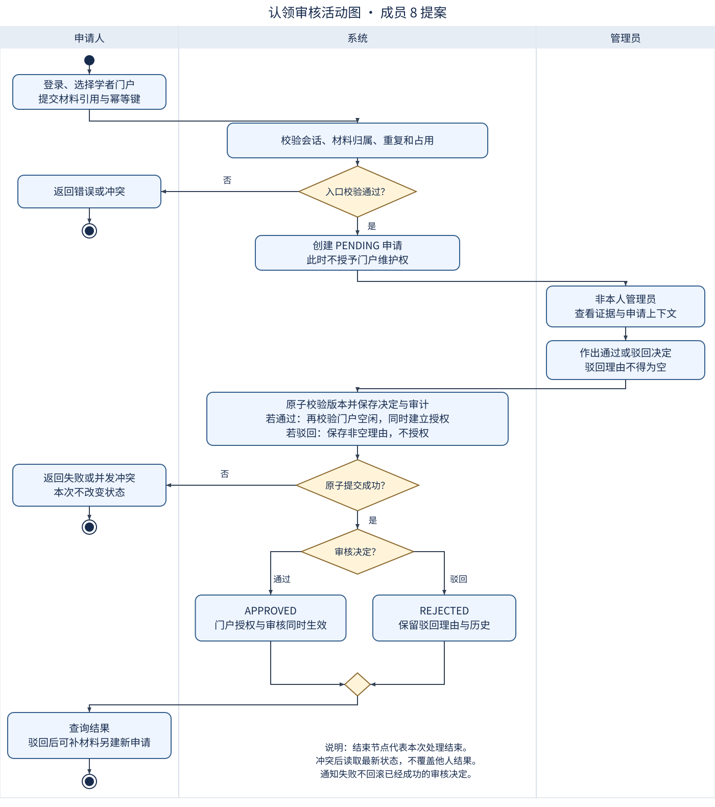
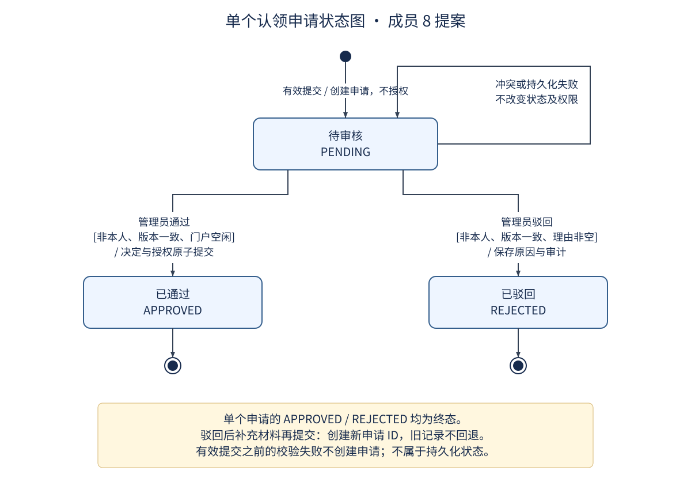

# 认领 UML 模型

模型对应 SPEC-M8-CLAIM、UC08-03/04 和 M8-CLAIM-01/02。当前均为待评审提案。

## 活动图

[可编辑 PlantUML 源文件](claim-activity.puml)。使用申请人、系统、管理员三条泳道；菱形表示判断，圆点为开始，靶心为活动结束。活动结束不一定意味着申请进入终态，例如尚未被其他请求处理的申请在保存失败后仍 PENDING；若另一审核已提交，则读取其最新终态。

## 状态图

[可编辑 PlantUML 源文件](claim-state.puml)。作用域是“单个已创建申请”，PENDING 之前的输入校验不属于持久化状态；APPROVED、REJECTED 各自完成生命周期。驳回后是新申请，不画旧记录回退。

SVG 是无需在线服务即可查看的同语义绘图；PlantUML 保留标准建模源码便于团队重排。两者均随文档维护，SVG 不是编译器自动导出的证明。本次检查 SVG XML 与模型语义，未运行 PlantUML 编译器。

详细转移表：

| 起点 | 事件与条件 | 终点 | 副作用 |
| --- | --- | --- | --- |
| 未创建 | 有效提交且入口校验通过 | PENDING | 创建申请，记录证据引用；不授权 |
| PENDING | 非本人管理员通过，版本正确、门户空闲、原子提交成功 | APPROVED | 同时建立门户授权、审计 |
| PENDING | 非本人管理员有理由驳回，版本正确、提交成功 | REJECTED | 记录理由和审计，不授权 |
| PENDING | 保存失败、并发占用或旧版本 | 本请求不改变状态，读取最新值 | 尚未处理则仍 PENDING；不得覆盖他人已提交终态 |
| APPROVED/REJECTED | 再次改变决定 | 不变 | 拒绝；原幂等请求可重放既有结果 |

第三行驳回后重新申请时创建新的状态机实例。撤回、撤销、转让和申诉尚未纳入最小方案。
