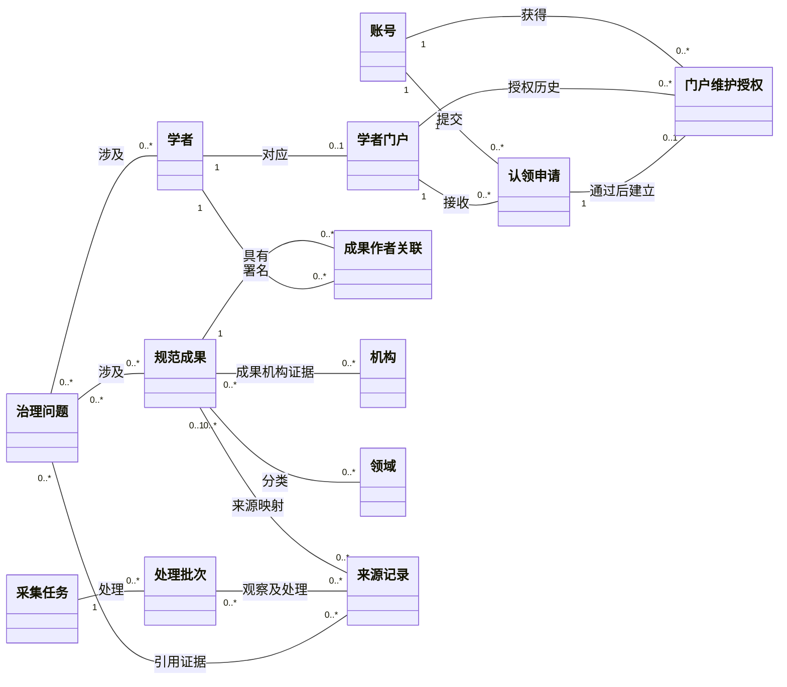

# 整体分析类模型与说明

状态：成员1整体结构提案。图号M1-AN-01，2026-10-19。这是概念关系图，供成员3/8细化业务类；不是E-R图或已批准的公共实体定义。

## 1. 整体图

同一图的[PlantUML源文件](diagrams/overall-domain-model.puml)用于文本审查及人工复建。两种图源均非CodeArts原生工程。图未包含全部属性与方法，避免提前把分析类变成实现类。

## 2. 关键多重性

| 关系 | 读取方式 | 规则与限制 |
| --- | --- | --- |
| Scholar—ScholarPortal | 一门户对应一个学者，一学者在一期至多一个门户 | 允许尚未生成门户的学者，不允许按同名复用门户；基数为待联合确认的整体提案 |
| Account—ClaimRequest—ScholarPortal | 每申请有一个申请人和一个目标门户，双方各可有多条历史申请 | 同用户同门户至多一个待审是条件约束，不能靠普通基数表达 |
| ScholarPortal—PortalGrant | 门户可保存多条历史授权关系 | 任一时刻至多一个有效维护授权，不能把历史0..*理解为允许并行冒领 |
| ClaimRequest—PortalGrant | 一申请最多建立一个授权，每个本流程授权来自一个通过申请 | 驳回或待审对应0，不能强制所有申请都有授权 |
| Work—Authorship—Scholar | 每署名关联指向一个成果和一个学者，二者各可参与多次关联 | 允许未知作者暂未关联规范学者，原始作者仍保留在来源证据中 |
| Work—SourceRecord | 一个来源记录在本次有效映射中最多指向一个规范成果，一成果可有多来源 | 未决映射为0；拆分与历史映射需成员2/7细化版本，不复制计数 |
| CollectionTask—ProcessingBatch | 一批次属于一任务，一任务可有多个批次 | 重试执行与原任务的关系由成员2/7细化，不把任务状态当成果状态 |
| ProcessingBatch—SourceRecord | 来源记录可被多个批次重复观察，批次可处理多条记录 | 每次观察的证据独立可追溯，重复观察不等于新增成果 |
| Work—Organization / Field | 成果可有多个机构或领域，也可暂缺 | 机构关系按来源成果证据，不用当前学者任职替代历史事实 |

SourceRecord允许保留被治理、隔离或尚未规范化的记录；合法人工补录同样应有可追溯的来源证据。图上Work端0..*来源用于表达处理中的概念状态，**公开Work必须至少有一个有效来源依据**，由公开准入规则约束。

## 3. 必须随图保留的约束

- C01：Account、Scholar、ScholarPortal分离，账号登录不代表门户维护权。
- C02：每个门户同时最多一个有效维护授权；申请通过、授权与审计原子一致。
- C03：审核者必须具备操作资格且不是申请人；审核者关联、材料对象和审计类留给详细模型补充。
- C04：姓名相同不构成学者同一性证据，来源数不构成果数。
- C05：公开成果有有效来源依据；受限证明材料与公开元数据隔离。
- C06：重复批次不重复计数，人工修改冲突进入治理。
- C07：百万级计数与索引对账使用同一冻结版本和公开成果标识集合。
- C08：图上的普通关联不表示级联删除，门户解除展示不得删除共享成果。

## 4. 人工绘图参照

建议把图分为“账号与门户权限”“科研实体”“数据处理与治理”三个区域，以Scholar和Work连接。先画13个概念类，再按源文件加关联与基数，最后在图旁放C01～C08中与展示有关的约束。

不必为类强填get/set方法。署名顺序放在Authorship上；不要用Account继承Scholar，不要用门户组合Work，不要画成“申请提交即授权”。图较宽时拆成总览和认领权限局部放大，保持同名对象与相同基数。

最终平台图由实际操作人保存工程并导出，来源文件名和版本登记在05。本包没有声称已经在平台绘制。
