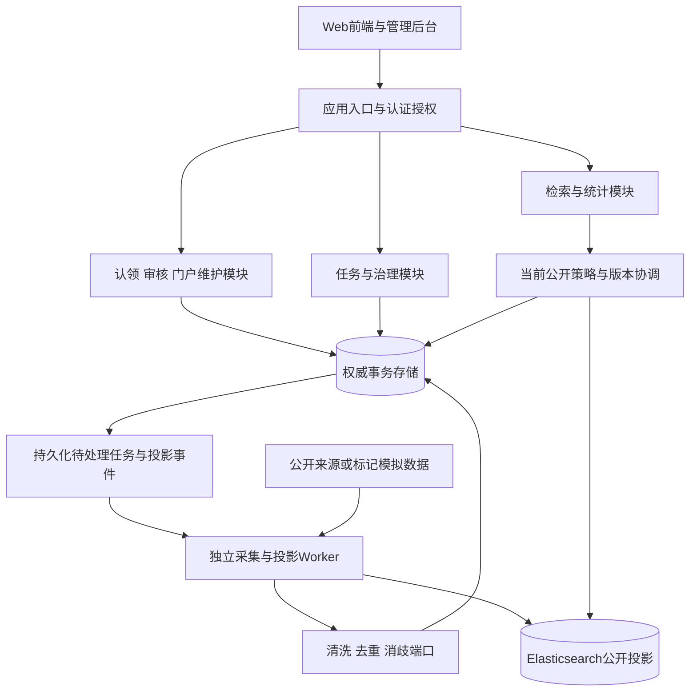

# 方案A与服务划分

## 总体结构

服务在此表示职责边界；部署起点为Web、模块化API与独立Worker。下图是Mermaid参考源，可用于正式架构图汇编。

## 模块所有权与依赖

| 边界 | 主要职责与拥有的数据 | 调用关系 | 共同设计岗位 |
| --- | --- | --- | --- |
| 认证授权 | 账号 会话 角色检查 | 应用用例获得身份，最终写入仍校验授权 | 3/8 |
| 认领门户 | 申请 决定 维护授权 展示选择 | 同步事务提交核心结果，通知异步 | 3/8 |
| 任务治理 | 任务 尝试 批次 冲突处置 | 创建持久化工作，后台执行 | 2/7与3/8 |
| 规范数据 | 学者 成果 机构 领域 来源映射 | 治理后写入，通过端口提供规范身份 | 2/7与3/8 |
| 检索统计 | 公共查询协调与版本信息 | 读取公开投影并落实当前策略 | 3/8 |
| 展现 | 查询上下文 页面状态 非敏感草稿 | 仅经应用端口访问服务 | 4/9 |
| 运行保障 | 配置 健康检查 指标 备份恢复 | 观测各边界，业务日志过滤证明 | 5/10 |

数据库是物理存储候选；共享实例时按模块约束写入所有权，禁止跨模块直接修改内部表。对外端口只定义所需能力，如提交申请、审核、查询、发布候选版本；路径、字段、状态枚举待公共契约评审，不在本供稿中冻结。

## 三条关键运行链路

采集链路：配置和来源许可检查 → 持久化任务 → Worker读取有界批次 → 清洗去重消歧 → 保存规范候选、来源及处置事实 → 投影构建 → 同版本公开ID集合核对 → 确认发布。处理中断恢复使用检查点，成功发布后才推进发布水位。

认领审核：应用入口识别账号 → 审核模块检查职责及回避 → 在提交边界复查申请版本与门户占用 → 原子保存决定、终态、授权和审计。通知工作随事务可靠留存，事务后处理。重复通知不改变审核结果。

检索统计：校验查询和请求版本 → 确定当前允许公开的完整集合 → 在同一集合上过滤、排序、分页、计算total及统计 → 返回来源与版本。ES落后时可对受影响范围阻断查询，或按已核验的全量排除条件重算查询；禁止只过滤当前页。完整策略由3/8设计，性能与故障关闭行为进入联合试验。

## 模块替换方式

外部公共端口稳定，来源适配、清洗策略、检索实现和展现可分别替换。迁移先用同一夹具做只读影子比较，再切换单一写入方；每次只迁移一个边界，保留可回切版本及审计。A/B停止与重试差异先建立显式状态映射，禁止按状态名直接互换。

## 部署交接

前端/API与Worker分别配置资源、健康探针和日志。业务存储、索引及私有材料分别控制网络和访问身份。云网络、具体服务SKU、CodeArts流水线、备份保留与恢复目标由5/10提供拓扑和演练材料，成员1核对业务约束覆盖。
