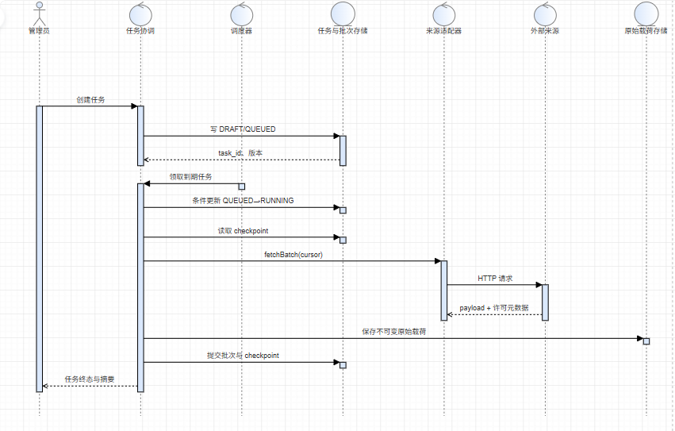
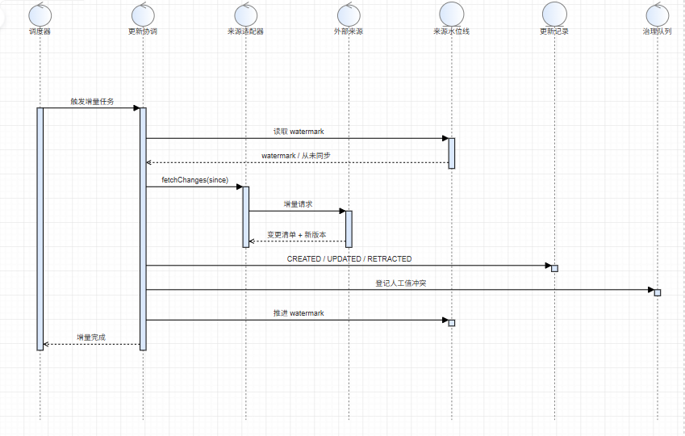
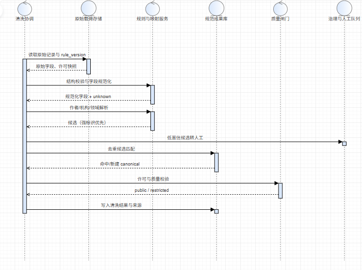
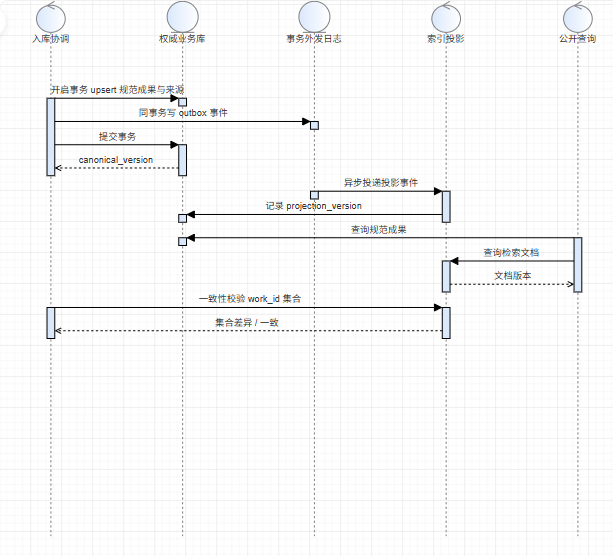

# 数据接入交互模型

版本 0.2。四张时序图覆盖成员二负责的采集任务、更新记录、数据清洗与数据入库。图中的「权威业务库」「索引投影」「原始载荷存储」是职责参与者，不表示已选定数据库、检索或部署方案。

## 1 采集任务执行与停止边界（M2-AN-01）

覆盖 M1-UC-09，DR-TASK-001..010、DR-COL-005/007/008/013。

**前置条件**：来源已登记并通过许可与合规审核；调用方有创建/启动权限；同 `source_id + scope` 无其他活动任务。

**输入/输出**：输入 source_id、scope、retry_policy、幂等键；输出 task_id、批次进度、分阶段计数、终态与质量摘要。

**正常路径**：调度器以条件更新把 QUEUED 改为 RUNNING 并取得租约 → 读取 checkpoint → 逐批抓取 → 保存不可变原始载荷 → 解析计数 → **批次状态与检查点同一事务提交** → 全部批次完成汇总。

**异常与补偿**：

- 401/403、验证码、结构契约不符：判为永久错误，任务 FAILED，保留脱敏错误上下文，**不自动重试、不绕过**。
- 429/5xx/超时：可重试错误，保存 attempt 与 `next_attempt_at`，进入 RETRY_WAIT；重试由调度器重新领取，不并发执行。
- 原始载荷已保存但检查点提交失败：重放同一 `batch_no`，按内容哈希与批次幂等键去重，不重复计数。
- 停止请求：只在**阶段边界**处理——完成或回滚当前批次后再 STOPPED；不得在半写入批次中退出。
- 进程中断：从最后已提交检查点恢复；未提交批次视为未发生。

**说明**：本图是消息顺序与事务边界，不是状态图；状态与迁移沿用[需求阶段的采集任务状态图](../requirements/03-collection-task-state-machine.md)。

## 2 增量更新与更新记录（M2-AN-02）

覆盖 M1-UC-09/11，DR-INC 系列、DR-COL-012、DR-DED-006/007、DR-GOV。

**前置条件**：来源已登记版本/水位线；适配器声明是否支持增量。

**输入/输出**：输入 source_id、范围、watermark（source_version/etag）；输出变更计数、更新记录、新水位线。

**正常路径**：读 watermark → 拉取增量变更 → 逐条计算内容哈希 → 新增/变更/撤回分别登记 UpdateRecord → 批量写记录并推进 watermark（同一提交边界）。

**异常与补偿**：

- 内容未变化：登记 NO_CHANGE（可采样），不逐条膨胀更新记录。
- 与人工维护字段冲突：登记 GovernanceIssue，**不覆盖人工值**，也不改变来源记录内容。
- 来源撤回/删除：只标记来源记录失效并登记 RETRACTED，不物理删除规范成果；公开可见性由策略决定。
- 来源版本回退或出现缺口：拒绝推进 watermark，登记来源契约异常，要求全量重同步。
- 重复投递同一 source_version：幂等跳过，不新增更新记录。

**说明**：UpdateRecord 是「来源变化日志」，不是规范成果的版本号；规范成果的版本由入库事务维护（见 M2-AN-04）。

## 3 数据清洗与去重消歧（M2-AN-03）

覆盖 M1-UC-10，DR-CLN-001..010、DR-DED-001..008、DR-DIS-001..008、DR-INS-001..002。

**前置条件**：原始载荷可读且校验通过；清洗规则与映射表有版本号。

**输入/输出**：输入原始记录与 rule_version；输出规范化字段、质量标记、候选匹配结果、规范成果或隔离记录。

**正常路径**：结构校验 → 字段规范化（标题/DOI/日期/语言/venue）→ 作者与机构解析（强标识优先）→ 许可与可见性判定 → 去重候选匹配 → 质量规则 → 写入规范成果与字段级来源。

**异常与补偿**：

- 仅有姓名/名称相似：只产生低置信候选，进入人工确认队列，**不自动合并**（DR-DIS-002）。
- 强标识冲突：登记治理，保留两条来源记录，不覆盖任一来源（DR-DED-003）。
- 许可未知或受限：标记 restricted，不进入公开投影，也不计入公开成果数（I-D05）。
- 质量不通过：隔离并登记 QualityIssue，不进入公开计数。
- 未知值：保留为 `null` 并带 unknown/missing 标记，不写成 0 或空字符串（DR-CLN-005/007）。

## 4 入库与公开投影一致性（M2-AN-04）

覆盖 M1-UC-09/10，R05（不少于 10,000 条规范可公开成果）、R11（完整链路）。

**前置条件**：清洗与质量闸门通过；可见性已判定。

**输入/输出**：输入规范成果与来源关联、版本；输出已提交的 canonical_version、投影状态与可检索结果。

**正常路径**：事务内 upsert 规范成果、来源关联与字段级来源 → **同事务写 outbox 事件** → 提交 → 异步投影按 `work_id + version` 幂等写入 → 记录 projection_version → 查询按版本与可见性策略返回。

**异常与补偿**：

- 事务任一步失败：全部回滚，不产生部分提交。
- 索引写入失败：保留「已保存、待索引」状态并退避重试，**不回滚**已提交业务数据。
- `projection_version < canonical_version`：查询返回「待同步/稍后重试」，不用旧值冒充新值，也不返回伪造的空结果。
- 发布一致性校验：比较同一版本的**公开 work_id 集合**，不能只比较数据库与索引条数。
- 可见性收紧：先撤下公开投影再确认策略生效，保留数据与审计。

## 5 分析走查表（系统测试待实现）

| 场景 | 应保持的结果 | 图/规则 |
| --- | --- | --- |
| 同一批次重复投递 | 不新增规范成果、不重复计数 | AN-01，I-D03 |
| 抓取成功但检查点未提交 | 重放后只计一次 | AN-01，I-D02 |
| 停止请求发生在批次中 | 完成/回滚当前批次后 STOPPED，不丢检查点 | AN-01，DR-TASK-005 |
| 来源版本回退 | 拒绝推进 watermark，要求全量重同步 | AN-02 |
| 来源更新与人工值冲突 | 人工值保留，登记治理 | AN-02，I-D08 |
| 只有姓名相同 | 不自动合并，进人工队列 | AN-03，I-D06 |
| 许可未知 | 不进入公开投影与公开计数 | AN-03，I-D05 |
| 数据库成功、索引失败 | 已保存待索引，不回滚、不返回伪造空集 | AN-04 |
| 旧索引版本 | 返回待同步，不用旧值冒充分数 | AN-04，I-D07 |
| 可见性收紧 | 先撤下公开投影，再确认策略 | AN-04 |
