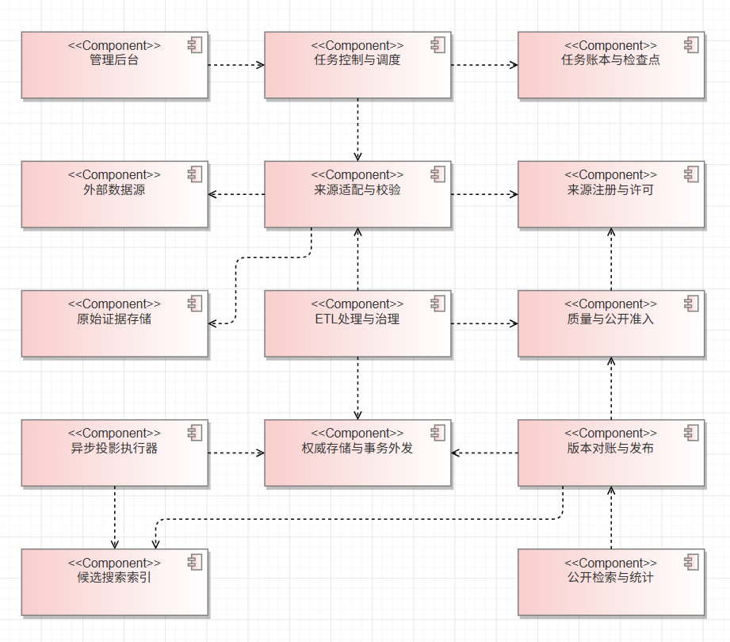

# 数据采集与 ETL 架构设计 · 方案 A

成员 2 · 第 9～11 周 · 2026-11-05

本章覆盖采集层、处理层、异步任务、增量更新，以及与成员 3/8 负责的存储、检索和统计层的交接。对应统一 SRS 的 M1-FR-02～05、M1-FR-14，并承接[数据处理需求](../requirements/01-data-pipeline-requirements.md)、[采集任务状态图](../requirements/03-collection-task-state-machine.md)和[四张数据接入顺序图](../analysis/02-data-pipeline-interactions.md)。

采用**分层模块与独立后台执行进程**。控制端受理命令和查询进度，后台执行器处理外部 I/O、规范化与入库，投影执行器独立处理检索同步。A 组选择持久任务队列和事务外发日志（outbox）作为初始方案，可与业务 API 同仓实现、独立运行与扩缩容。数据库产品、表结构、公共 API 和部署规格沿用团队统一设计。

## 1. 架构视图

图 M2-ARCH-01 为 UML 组件图。虚线由依赖方指向其使用的构件。

[下载 UML 组件模型（XML）](diagrams/M2-ARCH-01-codearts.xml)

「任务账本与检查点」和「权威存储与事务外发」按职责分列，规范数据、批次计数、检查点和 outbox 在同一权威存储事务内写入。原始证据存储及 Elasticsearch 位于该事务之外。「公开检索与统计」也为公开门户提供版本一致的读数据。

| 模块 | 职责与输出 | 约束来源 |
| --- | --- | --- |
| 来源注册与适配 | 以 `source_id` 管理访问方式、授权引用、范围、分页、限流、字段映射和许可快照。输出带来源 ID、时间、版本、内容哈希与策略引用的 `SourceRecord` | [SPEC-DATA-001](../requirements/specs/SPEC-DATA-001-source-adapter.md) |
| 任务控制与执行 | 鉴权后创建、启动、停止、重试和查询。调度器发放执行租约，执行器按批更新阶段、计数和审计 | [SPEC-DATA-002](../requirements/specs/SPEC-DATA-002-collection-task.md) |
| 清洗、匹配与治理 | 保留原值证据，输出规范化字段、规则版本、强键和匹配依据。字段冲突、低置信度和违规记录分别进入治理或隔离 | [SPEC-DATA-003](../requirements/specs/SPEC-DATA-003-cleaning-normalization.md)、[SPEC-DATA-004](../requirements/specs/SPEC-DATA-004-dedup-disambiguation.md) |
| 增量处理 | 规划固定输入窗口，比较来源键与内容哈希，登记变化、人工冲突与撤回，维护恢复和发布进度 | [SPEC-DATA-005](../requirements/specs/SPEC-DATA-005-incremental-update.md) |
| 质量、投影与发布 | 校验必填项、字段许可、审批和模拟标记。输出可公开字段、版本、统计分母和对账报告 | [SPEC-DATA-006](../requirements/specs/SPEC-DATA-006-quality-gate.md) |

## 2. 采集层与处理层

**来源接入。** 论文以已获准的 OpenAlex 元数据接口及 DBLP 冻结文件为候选，科研项目以 NSF 官方接口或 CORDIS 获准导出为候选，专利通过已获授权的官方接口或批量数据，获奖通过官方公告的核准事实字段与人工 CSV。实时接入以来源注册表中的有效许可、访问和配额配置为准。历史样本与访问结论见[来源可访问性验证](../requirements/evidence/2026-10-12-source-accessibility-validation.md)。

**接入闸门。** 调度前检查来源启用状态、批准范围与采集权限。抓取结果同时检查状态码、内容类型、编码、结构和数量上限，HTTP 200 的挑战页按契约异常处理。允许留存的载荷写入受控存储后再引用，审计留存请求摘要、哈希、许可与规则版本。缺少原文存储权限时只保存允许留存的字段或证据摘要。公开与导出各自按字段授权检查。配置存认证引用，日志和任务消息不携带凭证或原始敏感内容。

**记录处理。** 一条来源观测对应一个成果，复合输入先拆分再处理。保留原值与字段级来源，按固定规则和映射版本执行 NFKC 比较键、标识符规范化、日期精度及未知值分类。按成果类型与强标识匹配，强键冲突进入治理，弱匹配按证据和阈值分类，阈值由共享样本校准。仅姓名相同的作者保持独立，机构优先使用 ROR 或获准别名，父子机构保留关系。合并记录来源、依据及规则版本，回滚通过重新生成受影响投影传播。

**公开闸门。** 以有效来源证据、必要字段、批准状态和字段许可构造公开候选。`ERROR` 阻断公开，`WARNING` 进入报告，`INFO` 供统计。高严重度冲突未处理时阻断受影响内容。模拟数据带明确标记并使用隔离范围。原始证据、候选、隔离记录和公开字段分别授权。

## 3. 异步任务、批次和失败恢复

1. **受理。** 控制端从服务端会话取得操作者，检查来源与操作权限。创建请求按既有幂等键去重。调度器从持久任务账本领取 `QUEUED` 或已到期的可重试工作，使用条件更新、租约和执行代次。写批次、完成任务和发布前都比较当前执行代次，失去租约的旧执行器无法继续提交。A 组按 `source_id + scope_hash` 对写任务实行互斥，来源级限流另行生效。对存在数据覆盖交集的在线范围，按来源串行执行，直到有可证明独立的分片；`sample` 使用独立范围且不推进线上水位。该约束覆盖状态图的同范围互斥，也覆盖 SPEC-DATA-002 含 `mode` 的任务维度。
2. **分批。** 执行器按 `DISCOVER → FETCH → PARSE → CLEAN → DEDUP → PERSIST → INDEX_SYNC → FINALIZE` 记录阶段。请求与规则计算在短事务外完成。入库事务复核执行权、检查点前值、批次幂等键和数据版本，原子提交来源观测、规范结果或明确处置、批次计数、处理检查点及所需 outbox 事件。规范成果的并发写入由权威存储中的稳定标识约束和条件版本写保护。处理检查点只能跨过已持久化处置的连续批次，遇到未解决的失败批次时保留此前位置。
3. **重放。** 任务内批次键沿用 `task_id + batch_index + source_version`，跨任务增量重放按 `source_id + source_version + batch_hash` 判重，记录级按稳定来源键及来源版本维护幂等。重复执行可增加 attempt 审计，阶段业务计数按已提交批次复算。外部原始证据先写成功但事务回滚时，用已授权的内容哈希引用复用，无引用载荷按保留策略清理。规则升级在新的处理版本中复用原来源观测并重新计算派生结果，采集判重只跳过重复写原始观测。受影响记录生成影响报告和新投影。
4. **退避和停止。** 429 遵守 `Retry-After`，超时或暂不可用按预算退避。401/403、许可拒绝、挑战页和结构错误记录原因并交人工处置。接受停止请求后禁止领取新批次，当前事务按安全边界提交或回滚，再转 `STOPPED`。管理端显式恢复时沿用最后已提交进度，`FAILED` 按 A 组状态模型人工修复后新建任务。发布事务与停止请求竞争时，以权威存储中先成立的条件写决定结果，迟到的完成回报不会覆盖有效停止。
5. **投影补偿。** outbox 与业务写入同事务提交，投影执行器在事务外轮询并至少一次投递。以目标投影版本、成果 ID、规范版本判重和防止旧事件覆盖新状态，写入后回填投影回执。进程在索引写成功后、回执前崩溃时，重复处理得到同一投影结果。索引同步耗尽预算后，已保存批次按状态图记录 `PARTIAL_SUCCESS`，补偿从 outbox 或指定数据版本启动。只有目标批次全部处理完并通过发布核验时才记录 `SUCCEEDED`。

## 4. 增量窗口、双水位与公开切换

| 进度 | 所属范围 | 推进条件 | 用途 |
| --- | --- | --- | --- |
| 批次处理检查点 | 来源及固定范围，本次窗口内 | 批次事务成功且此前批次均有持久化处置 | 重启、恢复与重放 |
| 公开发布水位 | 来源及范围，绑定已发布数据版本 | 候选版本通过索引与账目核验，发布事务提交 | 下次增量窗口的成功基线 |

**选择输入。** 从公开发布水位 `W` 起步，固定本轮上界 `U` 或来源版本，保存请求计划、游标和 manifest。时间源采用 `(更新时间, 稳定来源 ID)` 排序与续读，有迟到记录时使用按来源配置的重叠窗口并按稳定键、版本和哈希去重。只支持游标的来源以其有效快照或有界枚举完成条件为准。无可靠增量能力时，用获准的完整文件版本做受控快照差分。游标失效、版本回退或缺页时，从最后可验证的 manifest 恢复，必要时走受控全量重同步。多来源版本由候选 manifest 记录每个来源的旧水位和本轮拟推进水位，未纳入本次变更的来源保留已发布位置。

**处理变化。** 新增和修改重新经过清洗、匹配、准入。相同内容哈希计入未变化。人工维护字段与来源更新冲突时保留两份依据和原批准值，记治理事项。仅在来源明确撤回或可证明同范围完整快照差分时记录 tombstone，重新判定规范成果及字段是否还有其他有效授权依据。单页缺失、网络失败和导出不完整均保留旧观察。更新报告关联任务、来源版本、处理检查点和发布水位，并分别列出新增、修改、撤回、未变化、冲突和失败。

**准备发布。** 每个候选 `dataset_version` 固定纳入批次、版本清单、源水位和公开策略版本。权威快照从上一个已发布版本继承未变化成果，叠加本轮保存的规范版本与撤回处置，使同一候选可重复读取。投影侧先准备隔离的目标版本，基于同一基线和变更事件补齐投影，基线不可复用时按权威快照重建。对账比较同版本、同许可范围的公开成果 ID 集合，并核对投影版本、字段白名单、真实和模拟分列计数与统计分母。百万规模下按稳定 ID 分区归并比较有序 ID 流，发现差异后定位到 ID 补偿。统计结果与检索绑定同一发布版本和合法范围。

**确认发布。** 候选通过校验后，由权威存储的一次条件事务比较当前发布指针、任务代次、停止状态和许可策略版本，共同更新发布指针及该版本对应的公开水位，记录任务发布结果。读服务按权威指针选择已就绪的 Elasticsearch 投影和统计数据。确认失败时保持原发布指针与水位，保留候选供恢复。任务候选基于旧发布版本时，以新基线重新生成并对账，避免后完成的旧候选覆盖先发布的更新。回退必须核验目标版本仍可按当前公开策略读取，指针与其水位共同回退并保持后续重放可幂等。

**撤回与权限收紧。** 先更新权威公开策略，使已撤回的作品或字段在公开读取路径失效，再排队更新索引、缓存和统计。公开读取按当前策略生成合法候选集合，在排序分页、`total`、统计分母和字段投影之前应用限制。搜索过滤使用有版本的公开策略过滤条件或受控可见集合；若旧索引的排序、匹配或聚合字段已失去授权且无法在分页前排除影响，受影响查询返回同步或依赖异常。校验策略版本失败同样关闭受影响公开读取。旧版本快照和缓存也受当前策略约束。

## 5. 存储、检索与后台交接

| 对接方 | 交付语义 | 对接方反馈 |
| --- | --- | --- |
| 存储层（成员 3/8） | 成果及学者、机构、领域稳定标识，来源和字段证据引用，批次与规则版本，审批、模拟标记和候选范围。批次写入与 outbox 同事务 | 已提交规范版本、条件写冲突、可复算的版本快照与账目 |
| 检索与统计（成员 3/8） | 版本化公开字段与撤回操作、当前策略版本、已发布数据集版本及其覆盖范围 | 可查询投影版本、差异 ID、索引与统计就绪状态。按同一合法范围计算 `total` 和统计分母 |
| 管理后台（成员 4/9） | 任务状态与阶段、已保存和待索引进度、分阶段计数、脱敏错误摘要及任务追踪号 | 操作者权限由服务端确认。管理操作沿用任务状态与幂等语义 |
| 部署与测试（成员 5/10） | API、采集处理进程与投影进程的运行边界，固定 manifest、可重放批次及故障注入场景 | 同一夹具和环境下的对账、吞吐、发布延迟、恢复结果及质量记录 |

接口仅描述交互语义，字段定稿参照统一契约与[成员 3 接口约束](../../member-03/requirements/03-interface-constraints.md)。部署时，采集进程只访问已批准来源及必需的内部资源。投影进程消费已提交事件，使用独立权限写候选索引。后台 API 与公开读服务按职责隔离权限。

## 6. 容量、监控与架构验收

容量目标按统一需求分析材料的**百万条合格公开规范成果**设计，早期 SRS 和 SPEC-DATA-006 的一万条保留为历史基线。真实公开计数以已发布版本内、通过审批和质量与许可检查、仍有效的 `canonical_id` 去重计数。模拟、受限、隔离、撤回与来源记录分别报告。两组用同一输入 manifest、过滤范围、硬件环境和测量方式比较。实际规模、吞吐、重试预算和延迟由实现阶段测量。

- **扩容。** 来源请求按配额限流，处理按有界批次流式执行，强键索引和有界分桶减少候选搜索范围。采集/处理及投影进程分别按队列积压、索引滞后扩容，积压越过运行阈值时暂停领取低优先级采集批次。发布对账以分区和批量读取限制内存峰值。
- **可观测性。** 用 `task_id → batch_id → 来源记录 → canonical_id → dataset_version` 串联审计。记录各阶段输入、输出、处置数、最老待处理任务/事件年龄、租约冲突、退避、对账差异、规则版本和策略版本。运维发现积压先区分来源限流、处理瓶颈和索引故障，再决定限流或补偿。

| 场景 | 可核验的架构结果 |
| --- | --- |
| 同范围并发启动，旧执行器租约到期后回写 | 只有一个有效执行者能提交，已提交的批次与计数只入账一次 |
| 批次事务回滚，进程重启，或人工中途停止 | 处理检查点停在已提交位置。公开水位保持在已发布版本。恢复后无跳页和重复计数 |
| 429、HTTP 200 挑战页、游标过期 | 限流按指示退避，挑战页阻断，失效游标触发可验证恢复。三者有独立审计 |
| 增量窗口有迟到、重复、人工冲突或来源撤回 | 重叠输入不重复计数，人工值保留，撤回条件有证据并立即作用于公开策略 |
| 索引回执丢失、失败或事件乱序 | 投影可单独补偿，旧事件不覆盖新状态，未经核验的候选不会切换指针或推进公开水位 |
| 两个候选竞争发布，或发布时策略变更 | 条件事务只接受基线、任务和策略仍匹配的候选。检索、总数及统计使用同一合法范围 |
| 固定 manifest 完整链路 | 从任务和批次追踪到规范成果、检索和统计。按 ID 集合对账，真实公开数量可独立复算 |

汇编时本章作为统一架构说明书的「方案 A · 数据采集与处理」章节，决策依据与 A/B 对照见[架构决策材料](02-architecture-decision-inputs.md)。
