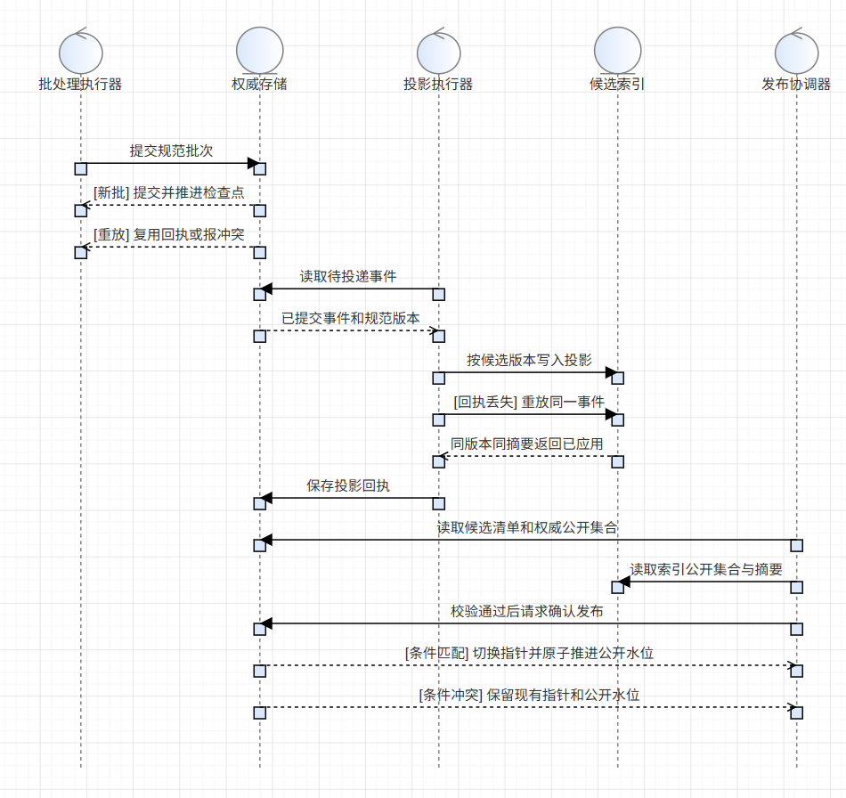

# 数据采集与 ETL 构件设计 · 方案 A

成员 2 · 第 10～12 周 · 2026-11-16

对应[双组并行开发与合并方案 §5.5](../../../../双组并行开发与合并方案.md#55-构件设计阶段第-1012-周)和[统一构件设计目录](../../member-01/component-design/02-design-catalog-and-traceability.md)的「数据管道设计」。设计承接[方案 A 的 ETL 架构](../architecture/01-data-pipeline-architecture.md)，供成员 8 汇入统一构件设计说明。

| 供稿 | 设计内容 | 对应 SPEC |
| --- | --- | --- |
| [数据源适配与采集调度](01-source-and-scheduling.md) | 四类输入、按字段许可、请求计划、并发领取、退避、停止和批次回执 | DATA-001、002 |
| [清洗消歧、增量更新与数据质量](02-processing-and-publication.md) | 规范化、身份匹配、版本差分、双水位、发布闸门和计数 | DATA-003～006 |
| [验收场景与汇编交接](03-validation-and-handoff.md) | SPEC 到验收场景的追踪、离线样例、故障注入、规模试验与实施依赖 | DATA-001～006 |

## 构件边界

| 构件 | 持有的状态 | 向下游交付 |
| --- | --- | --- |
| 来源适配器 | 来源配置版本、访问边界、分页或快照契约 | 带许可、哈希和追踪信息的来源记录，或可分类的批次失败 |
| 采集调度器 | 任务、执行代次、租约、退避和停止请求 | 可恢复的批次计划、处理进度和已提交回执 |
| 清洗与匹配 | 映射版本、规范化规则、匹配证据和人工决定 | 规范候选、来源关联、质量问题与治理处置 |
| 增量与公开准入 | 输入窗口、候选清单和拟推进的来源水位 | 可重放的批次、候选版本、对账和发布证据 |
| 权威存储与投影 | 批次提交、规范成果版本、事件、发布指针和公开投影 | 原子批次回执、投影回执及已发布的数据版本 |

内部交接沿用成员 3 的 [AppendNormalizedBatch、ProjectRevision、PreparePublication 和 ConfirmPublication](../../member-03/component-design/03-api-and-async.md#3-内部异步协议)。下文的键、回执和算法参数用于方案 A 的内部设计，公共字段、状态及持久化结构按统一契约落实。

## 构件设计顺序图

[下载 CodeArts UML 模型（XML）](diagrams/M2-COMP-01-codearts.xml)

新批在权威存储提交时推进处理检查点。同批重放按摘要复用回执或报冲突，索引回执丢失时重放已提交事件。候选完成对账并满足发布条件后，权威存储在同一事务内切换发布指针和推进公开水位。图中方括号标记分支条件，详细守卫见[增量与发布设计](02-processing-and-publication.md#4-公开准入与版本切换)。

## 相关 CodeArts 图

| 图 | 图片 | 导出模型 |
| --- | --- | --- |
| M2-ARCH-01 数据采集与 ETL 架构 | [组件图](../architecture/diagrams/M2-ARCH-01-codearts.png) | [XML](../architecture/diagrams/M2-ARCH-01-codearts.xml) |
| 采集任务状态机 | [状态图](../requirements/diagrams/collection-task-state-codearts.png) | [XML](../requirements/diagrams/collection-task-state-codearts.xml) |
| M2-AN-01 采集任务执行与停止边界 | [顺序图](../analysis/diagrams/collection-task-sequence.png) | [XML](../analysis/diagrams/collection-task-sequence-codearts.xml) |
| M2-AN-02 增量更新与更新记录 | [顺序图](../analysis/diagrams/incremental-update-sequence.png) | [XML](../analysis/diagrams/incremental-update-sequence-codearts.xml) |
| M2-AN-03 数据清洗与去重消歧 | [顺序图](../analysis/diagrams/cleaning-sequence.png) | [XML](../analysis/diagrams/cleaning-sequence-codearts.xml) |
| M2-AN-04 入库与公开投影一致性 | [顺序图](../analysis/diagrams/persistence-sequence.png) | [XML](../analysis/diagrams/persistence-sequence-codearts.xml) |
