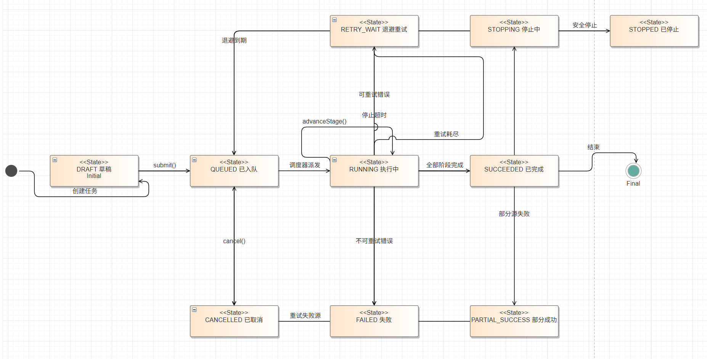

# 采集任务状态图

> 追踪：R04、R11
> 责任：成员 2、7 共同负责

## 1. 状态集合

| 状态 | 含义 |
| --- | --- |
| DRAFT | 任务已保存但未激活 |
| QUEUED | 已进入队列，等待执行 |
| RUNNING | 正在执行某个处理阶段 |
| STOPPING | 已收到停止请求，等待当前安全边界 |
| RETRY_WAIT | 等待退避或人工确认后重试 |
| STOPPED | 已在安全边界停止，可保留 checkpoint |
| PARTIAL_SUCCESS | 部分批次成功、部分失败 |
| SUCCEEDED | 所有目标批次成功并完成索引同步 |
| FAILED | 达到失败终态，需要人工处理 |
| CANCELLED | 人工取消且不再恢复 |

## 2. 阶段

```text
DISCOVER -> FETCH -> PARSE -> CLEAN -> DEDUP -> PERSIST -> INDEX_SYNC -> FINALIZE
```

阶段不改变顶层状态；顶层状态统一为 RUNNING，阶段作为子状态记录。

## 3. 转换表

| 当前状态 | 事件 | 守卫 | 动作 | 下一状态 |
| --- | --- | --- | --- | --- |
| Initial | 创建任务 | 调用方对目标范围有创建权限 | 生成 task_id 与初始配置快照 | DRAFT |
| DRAFT | submit() | `source_config_valid`：范围、许可和来源配置有效 | 入队，写入 idempotency_key | QUEUED |
| DRAFT | cancel() | 无运行中事务 | 记录取消原因 | CANCELLED |
| QUEUED | 调度器派发 | `no_active_task_same_scope`：同 scope 无其他活动任务 | 获取执行锁 | RUNNING |
| QUEUED | cancel() | 无运行中事务 | 记录取消原因 | CANCELLED |
| RUNNING | advanceStage() | 还有后续阶段 | 保存阶段计数和 checkpoint | RUNNING |
| RUNNING | 全部阶段完成 | 所有阶段成功 | 生成摘要并写审计 | SUCCEEDED |
| RUNNING | 可重试错误 | `retry_attempts_remaining` 且 `policy_allows_retry` | 保存失败批次，计算退避 | RETRY_WAIT |
| RUNNING | 部分源失败 | 已提交批次保留，部分来源永久失败 | 记录失败来源清单 | PARTIAL_SUCCESS |
| RUNNING | 不可重试错误 | 永久错误或重试次数达上限 | 记录错误，保留已提交批次 | FAILED |
| RUNNING | stop() | `safe_boundary`：到达阶段边界 | 提交或回滚当前批次 | STOPPING |
| RETRY_WAIT | 退避到期 | `checkpoint_readable`：来源允许且未取消 | 重新入队，从 checkpoint 继续 | QUEUED |
| RETRY_WAIT | 重试耗尽 | 重试次数用尽 | 记录理由与错误码 | FAILED |
| STOPPING | 安全停止 | `safe_boundary`：无未提交事务 | 保存 checkpoint | STOPPED |
| STOPPING | 停止超时 | 超时后仍有未提交事务 | 强制失败并记录 | FAILED |
| STOPPED | resume() | 管理员显式恢复 | 重新入队，从 checkpoint 继续 | QUEUED |
| PARTIAL_SUCCESS | 重试失败源 | 失败来源允许重试 | 以失败来源为范围重新入队 | QUEUED |
| SUCCEEDED | 结束 | 全部阶段完成且索引同步成功 | 归档任务与审计记录 | Final |

说明：`FAILED`、`CANCELLED`、`STOPPED`、`PARTIAL_SUCCESS` 为终止状态，图中不再引向统一的终止伪状态；其中 `FAILED` 需人工修复后以新任务重新发起（不复活原任务），`STOPPED` 与 `PARTIAL_SUCCESS` 仅在显式恢复或重试失败源时离开终止状态。

## 4. 关键守卫

1. `source_config_valid`：来源、范围和许可快照有效。
2.`no_active_task_same_scope`：同 source_id + scope_hash 无其他活动任务。
3. `checkpoint_readable`：checkpoint 和 manifest 可读。
4. `retry_attempts_remaining`：未超过最大重试次数。
5. `policy_allows_retry`：授权、许可和内容契约问题不自动重试。
6. `safe_boundary`：当前批次已提交或已回滚。
7. `idempotency_key_valid`：创建和重试请求幂等。

## 5. 状态持久化字段

```text
task_id
source_id
scope_hash
status
stage
attempt
max_attempts
stop_requested_at
checkpoint_before
checkpoint_after
error_code
error_summary
counts_json
created_at
updated_at
finished_at
```

## 6. 异常恢复

| 异常 | 恢复策略 |
| --- | --- |
| 进程中断 | 从最后已提交 checkpoint 恢复 |
| 429/限流 | RETRY_WAIT，遵守 Retry-After |
| 401/403 | FAILED，等待授权或权限处理 |
| HTML 挑战页 | FAILED，记录来源契约异常，禁止绕过 |
| 部分写库失败 | 事务回滚该批，已提交批保留 |
| 写库成功但索引失败 | PARTIAL_SUCCESS，只重放 INDEX_SYNC |
| 重复触发 start | 返回当前状态，不创建第二执行实例 |

## 7. CodeArts 状态机图



[下载 UML 状态机模型（XML）](diagrams/collection-task-state-codearts.xml)

## 8. 验收

1. 状态、阶段、错误码和计数在接口、数据库和 UI 中一致。
2. 任意两个活动任务不能共享同一 source_id + scope_hash。
3. 停止、重试、部分成功和索引补偿均不重复 canonical 记录。
4. 状态转换全部写入审计记录。
