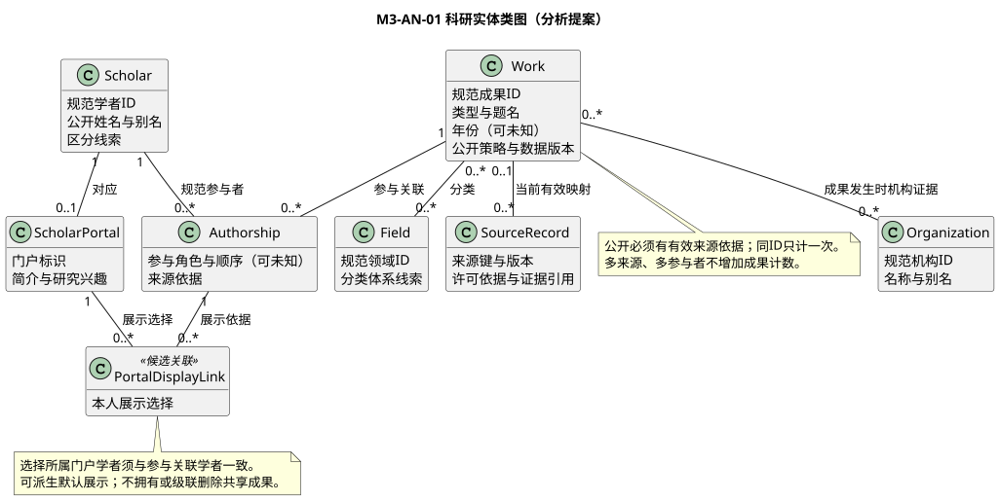
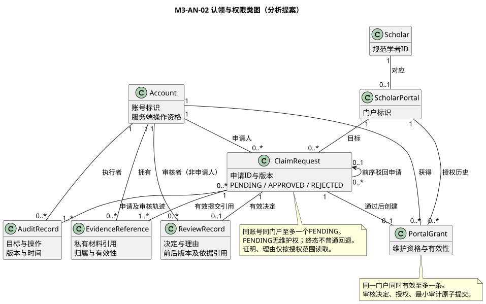

# 核心业务类模型说明

版本0.1；方案 A 分析提案。依据成员一整体模型 C01～C08、[业务需求](../requirements/01-srs-contribution.md)、SPEC-M3-AUTH/SEARCH/CLAIM/STATS。图中属性为语义说明，不是接口字段或数据库列；方法表达职责，不指定实现框架。

## 1 科研实体（M3-AN-01）

[图源](diagrams/core-domain.puml)。Work 是四类成果的共同概念，论文、专利、项目、获奖为类型而非强行设计四张表。年份允许未知。Scholar、Organization、Field 均有规范 ID，显示名和别名不保证唯一。

| 对象 | 关键语义 | 多重性及约束 |
| --- | --- | --- |
| Scholar | 规范学者、公开姓名、别名、区分线索 | 可无账号、无门户、无已确定成果关系；同名不合并 |
| Work | 规范成果、类型、题名、年份、公开策略、数据版本 | 一个成果可有多个来源，只计一次；公开必须有有效来源依据 |
| Authorship | 成果与规范学者的参与关联，顺序、角色、依据可未知 | 每条关联恰好一个学者和一个成果；不为未知作者编造学者，不把项目参与人统称论文作者 |
| Organization | 规范机构和别名线索 | 与成果多对多，按成果发生时来源证据统计；不能由学者当前机构倒推 |
| Field | 规范领域及体系线索 | 与成果多对多，未知为无已确认关联，不建立虚假“未知领域”实体 |
| SourceRecord | 来源键、版本、许可依据、原始证据引用 | 一个来源当前有效映射0..1个成果，一个成果0..*来源；公开准入另加至少一个有效来源约束 |
| PortalDisplayLink | 门户展示选择，关联可追溯参与关系 | 每条选择对应一个门户和一个参与关联，二者学者须一致；默认展示可由规则派生，不要求逐条存储 |

PortalDisplayLink 是候选分析关联类：用于区分“隐藏本人展示”与“修改规范参与关系”。它不拥有 Work，不含级联删除语义；删除选择或隐藏只影响本人视图。其基数表达选择记录，不表示每项公开成果都必须有持久化选择记录。

多机构计数可大于成果总数；多领域占比可超过100%。合作边基于同一 Work 的规范学者 ID 集合，不依赖门户展示选择，也不按姓名建立关系。[统计 SPEC](../requirements/specs/SPEC-M3-STATS.md)仍是口径来源，本阶段不重写算法。

## 2 认领与权限（M3-AN-02）

[图源](diagrams/claim-domain.puml)。Account 是服务端会话主体，Scholar 是学术实体；两者无继承或默认等号。管理员是操作资格，不是 Account 的固定子类。角色与职责范围需每次操作重新核验。

| 对象 | 关键语义 | 多重性及约束 |
| --- | --- | --- |
| ScholarPortal | 指向一个 Scholar 的公开展示入口 | 沿用整体提案：一学者0..1门户，待联合确认 |
| ClaimRequest | 申请人、目标、材料引用、状态、版本、前序申请 | 每申请一个账号、一个门户；同账号同门户最多一个 PENDING；重提为新 ID，最多关联一个前序 REJECTED 申请 |
| EvidenceReference | 私有材料引用、归属、有效性 | 每引用一个拥有账号，可复用于其0..*申请；有效提交至少一个可用本人引用，不复制证明正文 |
| ReviewRecord | 审核人、决定、理由、前后版本和依据引用 | 一个已终结申请有一次有效决定，待审为0；并发失败不伪造决定记录；审核账号不得等于申请账号 |
| PortalGrant | 账号到门户的维护资格及有效性 | 门户可有历史多条、同时有效至多一条；本流程每授权来自一个通过申请，每申请最多一授权 |
| AuditRecord | 最小操作轨迹，引用目标、执行账号和版本 | 每成功提交申请/审核/维护至少有相应轨迹；审核轨迹与决定/授权原子提交，不存私有正文 |

ReviewRecord 承载业务决定，AuditRecord 承载操作追踪，允许内部实现合并存储，不能据此增加公共表。失败访问可记安全事件，但不能伪装成成功审核审计。授权有效期、撤销、转让与多人代管仍待专门规则，不从历史多重性自动开放。

## 3 状态与一致性不变量

- I01：PENDING 不授予维护权；APPROVED 的本流程申请存在相应授权创建及有效审核审计；REJECTED 不新增授权。
- I02：任何时刻每门户至多一个有效授权；任何申请只能提交一个审核终态。
- I03：决定、授权和最小审计共同成功或共同失败；并发失败不能撤销另一个请求已提交结果。
- I04：同主体、操作、幂等键、参数重试返回原结果；同键不同参数冲突。重放仍需当前会话与对象读取资格。
- I05：当前公开策略约束结果、total和统计全集；证明不进入公开投影。旧快照不能绕过撤下规则。
- I06：来源、参与、展示三个层次分离；个人隐藏不删除共享成果、不改变公共合作统计。

以上来自既有候选规范，不表示公共基线已经冻结。AN-Q01～Q08仍按成员一交接记录待决；本包新关联类和审计基数也需成员八及成员一/六核对。
