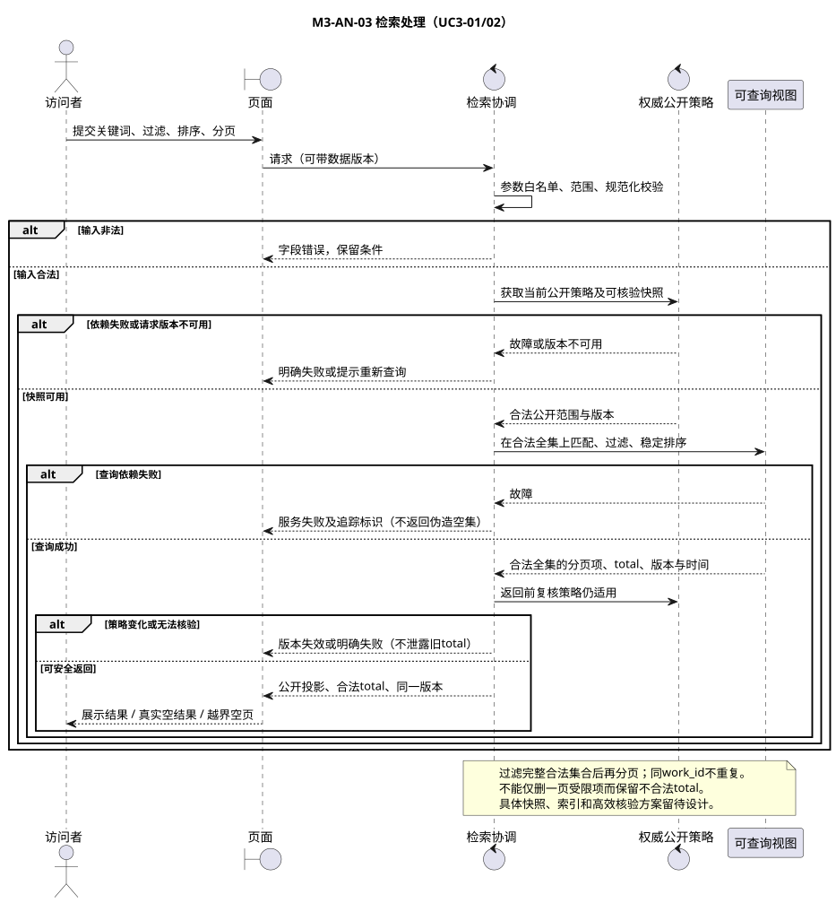
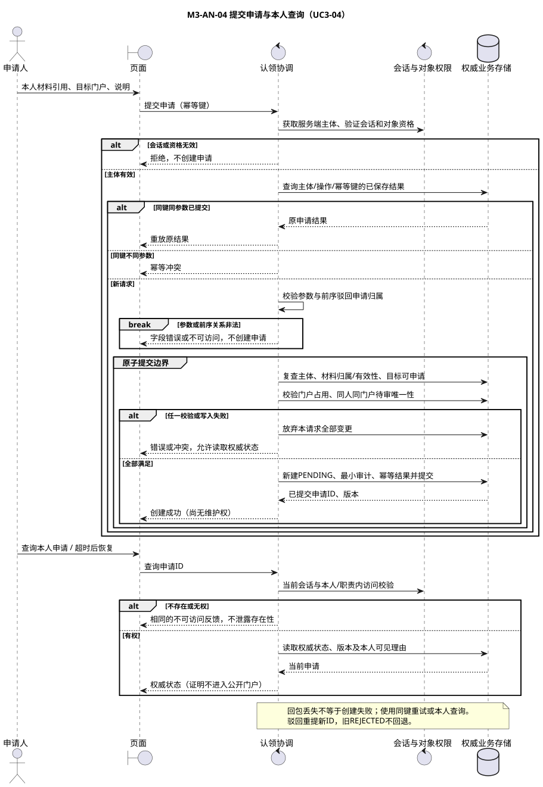
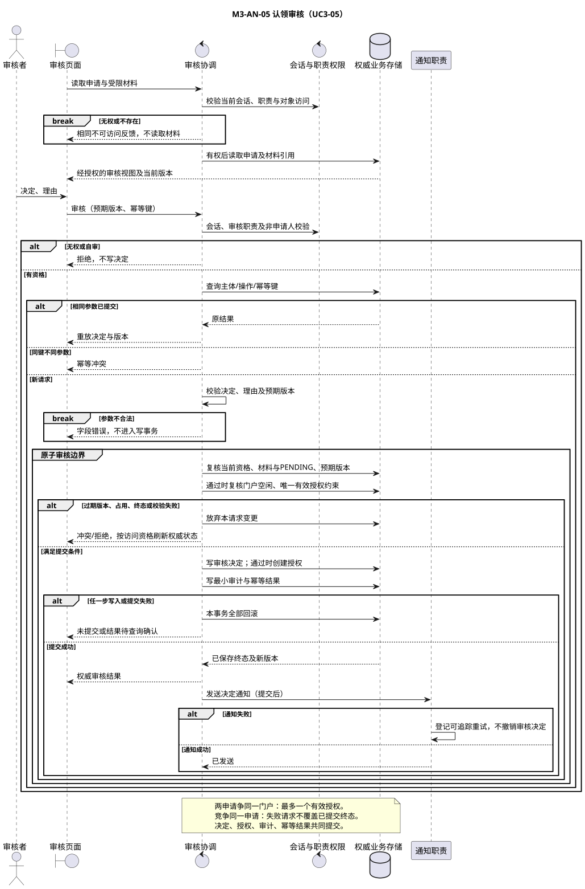

# 关键用例交互模型

版本0.1；引用 SPEC-M3-AUTH、SPEC-M3-SEARCH、SPEC-M3-CLAIM。边界对象为页面，控制对象为分析级业务协调者，实体对象由类图给出。图中的“存储”“索引”“会话权限”是职责参与者，不表示已经选择数据库、ES配置、认证协议或服务部署拓扑。

## 1 检索（M3-AN-03）

覆盖UC3-01/02，AC3-05～12、24。正常输入为关键词、类型、年份、机构/领域、排序和分页，输出为公开项、合法全集 total、数据版本和更新时间。排序、规范化与未知年份规则原样引用[SEARCH SPEC](../requirements/specs/SPEC-M3-SEARCH.md)，不在分析图内换成 BM25。

索引返回候选不是公开授权。必须能证明所查询完整集合及 total 受当前权威策略约束；只过滤一页无法保证总数正确。图表达一种安全的分析路径：取得可核验公开快照，计算完整合法集合，返回前复核公开策略版本。无法提供此保证时返回版本不可用或依赖失败；不能推断实际实现必须逐条扫描百万条数据。

详情/门户直接按规范 ID 读取权威可公开投影，不必先检索；门户四类栏目保留，缺失信息为未知，无权或不存在目标采用不可访问反馈。公开策略依赖失败时不回退未验证缓存。页面加载、错误、版本失效为UI状态，不新增申请业务状态。

## 2 提交及本人查询（M3-AN-04）

覆盖UC3-04，AC3-04、12～14、18。会话主体由服务端获得，客户端不能指定申请人。材料归属/有效性、门户存在/占用、同人同门户待审唯一性须在提交边界保持有效；初次表单预检查不够。幂等结果与申请写入共同提交，避免“申请成功但幂等结果丢失”造成重复。

网络超时或回包丢失不能推断创建失败；同键同参数重试或查询本人申请恢复。查询必须核验本人或职责内审核权限，无权与不存在不泄露差异。图不定义上传大小、材料保留时长或真实身份通过标准。

## 3 审核（M3-AN-05）

覆盖UC3-05，AC3-15～18、24。审核者须有职责资格且非申请人；理由和预期版本不可缺失。事务中再次核验资格、材料、当前PENDING、版本和通过时门户空闲，随后原子写决定、授权及最小审计。驳回只写决定及审计，不创建授权。

两个申请竞争同门户：最多一授权创建成功，失败者本次事务无写入，其申请可以仍为PENDING；若竞争同一申请，则失败者读取另一请求已提交的终态，不把其改回待审。终态收到新审核返回冲突；已保存幂等请求重放例外，返回原结果。

通知在业务提交后执行，失败保持已保存决定并登记可追踪重试。图中的通知职责只表达隔离与重试，不指定消息中间件；通知重试机制的可靠保存留待架构/构件设计。通知不得携带证明正文。

## 4 维护与统计的衔接

UC3-06/08：会话→当前目标门户授权→字段白名单/预期版本→原子保存权威值和审计→触发公开投影同步。简介/兴趣允许直接维护；DOI等公共字段转GovernanceIssue，不覆写来源。删除个人展示只更新PortalDisplayLink；同步失败返回已保存、待同步，撤下后公开读取仍执行当前策略。

UC3-07：在同一公开快照按规范Work ID去重，再计算类型、机构、领域、合作边和年度分布。未知年份/机构/领域分别披露，空分母share=null。统计与检索具有相同可见范围和版本约束；不得把失败当全零。这两条为详细图的衔接说明，不宣称新增完整治理或统计时序图。

## 5 分析走查表（系统测试待实现）

| 场景 | 应保持的结果 | 图/规则 |
| --- | --- | --- |
| 旧索引含私有成果 | 结果、total、统计均不计；无法核验则明确失败 | AN-03，I05 |
| q=graph合成夹具 | W-A/W-B/W-C；total=3，精确优先于高分 | AN-03，AC3-05 |
| 同键重复/参数变更 | 相同返回原结果，变更冲突；都不能新增重复申请 | AN-04，I04 |
| 审核自己或读取他人材料 | 拒绝；不能返回证明正文或泄露存在性 | AN-04/05 |
| 两申请争同一门户 | 一授权；失败请求不伪造驳回 | AN-05，I02/03 |
| 决定/授权/审计任一步失败 | 本请求无部分提交 | AN-05，I03 |
| 通知失败/回包丢失 | 决定保留；查询/幂等恢复；通知可重试 | AN-05，I04 |
| 驳回补充后重提 | 新ID关联旧ID，旧申请仍REJECTED | AN-04，CLAIM SPEC |
| 隐藏成果/来源更新冲突 | 不删共享数据；来源与人工值冲突转治理 | I06，UC3-06/08 |
