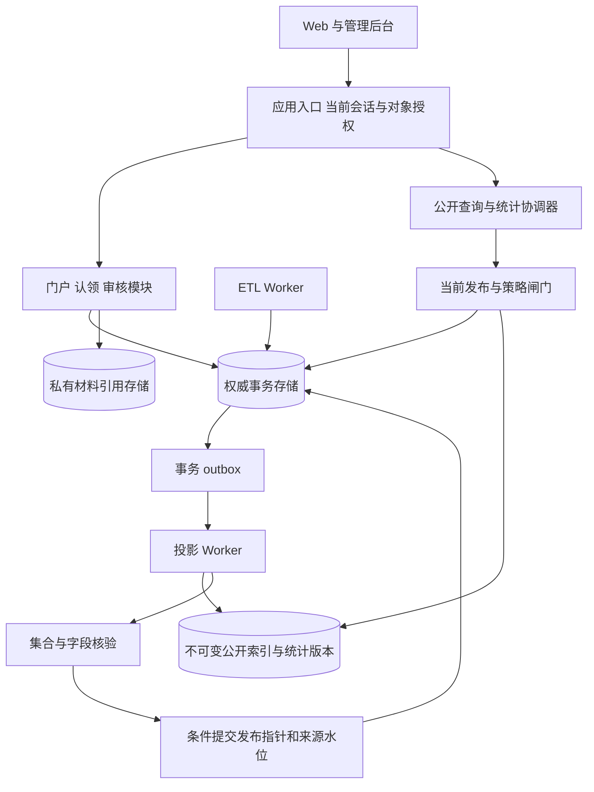
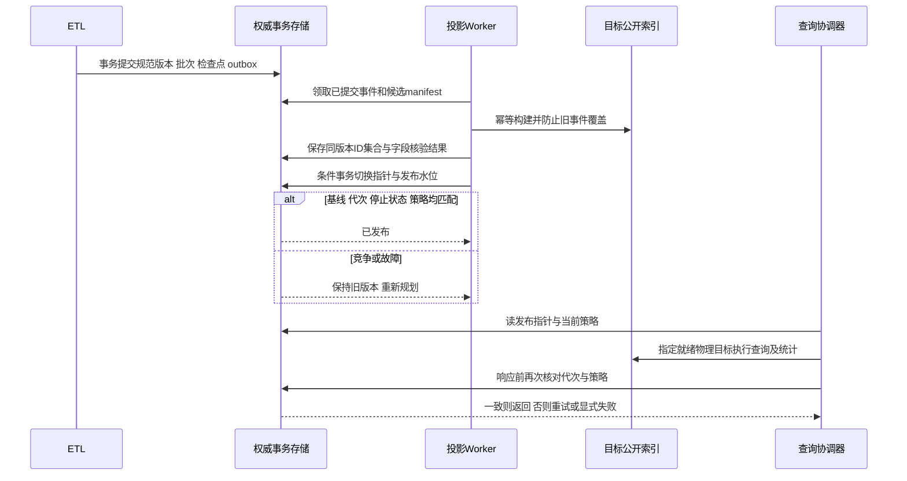

# 成员三 · 架构设计供稿

2026-11-11；M3-ARCH-01；方案 A 候选，供唯一架构报告汇编。对应分工 §5.4（第9～11周），不是另一套正式报告。

## 本轮顺序与完成清单

1. 已完成：拉取 `a` 到 `87724d13dd87d3bbcddb2dee5c283c2e2fe0680b`，确认 main 已归档需求分析，规模采用百万条规范公开成果。
2. 已完成：[存储与业务架构](01-storage-and-business.md)：模块所有权、认证、门户和认领事务。
3. 已完成：[检索、统计与一致性](02-search-and-publication.md)：合法全集、排序、版本、双水位及故障恢复。
4. 已完成：[决策依据与对比](03-decisions-and-evaluation.md)：向成员1/6提供三项 ADR 输入，不代替其正式 ADR。
5. 已完成：向后推进[构件设计工作包](../component-design/README.md)，提供关系模型、索引、映射及接口草案。
6. 已完成：静态核查与 SQLite 约束/事务设计试验，实际结果见[验证报告](../component-design/validation-report.md)。业务系统、ES 和 HTTP 服务未实现，运行验收仍待执行。

图源：[模块与存储](diagrams/storage-services.mmd)、[发布顺序](diagrams/publication-sequence.mmd)。汇编位置为统一架构说明书的存储层、检索服务、业务服务及一致性章节；由成员6汇编、成员1复核。

## 规范与固定来源

- 根目录 README、AGENT、AGENTS、分工方案已完整读取；本轮只新增成员三供稿与模型A证据。
- 本岗位 [AUTH](../requirements/specs/SPEC-M3-AUTH.md)、[SEARCH](../requirements/specs/SPEC-M3-SEARCH.md)、[CLAIM](../requirements/specs/SPEC-M3-CLAIM.md)、[STATS](../requirements/specs/SPEC-M3-STATS.md)，16条需求、24项验收不改写。
- [来源清单与交接](04-handoff-and-sources.md)固定 main、a、b 的提交及文件；远端公共内容通过 `git show` 读取，没有机械合并其他分支。

人工审阅、成员八交叉复核、成员一/六共同批准、CodeArts原生工程及运行测试均按真实发生情况另记，不能由此勾选。

## 架构图（与图源一致）

