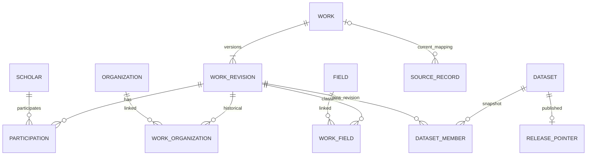
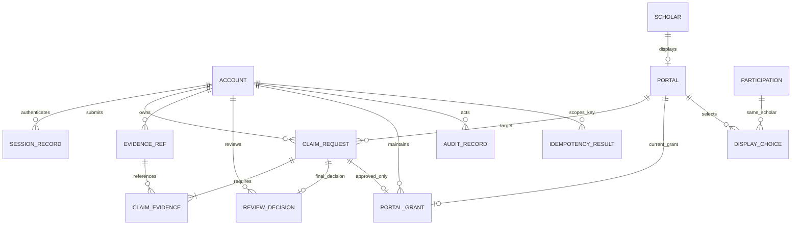

# 数据库与关系设计

依据 SPEC-M3-DESIGN-001、AUTH/CLAIM/SEARCH/STATS；内部物理候选，不改变公共基础库。

## 1 模型分层

[科研实体E-R源](diagrams/research-er.mmd)覆盖规范成果、版本、来源、参与与分类；[认领E-R源](diagrams/claim-er.mmd)覆盖账号、门户、申请、材料、决定、授权及审计。关系表使用复合主键去重，显示名称均非唯一。

| 表/逻辑对象 | 核心键与属性 | 约束/索引与用途 |
| --- | --- | --- |
| account、session_record | account_id、token_digest、expires_at、revoked | 摘要唯一；服务层检查账号禁用/到期/角色职责；无明文凭据 |
| scholar、organization、field | 稳定ID、公开名；别名和来源线索由版本投影保存 | 姓名不唯一；未知不建立假实体 |
| work、work_revision | work_id；(work_id,revision)、type/title/year/public_payload_hash | 身份与版本分离；类型/年份检查；历史投影payload为获准字段的内容摘要引用，不是私有原载荷 |
| participation | (work_id,revision,scholar_id)、参与角色/顺序 | 关联成果revision，去重学者；未知参与者不上假ID |
| work_organization、work_field | (work_id,revision,目标ID) | 历史机构/领域按成果revision，不倒推当前任职 |
| source_record | source_record_id、source_id/key/version、work_id可空、许可与证据引用 | 来源三元组唯一；未映射可留存；公开发布另查有效依据 |
| portal、display_choice | portal_id、scholar_id唯一；(portal_id,参与关系) | 选项必须属于同学者；隐藏不级联删work |
| claim_request、claim_evidence | claim_id、account_id、portal_id、状态、version、previous_id | 同申请人同门户PENDING部分唯一；前序应同主体同门户且REJECTED；本人有效材料关联由外键/触发器与服务复检 |
| evidence_ref | evidence_id、owner_id、valid | 私有存储引用，正文不落模型；撤销/保留期在服务处理 |
| review_decision、portal_grant | claim_id唯一、reviewer、reason；portal_id/claim_id唯一 | 非本人；只有正确申请的APPROVED决定可产生匹配授权；本轮未开放授权撤销 |
| audit_record、idempotency_result | 目标、actor、动作、前后版本；(actor,operation,key)、request_hash、result_ref | 成功业务最小轨迹；同键不同参数由服务拒绝；保留期未定 |
| processing_batch、outbox | batch_key唯一、task/epoch/checkpoint；event_id、target/aggregate/version/hash | 同批不重复；事件去重与防倒序由消费端；消息不含证明正文 |
| dataset、dataset_member | version、base_version、policy_version、状态；(dataset,work)→revision | 不可变快照；一版本内每成果只计一次，历史关系按revision复原 |
| release_pointer、source_watermark | 单一当前指针及代次；来源/范围水位 | 最终事务比较基线/策略/代次/停止并共同更新；不能用ES别名代替权威指针 |

内部版本表仍需字段级来源、许可及治理记录支撑；本SQL不是成员二完整任务/治理模型，也没有加入其公共任务枚举。`task_ref`与scope是跨模块受控引用，不能把试验字段当正式异步消息契约。

## 2 索引与事务

核心索引：待审按门户＋状态；本人申请按申请人＋ID；成果revision按类型＋年份＋ID；参与/机构/领域按关联目标＋成果；outbox按内部处理状态＋event_id；来源三元组；快照成员按版本＋成果。生产查询计划决定是否添加覆盖索引，写放大和索引空间必须测量。

门户锁是申请/审核并发序列化边界。先读申请定位门户，锁门户后重读申请和授权；版本条件更新防止同申请双审，唯一授权防止跨申请争用。决定必须与终态匹配且禁止自审，授权必须与通过决定/申请人/门户匹配；SQL检查可兜底，职责与材料授权仍由服务层执行。决定、授权、审计、幂等、outbox的存在性整体一致由应用事务保证；不要把单行CHECK称为跨表原子性。

## 3 版本化及公开准入

dataset_member引用不可变revision，关系也跟随revision；发布后禁止修改成员或revision。新增版本不原地覆盖旧快照。当前公开策略是独立权威事实；本SQL以最小policy代次支持试验，完整字段许可表由2/7与3/8联合设计。

发布必须校验至少一项当前有效来源、字段许可、数据质量和模拟标记；这些不是单个外键可以完整表达，执行器负责生成核验报告。集合摘要用作定位及审计，严格对账使用有序ID与投影哈希，不以非加密求和或总数替代。

## 4 迁移与回退

[正向SQL](models/001_candidate_schema.sql)和[回退SQL](models/001_candidate_down.sql)只运行于临时库。唯一内部模型号 `M3-DESIGN-001` 不是团队生产迁移序号。

批准后生产迁移顺序：确认引擎与公共字段→登记全局唯一迁移号→新增表/索引→分批回填规范ID/历史版本→处理重名/重复/孤儿与约束冲突→影子对账→开启约束→切换单一写方→验证回归。先备份并保留旧读路径；失败停止新写、恢复已核验指针并回放合法变更，不能直接删除已产生业务数据的表。SQLite回退会丢弃临时模型数据，不是生产回滚策略。

## E-R图（与图源一致）

