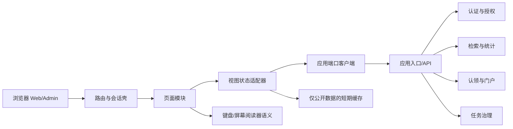

# 展现层架构与页面边界

状态：成员 4 方案 A 候选；不冻结公共 API。
输入：`M1-FR-01/06/07/08/09/10/11/12/15`、`UI4-FR-01～21`、`UI4-NFR-01～10`、成员 1 的 A 组模块划分。

## 1. A 方案结构

路由壳负责导航、会话恢复和全局错误边界；页面模块负责用户任务；状态适配器把公共响应转换成页面状态；端口客户端负责超时、取消、请求序号和错误分类。页面不得读取数据库、索引、队列或证明材料，也不得把内部错误栈传给用户。

## 2. 页面模块边界

| 模块 | 页面 | 依赖端口 | 不负责的事情 |
| --- | --- | --- | --- |
| `PublicSearch` | `UI4-P01/P02/P03` | 查询端口 | 排序算法、公开策略、total 计算 |
| `ScholarPortal` | `UI4-P04/P05` | 门户/统计端口 | 判断身份真实性、拼接受限材料 |
| `SessionAndClaim` | `UI4-P06/P07/P08` | 会话/认领端口 | 把登录或提交显示成授权 |
| `PortalMaintenance` | `UI4-P09/P10` | 门户维护/反馈端口 | 修改共享成果本体、绕过版本检查 |
| `AdminGovernance` | `UI4-P11/P12` | 审核/任务端口 | 自行决定审核规则或任务状态 |
| `InnovationView` | 候选扩展入口 | 统计或图谱端口 | 以预测或推荐代替基础统计 |

页面之间只共享路由上下文、公开查询条件和设计令牌，不共享可变业务对象。详情返回结果页时恢复查询条件，再验证数据版本，避免混合新旧分页。

## 3. 运行约束

1. 写操作使用提交快照和幂等上下文；提交中禁用重复操作。
2. 新请求生成单调递增序号或取消令牌，旧响应不能覆盖当前条件。
3. `OUTCOME_UNKNOWN` 进入权威查询，不直接重试创建申请或保存变更。
4. 无权限、内容下线、业务空结果和依赖失败使用不同页面状态；失败不得伪装成 `total=0`。
5. 证明材料、私有联系方式、审核备注和令牌不进入 URL、公开缓存、页面错误或客户端日志。
6. 页面在 1366×768 与 360×800 视口保持主操作可达；颜色不是状态的唯一表达。

## 4. A/B 替换点

| 位置 | A 组候选 | 替换约束 |
| --- | --- | --- |
| 页面组织 | 按任务分模块的 Web/Admin 单体前端 | 路由、权限和状态语义不变 |
| 数据获取 | 端口客户端 + 请求序号 + 公开缓存 | 版本、取消和错误分类不变 |
| 长任务反馈 | 任务详情轮询，未来可替换推送 | 不把任务中间态改成完成态 |
| 创新视图 | 与门户/统计隔离的图谱卡片 | 基础统计仍单独展示，候选结果标口径 |
| UI 组件 | 共享令牌和状态组件 | 无障碍名称、焦点和文案可追踪 |

B 组可采用不同框架、数据获取库或推送方式；在 B 组材料到齐前，不对其实现或性能作事实判断。
