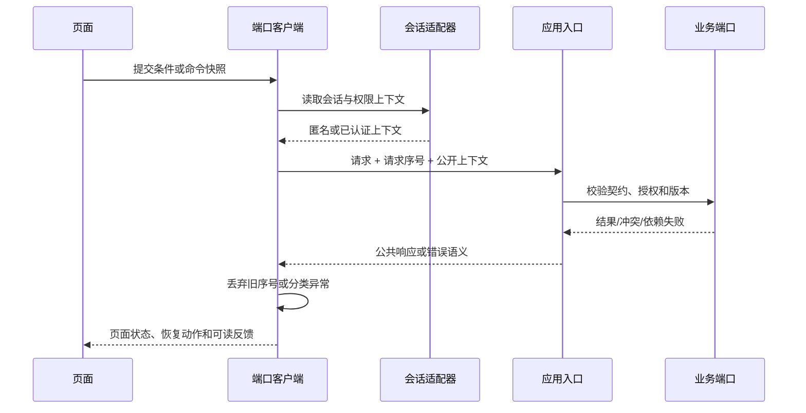

# 前后端通信与恢复架构

状态：成员 4 方案 A 候选；路径、字段、错误码和分页格式以成员 1/6、3/8 的公共契约为准。

## 1. 请求生命周期

客户端只负责显示和恢复，不计算权威 total、统计分母、授权或业务终态。端口客户端统一提供取消、超时和重试策略；`requestId` 仅在公共契约提供时展示，不能把数据库键当作追踪号。

## 2. 读请求规则

| 场景 | 客户端行为 | 禁止行为 |
| --- | --- | --- |
| 查询/筛选 | 保存条件快照，结果和版本原子替换 | 只换当前页却沿用旧 total |
| 翻页 | 携带同一查询版本；失效则转 `STALE` | 拼接不同版本的分页结果 |
| 空结果 | 显示可修改条件的空态 | 当作服务故障或缓存命中 |
| 依赖失败 | 保留条件并提供重试 | 把失败转换成空结果 |
| 门户返回 | 按不可变对象标识打开 | 用姓名字符串猜测对象身份 |

## 3. 写请求规则

| 写操作 | 提交前 | 成功判定 | 未知结果处理 |
| --- | --- | --- | --- |
| 认领申请 | 字段校验、隐私提示、重复提交锁 | 权威申请编号和状态 | 查询本人申请，不直接再次创建 |
| 审核决定 | 显示目标和理由，服务端复核回避 | 决定、终态、授权和审计共同成功 | 刷新权威申请，不覆盖他人决定 |
| 门户维护 | 带当前版本，仅提交允许字段 | 权威保存；索引同步另显示 | 查询权威版本，再决定重试 |
| 反馈 | 绑定公开对象，隔离私密材料 | 返回可查询编号（若契约提供） | 不显示内部处理详情 |

## 4. 会话和故障

- 路由恢复仅保存公开 ID、查询条件和非敏感草稿；证明材料、私有联系方式和内部备注不进 URL 或持久化浏览器存储。
- 会话过期时清除受限缓存；按钮隐藏不构成授权，每次读取和写入仍依赖服务端校验。
- 公开缓存按数据版本和公开范围隔离；认领申请、证明材料和管理员页面禁止进入公开缓存。
- 查询可取消；取消只影响本地等待，不推断服务端未执行。写请求超时转 `OUTCOME_UNKNOWN`，先查询权威状态。
- 自动重试仅用于明确可安全重试的读请求或公共契约声明幂等的命令；版本冲突、权限拒绝和业务冲突不共用一个重试按钮。
