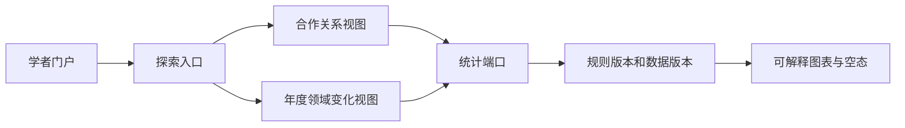

# 页面模块与创新功能接入

状态：A 组候选设计；创新功能尚未由成员 1/6 和课程评审冻结。

## 1. 路由和页面模块

| 路由语义（非公共 API） | 页面编号 | 页面壳 | 关键状态 |
| --- | --- | --- | --- |
| 公开检索 | P01/P02 | `PublicShell` | 初始、加载、结果、空、失败、过期 |
| 成果/门户详情 | P03/P04 | `PublicShell` | 成功、部分缺失、下线、无权限 |
| 统计 | P05 | `PublicShell` | 有数据、真实 0、未知、版本失效 |
| 登录/认领 | P06/P07/P08 | `AccountShell` | 登录必需、编辑、提交中、结果未知、三态业务视图 |
| 维护/反馈 | P09/P10 | `AccountShell` | 未保存、保存中、冲突、已保存待同步、无权限 |
| 审核/任务 | P11/P12 | `AdminShell` | 筛选、详情、确认、冲突、处理中、通知待处理 |

路由语义用于说明信息架构，不代表最终 URL；公共契约确认后再生成具体路由、字段和缓存键。

## 2. 创新候选：合作关系与年度领域变化

成员 3 的候选决策稿提出“公开成果生成合作者边、年度领域变化分析”。成员 4 只定义安全的展示接入，不宣称候选已选定或已实现。

接入规则：

- 只读取公开成果、规范学者 ID、领域和数据版本，不读取认领证明或私有材料。
- 节点、边权和年度分母随响应口径展示；未知领域和真实 0 分开表达。
- 数据不足时显示空态与限制，不生成虚构关系或预测结论。
- 入口不能替代成果检索、机构排名、类型分布和基础年度统计。
- 用 feature flag/能力发现控制显隐；候选未确认时只保留隐藏或实验入口。

## 3. A/B 隔离

创新视图通过 `InnovationPort` 读取已定义的统计/图谱能力。A 组可复用查询索引并渲染图表，B 组可选择不同组件或计算路径；两组必须保持相同的公开对象、分母、版本、隐私和空态语义。
