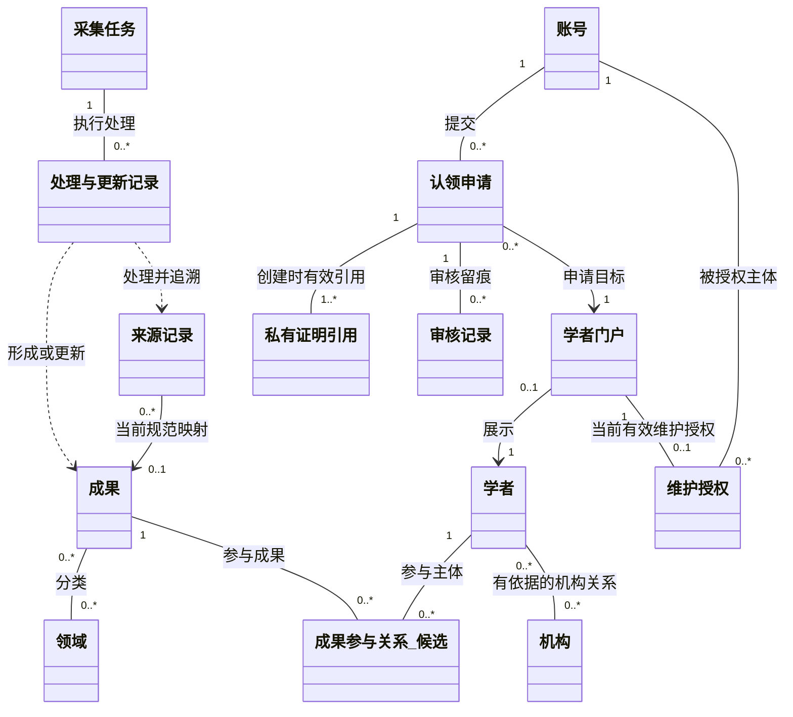

# 类模型整体结构（成员6供稿）

2026-10-19，0.1分析建议；图M6-AN-FIG-01。与成员1共同确定结构，成员3、8细化核心类。

## 1 层次与分区

总体图只展示概念对象与主要关系。实体描述持续存在的业务事实；边界对象承接页面/外部来源；控制对象组织一次用例。数据库、Elasticsearch、队列和框架类留在设计阶段，不加入核心业务实体类图。

另附[PlantUML源稿](diagrams/overall-analysis-structure.puml)，与上图使用同一组关系。两者都是本地分析语义图，未宣称已在CodeArts建立或导出。

## 2 关系与多重性理由

| 关系 | 分析建议 | 依据与需要确认的边界 |
| --- | --- | --- |
| 账号—申请—门户 | 每申请一个申请人、一个目标；账号/门户可有历史多申请 | 同账号同门户至多一个PENDING，不同账号可申请同一未占用门户；不是全局申请唯一 |
| 门户—当前有效授权 | 门户0或1个当前有效维护授权 | 来自SPEC-M8-CLAIM唯一owner；历史授权、协作编辑、转让不在此图推定 |
| 门户—学者 | 每门户一个学者，学者0或1门户 | 0允许尚未生成门户的学者；是否全量即时生成交3、8确认 |
| 学者—成果参与—成果 | 每参与关系一个学者、一个成果，双方可多条关系 | 关联角色与来源需保留；0条可能是缺失未知，不代表确证无人 |
| 学者—机构 | 多对多概念关系 | 来源、角色、时间语义待细化；不能把当前任职当历史成果单位 |
| 成果—领域 | 多对多，0表示未映射 | 来源分类与公共分类分开；unknown的实际表达由数据/接口共同确认 |
| 来源记录—规范成果 | 一来源记录当前0或1规范映射，成果可有多来源 | 限当前单成果记录粒度，隔离未映射为0；复合来源输入须由2、7说明拆分方式，历史映射不覆盖 |
| 任务—处理记录 | 一任务多次处理/更新记录 | task/attempt、停止恢复仍有A/B差异，图不冻结枚举 |
| 申请—证明引用 | 创建时至少一个有效引用 | 不规定文件格式/大小/存储期；删除或失效后如何保留审计依据待3、8确认 |
| 申请—审核记录 | 零或多条审核留痕 | “多条”含尝试/审计，不允许同申请多次成功终态决定；具体记录边界由3、8细化 |

不用组合黑菱形表达门户对成果、申请对证明的级联删除，防止模型暗示删除门户会删除全局成果或清除依法应留历史。材料保留期须另行批准。

## 3 控制/边界对象建议

| 用例 | 边界 | 控制职责 | 访问的概念对象 |
| --- | --- | --- | --- |
| 数据导入 | 来源适配入口、管理页 | 接入/处理协调 | 任务、来源、处理记录、成果 |
| 检索 | 检索页 | 公开查询与排序协调 | 成果、学者、机构、领域及只读视图 |
| 认领提交 | 认领流程页 | 会话/归属/重复校验与申请创建 | 账号、门户、证明引用、申请 |
| 管理员审核 | 审核页 | 权限、回避、版本/占用检查与原子提交 | 申请、门户、账号、授权、审核/审计 |
| 维护 | 门户维护页 | 资源授权与共享字段治理 | 门户展示关联、成果、变更请求候选 |
| 统计 | 统计页 | 同版本公开范围和去重计数 | 成果、领域、机构、统计视图 |

这里的“控制职责”不规定类名或服务部署。成员3、8可用相同语义映射其内部方案；成员2、7、4、9各自保留处理/界面设计。

## 4 A/B模型比较准则

比较账号与学者是否分离、来源与规范成果是否分离、私有证明边界、认领原子性、统计分母和错误可观察结果。内部是否使用独立关联类、继承、文档聚合等可不同，但不得改变公共输出和权限含义。

没有收到对应分析类图前不填写“A更优/B更优”或性能分数。先由3、8基于本图细化，再由1、6确认共用对象边界；最终只汇编一套正式分析文档并保留差异说明。
