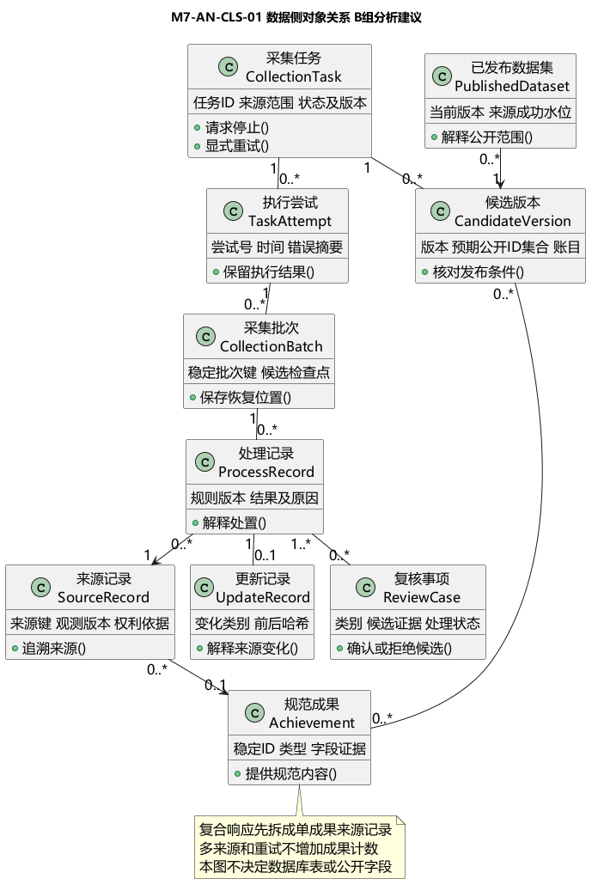

# 数据对象与关系

版本0.1，2026-10-27，B组分析提案。我们把来源事实、处理结果和公开版本分开，避免把“抓到数据”“写入候选区”“用户已能检索”当成同一件事。对象名称只表达职责，不冻结表名、字段类型、部署服务或公共API。

## 对象职责

| 对象 | 关键语义属性 | 方法职责 |
| --- | --- | --- |
| CollectionTask 采集任务 | 任务标识、来源、固定范围、状态、版本、规则版本 | 创建任务、请求停止、显式重试、记录终态 |
| TaskAttempt 执行尝试 | 尝试号、开始结束时间、错误摘要 | 保留一次执行结果，不改写旧尝试 |
| CollectionBatch 采集批次 | 批次键、输入版本、处置账目、安全检查点 | 记录有界处理单元，幂等保存恢复位置 |
| SourceRecord 来源记录 | 来源命名空间、来源键、观测版本、原值引用 | 追溯单个成果的来源事实，保留历史观测 |
| ProcessRecord 处理记录 | 规则版本、输入定位、结果、异常原因 | 解释valid、quarantine、filtered处置 |
| UpdateRecord 更新记录 | 来源键、前后哈希、变化类别、任务与版本 | 解释新增、修改、撤回及冲突；不是成果ID |
| ReviewCase 复核事项 | 证据引用、问题类别、候选值、结论或待定 | 承接非法值、身份/强键冲突和人工值冲突 |
| Achievement 规范成果 | 稳定成果ID、类型、字段证据、公开策略 | 合并无冲突来源、提供获准规范内容 |
| CandidateVersion 候选版本 | 版本标识、预期公开ID集合、账目、许可依据版本 | 暂存本次变化并核对待发布内容 |
| PublishedDataset 已发布数据集 | 当前公开版本、来源成功水位、规则/许可版本 | 解释当前检索和统计使用的数据范围 |

TaskAttempt、CollectionBatch、CandidateVersion、PublishedDataset、ReviewCase是对既有B组语义的分析细化建议；不是新增已批准公共实体。SourceRecord和Achievement沿用成员6/8名称，ProcessRecord承接成员6“处理与更新记录”；UpdateRecord是其变化事实的细分，不另造一套成果身份。

## 关系与多重性

| 关系 | 基数与含义 | 限制 |
| --- | --- | --- |
| 任务与尝试 | 一任务有0到多次尝试，每次尝试属于一个任务 | 创建后尚未运行可为0；失败后显式重试增加attempt |
| 尝试与批次 | 一次尝试处理0到多批，每批保留原归属 | 重放引用稳定批次键，不把同输入重复计入成果数 |
| 批次与处理记录 | 一批有0到多条处理记录，每条记录指向一个来源观测 | 同一来源可在多批、多尝试被观察，不用组合关系暗示删除来源 |
| 处理与更新记录 | 一条更新记录追溯一个处理记录 | unchanged可聚合计数，不要求每次无变化都新增事件 |
| 处理与复核事项 | 一条处理记录可关联0到多个复核事项；一个复核事项引用1到多条处理记录 | 冲突复核可共同引用两条或多条来源处理证据 |
| 来源与规范成果 | 单成果来源记录当前映射0或1成果；成果可有多个来源 | 隔离/待复核时可以无映射；原始响应含多成果时先拆分再建来源记录 |
| 候选版本与规范成果 | 候选版本包含0到多条规范内容版本 | 同一稳定成果可出现在多个版本中；隔离内容不得进入公开投影 |
| 已发布数据集与候选版本 | 已建立的公开指针指向一个已核验版本 | 初次发布前可无公开数据集；不暗示失败批次自动公开 |

## 必须保持的约束

1. task、attempt、batch和成果ID是四个不同概念。FAILED经显式重试可回PENDING并增加attempt；STOPPED不直接恢复，重跑创建新任务并引用旧任务，沿用SPEC-M7-INGEST。
2. 候选检查点只用于恢复已分类/已保存的批次；来源成功水位只在完整版本发布后推进。游标、批次检查点和公开水位不能混用。
3. 规范成果采用持久化稳定ID及映射，不能按输入行号、题名或作者姓名重新编号。多来源、多参与者和重复重试不增加规范成果数。
4. 来源记录粒度是一条成果，不是一个HTTP响应。一个获准响应可拆成多条来源记录；同一来源键的多次观测保留版本，不覆盖历史证据。
5. 原值只在许可允许的范围内保留。获取、存储、展示和导出分开判断；有原始引用不等于有权保留完整网页或全文。
6. 低置信度只形成候选。同名不赋予同一身份，作者消歧不授予门户维护权；未确认关联不进入合作关系边。
7. 候选发布前应检查类型、来源、许可、版本和公开ID集合。公开记录数按唯一成果ID计算；真实/模拟与四类分列，课程总规模口径待1/6确认。
8. 已撤下或禁止字段受当前权威可见性约束，即使旧索引或旧数据版本仍存在，也不得继续公开。

## 分析边界

来源适配、清洗、去重消歧、发布协调、候选记录库和索引投影是交互图的控制或存储职责，不当作学者、成果等业务实体。没有因此选定消息队列、outbox、数据库产品或服务拆分。

输入依据：[SRS数据章节](../requirements/01-srs-contribution.md)、[字段映射](../requirements/02-field-mapping.md)、[成员6对象结构](../../member-06/analysis/02-overall-class-structure.md)、[成员8核心类模型](../../member-08/analysis/01-core-class-model.md)。
