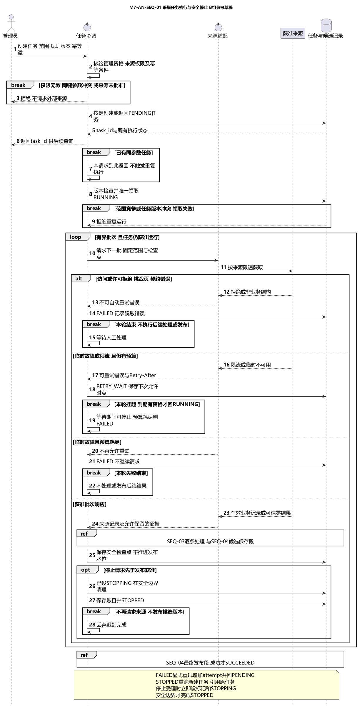
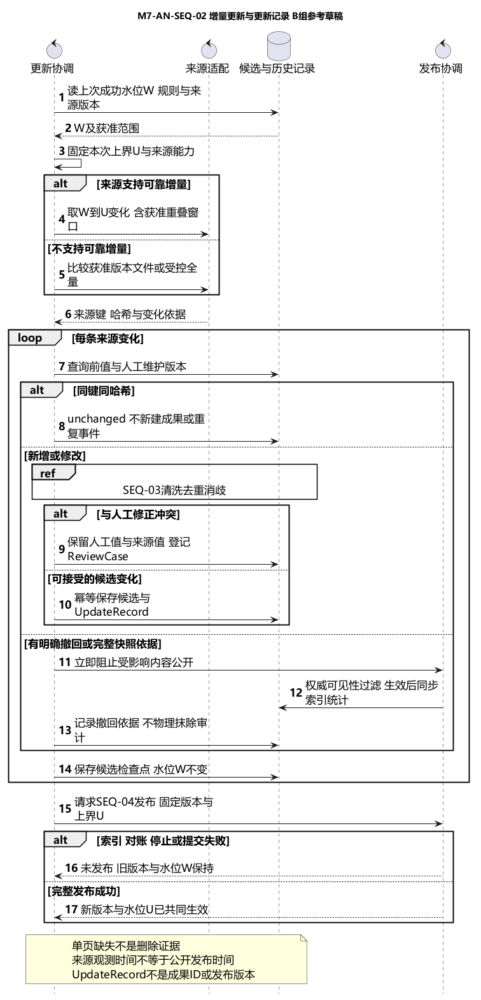
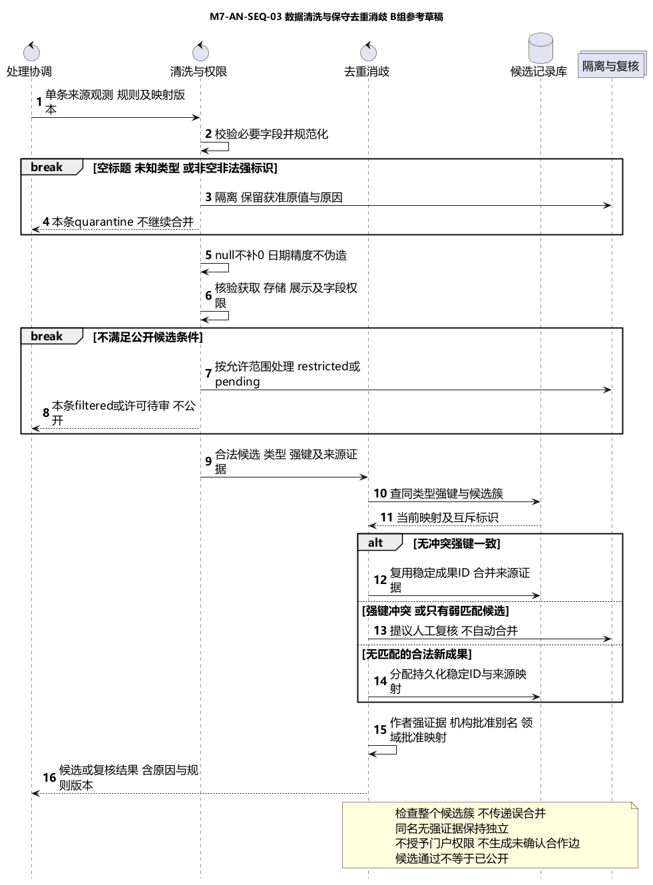
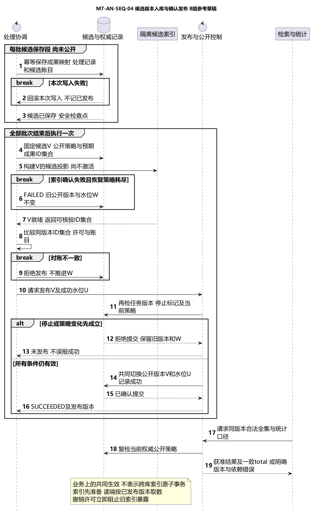

# 数据处理交互分析

2026-10-27，B组。四张图把既有SPEC转换成协作消息。图中的方法名是分析表达，箭头上的条件不是已实现的API或已通过的系统测试。

## 图一 采集任务执行与安全停止

目标：管理员获得可追溯任务、进度和终态。前置条件是有效管理权限、已批准的来源及范围；输入还包括规则版本和幂等键，主体由服务端会话取得。

正常路径：协调对象核验权限与来源，按幂等请求创建或返回PENDING任务，返回任务标识。执行时以任务版本/执行资格取得唯一运行权，转RUNNING；适配器读取有界批次。处理与候选保存调用图三及图四的保存段，安全检查点在分类/保存完成后记录。来源结束后调用图四发布段；发布成功后才SUCCEEDED。

拒绝、验证码、HTML挑战页或结构契约不符进入FAILED，不自动重试。临时故障或429且有预算进入RETRY_WAIT，按Retry-After等待；本轮执行挂起，不能继续往下画成处理成功。到期且资格仍有效才回RUNNING；等待期间可STOPPED，预算耗尽则FAILED。

RUNNING收到停止先受理请求并进入STOPPING，不再发新请求，在安全边界撤销未提交写入并保存可恢复账目后STOPPED。已获准停止不能被迟到完成覆盖。已发布成功后才到达的停止请求返回既有成功，不改变终态。失败后的人工重试增加attempt；已停止后重新运行创建新任务，不在图中照搬A组resume。

后置条件：成功任务有发布版本；失败或停止任务保留原因和旧公开版本，成功水位不推进。零结果只有在有效响应与处理核验完成后才可作为零新增成功。依据SPEC-M7-INGEST，AC07-17至22。

## 图二 增量更新与更新记录

目标：在固定输入范围内识别变化，保留更新依据，不因失败或重放丢失变化。读取的是上次成功发布水位W，本次固定上界U以及来源能力和规则版本。无可靠增量能力时，只使用获准版本文件或受控全量比较，不假称精确增量。

按稳定来源键和内容哈希分类new、update、unchanged；变化经过图三重新检查，进入候选版本并形成UpdateRecord。相同输入和规则版本重放不新建重复成果；更新记录本身也需要稳定事件依据，不因失败重试重复累计变化。

人工维护值与来源变化冲突时保留双方依据，生成复核事项，不覆盖人工值；冲突字段继续使用上次已批准值或阻止相关候选公开，具体选择待公共规则确认。仅凭某一页未出现记录不能判断删除。明确撤回或完整快照核对成立时，先让当前公开响应层阻止受影响内容，再安排索引/统计同步，不能等待新版本才停止暴露。

批次检查点可在候选处理中保存，但W不变。只有图四返回发布成功且新版本/新水位已经共同生效，才记录本次发布完成。索引、对账、停止或发布竞争失败均保留W。来源允许迟到数据时使用待评审的重叠窗口；不臆造具体天数。

后置条件：更新记录能追溯任务、来源、哈希和规则版本；公开数据集只指向核验成功版本。依据M7-UPDATE-01、SPEC-M7-INGEST第5节和AC07-22至24。

## 图三 数据清洗与保守去重消歧

目标：将单条来源观测处理为有证据的候选成果，或明确隔离/复核结果。输入是获准来源记录、原值引用、规则与映射版本；整个输入包结构损坏时先停止该包，本图的逐条处理不能用于掩盖坏编码或不完整解析。

清洗执行NFKC比较键、空白和DOI规范化，保留显示值与原值依据；年、月、日精度不伪造，未知年份/引用数为null而不是当前年/0。非空非法强标识、空标题、未知类型进入隔离，不将非法DOI清空后悄悄继续匹配。

字段权限独立判断。无合法存储依据的载荷不继续保存；许可待审、受限或禁止展示的内容不进入公开候选。合法的非公开处理只在被允许的范围内留存，不把全条元数据视为统一CC0。

同类型无冲突强键可关联同一规范成果，保留各来源及稳定ID；强标识互斥、标题核心冲突或传递候选簇存在矛盾时进入复核。弱匹配仅提出候选，不设置一个新阈值自动合并；无匹配且合法的新成果可分配稳定ID。作者强证据/批准映射才关联，姓名不是主键；机构用强ID或批准别名，领域用批准映射，未知保留。

后置条件：返回valid、quarantine、filtered或review结果及原因、来源和规则版本；valid仅表示候选处理通过，不等于已公开。依据SPEC-M7-CLEAN、SPEC-M7-RESOLVE及AC07-01至16。

## 图四 候选版本入库与确认发布

目标：隔离“保存候选”和“公开新版本”，让检索、统计及成功水位有一致依据。第一段按稳定ID/来源键幂等保存规范内容、映射、处理/更新记录与候选账目；失败的本次写入回滚，不能把部分写入当作已发布。

第二段只在全部批次已处理、任务仍获准运行时执行。构建隔离的候选索引，核对同一版本的预期公开成果ID集合、字段许可与计数。不能仅比较数据库和索引条数相等。索引确认失败时可以在RUNNING的等待发布阶段有限重试，超出策略则FAILED；不推进公开水位，不重新采集已保存的候选输入。

就绪后再次核对任务版本、停止请求及当前许可/公开策略。发布控制以原子比较或等价业务保证共同切换公开版本、来源成功水位并记录成功；不是声称数据库与索引有分布式原子事务。索引先准备但不对外激活，读端按已发布版本取数。停止或策略变更抢先成立时拒绝提交，不能先把新版本公开再决定停止是否有效。

公开查询仍按当前权威策略核验完整合法集合，统计分母/total与结果一致；旧索引不能泄漏已撤下信息。版本不再安全或不可复现时明确反馈版本变化/依赖失败，不返回伪造空集。许可撤销过滤不能仅过滤当前页而保留未过滤total。

后置条件：成功时新版本V与新水位U共同可核验；失败、停止、对账不符时旧公开版本与W保持不变。依据SPEC-M7-INGEST第5至6节、AC07-22至24及成员8公开范围/版本约束。

## 四图衔接

SEQ-01是生命周期入口；增量模式使用SEQ-02选择输入，逐记录调用SEQ-03，处理批次调用SEQ-04保存段，全部输入结束后只调用一次SEQ-04发布段。调用方向不应画成四个图各自再次创建任务或再次从公网抓取同一批。

四张顺序图中的数据库、索引、控制和适配器只表达分析职责。实现可以使用事务、条件写、租约或其他机制，但必须保持图中的可观察约束；本包不把A组outbox方案直接设为B组架构。
