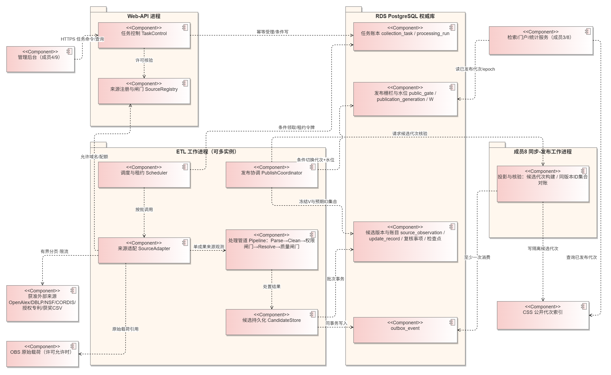

# 数据采集与处理架构设计 · 方案 B

成员 7 · 架构设计阶段（第 9～11 周）· 2026-11-16 · 版本 0.1 · 状态：B 组岗位供稿，对应成员 6 汇编稿中的 PH-7 槽位，待成员 8 衔接复核、成员 1/6 确认公共部分。

本章覆盖 B 组的采集层、处理层、数据管道、异步任务和增量更新，以及与成员 8 存储/检索/发布、成员 9 管理后台、成员 10 部署测试的交接。需求依据为统一 SRS 的数据章节与 [SPEC-M7-INGEST](../requirements/specs/SPEC-M7-INGEST.md)、[SPEC-M7-CLEAN](../requirements/specs/SPEC-M7-CLEAN.md)、[SPEC-M7-RESOLVE](../requirements/specs/SPEC-M7-RESOLVE.md)，分析依据为[四张数据交互图](../analysis/02-data-pipeline-interactions.md)与[数据对象模型](../analysis/01-data-object-model.md)。异步任务、增量与故障细节见 [02](02-async-task-and-incremental.md)，A/B 对比与 ADR 依据见 [03](03-ab-comparison-and-adr-inputs.md)。

本章只描述架构职责、边界和一致性规则。表名沿用成员 8 数据字典候选（`collection_task`、`processing_run`、`source_record`、`source_observation`、`update_record`、`outbox_event`、`publication_generation`、`public_gate`、`idempotency_record`），数据侧新增对象只作为构件设计建议，不冻结公共实体、API 或数据库结构。

## 1 架构选择一句话

**"候选版本优先"的分层管道**：在线 API 只受理和查询任务；独立 ETL 工作进程从关系库任务账本领取执行权，按有界批次完成"来源适配 → 清洗 → 权限闸门 → 去重消歧 → 质量闸门"，每批在一个数据库事务中写入候选版本、处置账目、检查点和投影待办；全部批次结束后，候选版本经隔离索引构建与同版本 ID 集合核验，再由一次条件事务切换公开发布代次和来源成功水位。

与成员 6 总体稿一致：七类逻辑服务中"数据采集"和"数据处理 ETL"由成员 2/7 负责，部署上与业务模块分离，但不拆为独立微服务；与成员 8 稿一致：沿用事务 outbox、公开栅栏与发布代次，数据侧不另建第二套发布机制。

## 2 逻辑视图



图 M7-ARCH-01 为 CodeArts 原生绘制的 UML 组件图（[SVG](diagrams/codearts/M7-ARCH-01-codearts.svg)，[导出登记](diagrams/codearts/README.md)）。虚线箭头是 Dependency，从依赖方指向被使用的构件；外层 Package 表示部署单元。

| 构件 | 所在部署单元 | 职责与输出 | 依据 |
| --- | --- | --- | --- |
| 任务控制 TaskControl | Web/API 进程 | 鉴权后 create/query/stop/retry；幂等受理；写任务与尝试记录；不做任何外部 I/O | INGEST §1、§3 |
| 来源注册与闸门 SourceRegistry | Web/API 与 ETL 共用模块 | 维护获准来源、允许域名、获取/存储/展示/导出四类许可、限流配额、凭据引用；创建任务和发布前各核验一次 | INGEST §2 |
| 调度与租约 Scheduler | ETL 工作进程 | 从任务账本条件领取可执行尝试，发放租约和执行代次令牌，续约、回收过期租约；同一来源范围同时只允许一个有效执行 | INGEST §4 |
| 来源适配 SourceAdapter | ETL 工作进程 | 每类来源一个适配器；有界分页读取、限流、Retry-After、挑战页与契约检测；按许可保存原始载荷引用；把响应拆为单成果来源观测 | INGEST §2、§4 |
| 处理管道 Pipeline | ETL 工作进程（进程内过滤器链） | Parse → Clean → 权限闸门 → Resolve → 质量闸门；每条观测得到 valid / quarantine / filtered / review 处置、原因和规则版本 | CLEAN、RESOLVE |
| 候选持久化 CandidateStore | ETL 进程 → 权威库 | 每批一个事务：来源观测、处置与更新记录、复核事项、规范内容版本、批次账目、候选检查点、outbox 待办；条件比较执行代次与停止标记 | INGEST §5、§6 |
| 发布协调 PublishCoordinator | ETL 进程发起，发布工作进程执行 | 冻结候选版本 V 与上界 U；请求构建隔离候选代次；核对同版本合法 ID 集合；条件事务切换代次与水位 | INGEST §5，成员 8 ADR-003 |
| 撤回快速通道 WithdrawGate | 权威库事务 | 来源明确撤回或许可收缩时，与权威变化同事务递增公开栅栏 epoch，立即阻断旧代次的新响应 | INGEST §5，成员 8 一致性 §2 |
| 审计与观测 Telemetry | 全部单元 | 以 task → run → batch → observation → work_id → candidate_version → generation 串联；记录计数、积压、退避、对账差异 | INGEST §6 |

依赖规则：

1. 只有 SourceAdapter 访问外部来源；外部地址来自 SourceRegistry，不接受管理员输入任意 URL（防 SSRF 与内网访问）。
2. Pipeline 内的过滤器不访问网络、不直接写库，输入输出都是内存中的单条观测与处置结果，便于固定夹具单元测试。
3. 只有 CandidateStore 和 PublishCoordinator 写权威库的数据侧对象；ETL 进程不写 Elasticsearch，投影由成员 8 的同步/发布工作进程消费 outbox 完成。
4. 管理后台（成员 4/9）只调用 TaskControl 的 HTTPS 接口，不直接读写任务表。
5. 检索、门户、统计只读取已发布代次，不读取候选版本、隔离记录或原始载荷。

## 3 采集层

**来源接入。** 沿用调研与 SRS 已形成的候选：论文以 OpenAlex 获准元数据接口和 DBLP 冻结文件为主；科研项目以 NSF 官方接口或 CORDIS 获准导出为候选；专利仅在取得授权的官方接口或批量数据后接入；获奖以官方公告的结构化核准字段和人工 CSV 导入；课程模拟数据单独注册来源并携带模拟标记。接入实际以 SourceRegistry 中有效许可为准，本章不宣称已取得任何授权。

**适配器契约。** 每个适配器实现同一组能力声明：是否支持可靠更新时间、是否支持游标、是否只提供版本文件、单页上限、限流配额、允许保存的字段。调度器据此选择增量模式（见 02 §3），不按来源名硬编码分支。

**接入闸门。** 读取结果依次检查：最终 URL 仍在允许域名且为 HTTPS、状态码、内容类型与编码、结构契约、单页数量上限。HTTP 200 但无业务字段的挑战页按契约错误处理，不计为空结果。证书校验失败停止任务，不关闭 TLS 验证。禁止通过轮换账号、IP 或识别验证码规避拒绝。User-Agent 按来源要求写项目名和版本，联系邮箱确定前不虚构。

**原始载荷。** 仅当来源许可允许存储时，原始响应写入 OBS 受控路径，权威库只保存 `raw_object_key` 和 `payload_hash`；不允许存储时只保留许可范围内的字段与摘要。日志和任务消息不携带凭据、完整原文或个人敏感字段。

**拆分粒度。** 一个响应可能含多条成果，适配器先拆为单成果来源观测再交给管道；同一 `source_record` 的多次观测按版本保留，不覆盖历史证据。

## 4 处理层

处理层采用进程内"管道—过滤器"结构，同一批次的观测顺序流过固定过滤器链。过滤器无共享可变状态，规则与映射表以 `rule_version` 固定，同一输入和规则版本得到同一输出。

| 过滤器 | 关键规则 | 失败处置 |
| --- | --- | --- |
| Parse | 按来源格式严格解析；XML 禁用外部实体与网络 DTD | 整包结构损坏：停止该包，任务进入 FAILED 或 RETRY_WAIT，不逐条硬修 |
| Clean | NFKC 比较键、空白归一、DOI/专利号规范化、日期精度、null/0/[] 区分 | 非空非法强标识、空标题、未知类型 → quarantine，不清空后继续匹配 |
| 权限闸门 | 获取、存储、展示、导出四类许可分别判断；模拟标记保留 | 无存储依据 → 不保存；待审/受限/禁止展示 → filtered 或仅非公开留存 |
| Resolve | 同类型强键匹配；作者强证据或批准映射；机构 ROR/批准别名；领域批准映射 | 强键冲突、传递簇矛盾、弱匹配 → review，只生成复核事项不自动合并 |
| 质量闸门 | 必要字段、来源证据、许可、模拟标记、类型合法 | ERROR 阻断进入公开候选；WARNING 写入批次报告 |

**稳定标识。** 规范成果 ID 由持久化 ID 注册表分配，重跑、输入顺序变化不换 ID；合并保留存续 ID 与旧 ID 重定向。同名作者无强证据时保持多个学者 ID，消歧结果不授予门户维护权，未确认关系不进入合作网络。

**人工值保护。** 来源新值与人工维护值冲突时，保留双方依据并生成复核事项，公开候选继续使用上次已批准值，不静默覆盖。

## 5 数据管道与一致性边界

```text
获准来源 → [适配/拆分] → 来源观测 → [过滤器链] → 处置结果
   → (批次事务) 候选版本 V + 账目 + 检查点 + outbox
   → (发布工作进程) 隔离候选代次 G'  → 同版本 ID 集合核验
   → (条件事务) public_gate.active_generation = G'，来源成功水位 W := U，任务 SUCCEEDED
```

**批次事务。** 一个批次在权威库中原子提交以下内容，且以 `processing_run` 的当前执行代次令牌、任务停止标记和批次幂等键为条件：

- 来源观测、处置记录（valid/quarantine/filtered/review 与原因）、更新记录（new/update/unchanged/withdraw）、复核事项；
- 候选版本中的规范内容版本与来源到成果映射；
- 批次账目（read = valid + quarantine + filtered；valid = new + updated + unchanged + duplicate）；
- 候选检查点（批次序号、来源游标或文件偏移）；
- `outbox_event`（destination = 候选投影），供成员 8 的同步进程增量写入隔离候选代次。

条件不满足（旧执行者、已停止、批次已提交）时整批回滚并返回原因，不部分写入。外部 OBS 先写成功但事务回滚时，按内容哈希复用或由保留策略清理孤儿载荷。

**发布事务。** 全部批次结束后执行一次：冻结候选版本 V 与本轮上界 U；待成员 8 的发布工作进程报告候选代次构建完成，按同一版本、同一许可范围比较合法 `work_id` 集合（缺失、额外、重复、受限 ID 与分类计数，不只比较条数）；核验通过后由一次权威库条件事务比较"当前发布代次仍为本轮基线、任务执行代次仍有效、未收到停止、`public_gate.epoch` 未变化"，同时更新发布代次、来源成功水位和任务终态。任一条件失败保持旧代次与旧水位，候选保留供重试或重建。

**明确不承诺的事。** 关系库与 Elasticsearch 之间没有跨系统原子事务；outbox 是至少一次投递，消费方必须按 `work_id + aggregate_version` 幂等并防倒序；"候选已保存"不等于"已公开"。

**撤回与收缩。** 来源明确撤回、许可撤销或展示权限收紧时，不等待新候选版本：在记录撤回事实的同一事务中递增 `public_gate.epoch` 并置 BLOCKED（成员 8 的保守栅栏方案），由新代次清理后恢复 READY。单页缺失、网络失败或导出不完整都不是删除证据。

## 6 部署映射

| 部署单元 | 承载构件 | 访问边界 |
| --- | --- | --- |
| Web/API 进程（ECS） | TaskControl、SourceRegistry 查询 | 仅内部访问 RDS；不访问外部来源 |
| ETL 工作进程（ECS，可多实例） | Scheduler、SourceAdapter、Pipeline、CandidateStore、PublishCoordinator 发起端 | 出站仅允许 SourceRegistry 中的域名；读写 RDS；按许可写 OBS 原始载荷路径 |
| 同步/发布工作进程（成员 8 负责） | outbox 消费、候选代次构建、逐项确认、集合对账 | 读 RDS、写 CSS；不访问外部来源 |
| RDS PostgreSQL | 任务账本、候选版本、账目、outbox、发布栅栏 | 不暴露公网 |
| OBS | 原始载荷（许可允许时）、获准冻结文件 | 按路径与身份隔离；与认领证明桶分开 |

ETL 进程可按积压水平横向扩容，但来源级并发由来源配额与租约共同约束，扩容不提高对单一来源的请求速率。具体规格、网络与安全组由成员 5/10 核实，本章不给出实例型号和费用。

## 7 容量与可观测性

容量按统一需求分析的"不少于 100 万条合格公开规范成果"设计，早期 SRS 的一万条作为历史基线保留，规模口径待成员 1/6 统一。设计措施：来源请求按配额限流；批次有界、流式处理，不整源载入内存；强键唯一索引和阻塞分组限制候选匹配范围；发布核验按稳定 ID 分区对有序 ID 流做摘要比较，摘要不一致再下钻到具体 ID。实际吞吐、批次大小、内存峰值和发布延迟由实现阶段在同一 manifest 下测量，本章不填数字。

观测指标：每阶段输入/输出/处置数，最老待执行任务年龄，租约冲突次数，退避次数与原因分类，outbox 积压与最老事件年龄，候选与发布代次的 ID 差异数，规则版本与策略版本。积压先区分来源限流、处理瓶颈和索引故障再处置。

## 8 与相邻岗位的接口语义

| 对接方 | 数据侧提供 | 需要对方确认 |
| --- | --- | --- |
| 成员 8 存储/检索/发布 | 稳定 `work_id`、来源与字段证据、候选版本与预期公开 ID 集合、批次账目、outbox 事件、撤回事实 | 候选代次构建完成回报、集合对账接口、`public_gate` 条件事务的字段与并发语义；`collection_task.state_code` 映射 |
| 成员 9 管理后台 | 任务状态与 stage、已保存/待发布进度、分处置计数、脱敏错误摘要、"总量未知"标识 | 页面区分"候选已保存/等待索引/已发布/失败"；停止和重试携带 expected_version |
| 成员 10 部署与测试 | 进程边界、出站白名单、固定 manifest、故障注入点（见 02 §5） | 同一夹具下的吞吐、恢复、对账与撤回残留测量 |
| 成员 1/6 | 本章及 ADR 依据 | 任务公共状态、规模口径、outbox 是否作为两组公共机制 |

本章作为统一《系统架构设计说明书》中"方案 B · 数据采集与处理"章节的供稿；方案 A 见成员 2 的[架构正文](https://github.com/Amen-ai36/soff/blob/3d90727/docs/contributions/member-02/architecture/01-data-pipeline-architecture.md)。
