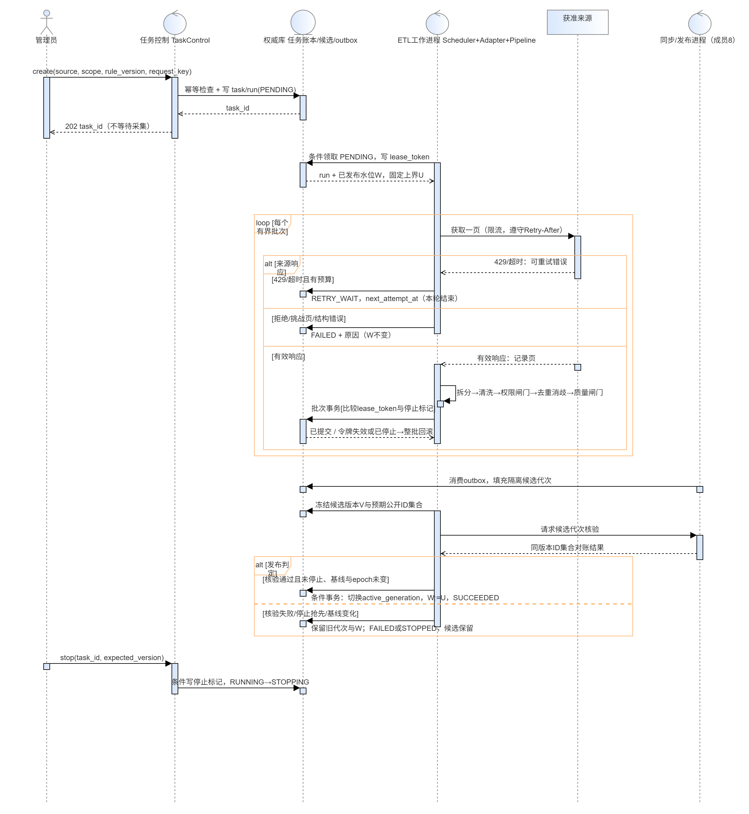

# 异步任务、增量更新与故障恢复 · 方案 B

成员 7 · 2026-11-16 · 配套[架构正文](01-data-pipeline-architecture-b.md)。运行时交互见 CodeArts 顺序图 M7-ARCH-02（[PNG](diagrams/codearts/M7-ARCH-02-codearts.png)、[SVG](diagrams/codearts/M7-ARCH-02-codearts.svg)）。

图中 1–4 为同步受理，API 立即返回，不等待采集；5–6 为工作进程条件领取；loop 内 alt 的三个分支分别对应可重试、不可重试和有效响应；15–20 为候选版本冻结、核验与条件发布；21–22 为停止请求。停止与第 19 步的发布事务竞争时，先成立者胜。

## 1 任务、尝试与状态

B 组沿用 [SPEC-M7-INGEST](../requirements/specs/SPEC-M7-INGEST.md) 与[状态转移表](../requirements/diagrams/collection-transitions.json)：

| 状态 | 含义 | 架构上的持有者 |
| --- | --- | --- |
| PENDING | 已受理，等待领取 | 任务账本 |
| RUNNING | 持有有效租约；stage 区分 FETCH / PROCESS / SAVE / AWAIT_PUBLISH | ETL 工作进程 |
| RETRY_WAIT | 可重试故障，等待 `next_attempt_at` | 任务账本 |
| STOPPING | 已受理停止，等待安全边界（内部状态，对外是否单列待确认） | ETL 工作进程 |
| STOPPED | 终态；重跑须创建新任务并引用 `previous_task_id` | 任务账本 |
| FAILED | 需人工处理；显式 retry 回 PENDING 并新增 `processing_run`（attempt + 1） | 任务账本 |
| SUCCEEDED | 候选版本已发布，水位已推进 | 任务账本 |

"清洗中""入库中""等待索引"都是 RUNNING 的 stage，不是新状态。没有 PARTIAL_SUCCESS：索引或核验失败时候选版本保留，任务 FAILED，公开数据保持旧代次。

## 2 受理、领取与执行代次

1. **受理（API 进程，同步）。** 从服务端会话取得操作者，核验任务管理权限与来源许可；按 `idempotency_record(account_id, operation_code, request_key)` 去重：同键同参数返回原任务，同键不同参数返回冲突。新任务与首个 `processing_run` 同事务写入，状态 PENDING，立即返回 `task_id`，不等待采集完成。
2. **同范围互斥。** 每个 `(source_code, scope_hash)` 同时至多一个非终态任务，建议用部分唯一约束保证；`sample` 模式使用独立范围，不推进线上水位。
3. **领取（ETL 进程，异步）。** 工作进程轮询账本，以条件更新领取 PENDING 或到期的 RETRY_WAIT 尝试（PostgreSQL 候选写法为 `FOR UPDATE SKIP LOCKED`），写入 `lease_owner`、`lease_until` 和新的 `lease_token`（执行代次令牌）。
4. **续约与回收。** 执行中定期续约；进程崩溃后租约过期，其他进程可重新领取并生成新令牌。旧进程之后的任何批次提交、状态变更、发布请求都比较令牌，不匹配即拒绝，因此"同一时刻至多一个有效写入者"由数据库条件写保证，不依赖进程自觉。
5. **来源级限流。** 同一来源跨任务、跨进程的请求速率由来源配额约束，默认每来源一个并发执行者；扩容 ETL 进程只提高不同来源的并行度。

选择数据库任务账本而不是消息中间件的理由与替代见 [03 ADR-M7-01](03-ab-comparison-and-adr-inputs.md)。

## 3 增量更新

| 进度 | 保存位置 | 推进条件 | 用途 |
| --- | --- | --- | --- |
| 候选检查点 | 候选版本 / `processing_run.checkpoint_ref` | 批次事务提交 | 同一候选版本内的崩溃恢复与 FAILED 后重试 |
| 来源成功水位 W | 已发布数据集（建议 `source_watermark`，绑定代次） | 发布事务提交 | 下一轮增量的起点；只随发布前进 |

**选择输入。** 读取当前已发布的 W，固定本轮上界 U（时间、游标快照或文件版本）并写入候选 manifest。按适配器能力选择模式：

- **可靠更新时间**：读取 `(W − 重叠窗口, U]`，按 `(更新时间, 稳定来源键)` 排序续读；重叠窗口按来源配置，待评审，不臆造天数。
- **只有游标**：游标只作为候选检查点；游标失效时从最后可验证 manifest 恢复，必要时转受控全量。
- **只有版本文件**：比较获准的新旧完整文件，属于受控快照差分，不称为精确增量。

**分类。** 以稳定来源键和规范化内容哈希判定：同键同哈希 unchanged（只计数），同键新哈希 update，新键 new；new/update 必须重新经过整个过滤器链。哈希不含请求时间或日志 ID。重叠窗口带来的重复输入按"来源键 + 哈希"幂等，不重复计数、不新建成果。

**撤回。** 仅在来源明确撤回标记或同范围完整快照差分成立时记录撤回，并同事务触发公开栅栏收缩（01 §5）；随后判断该成果是否仍有其他有效来源依据。

**多来源。** 候选 manifest 记录每个来源的旧水位与拟推进水位；未纳入本轮的来源保持原值。

## 4 停止、重试与发布竞争

| 场景 | B 组处理 |
| --- | --- |
| RUNNING 收到 stop | 条件写置停止标记并转 STOPPING；不再发新请求；当前批次在安全边界提交或回滚；保留检查点与账目后 STOPPED；W 不变 |
| RETRY_WAIT 收到 stop | 直接 STOPPED |
| 已 SUCCEEDED 后收到 stop | 返回既有成功，不改终态 |
| stop 与发布事务竞争 | 发布事务把"停止标记未设置"作为提交条件；先成立者胜，迟到结果丢弃 |
| 429 / 超时 / 可重试 5xx | RETRY_WAIT，遵守 Retry-After；无合法值时按 SPEC 的指数退避加抖动，预算耗尽 FAILED |
| 401 / 403 / 挑战页 / 许可拒绝 / 结构错误 | 立即 FAILED，记录原因，人工处理，不自动重试 |
| FAILED 后人工 retry | 新 `processing_run`，attempt + 1；若已发布基线未变，从候选检查点继续；基线已变则以新基线重建候选 |
| STOPPED 后重跑 | 新任务引用旧任务；已提交来源观测按"来源键 + 哈希"判为 unchanged，不重复入库 |
| 两个候选竞争发布 | 发布事务比较基线代次；后完成的旧基线候选被拒绝，须在新基线上重建并重新核验 |
| 候选代次构建失败 | RUNNING/AWAIT_PUBLISH 内有限重试，超预算 FAILED；不重新采集已保存输入 |

## 5 故障注入与可核验结果

| 编号 | 注入点 | 期望结果 |
| --- | --- | --- |
| F-01 | 同范围并发创建/启动 | 只有一个非终态任务；同键重放返回原任务 |
| F-02 | ETL 进程在批次提交前被杀 | 租约过期后另一进程接手，从最后已提交检查点继续，无跳批、无重复计数 |
| F-03 | 旧进程在租约过期后回写 | 令牌不匹配被拒绝，账目只入账一次 |
| F-04 | 来源返回 429 带 Retry-After | 不早于指定时点重试，审计记录退避 |
| F-05 | 来源返回 HTTP 200 挑战页 | FAILED，不计为空结果，不推进 W |
| F-06 | 批次中混入非法 DOI、空标题、同名作者 | 非法 DOI/空标题隔离，同名作者保持独立 ID |
| F-07 | 候选代次部分文档写入失败 | 集合对账发现差异，不切换代次，W 不变 |
| F-08 | 发布时恰好收到 stop | 二者只有一个生效；若 stop 胜，旧代次与 W 保持 |
| F-09 | 发布前来源撤回某成果 | 栅栏立即阻断旧代次新响应；新代次不含该成果，total 与统计分母一致 |
| F-10 | 重叠窗口重复输入、人工值冲突 | 不重复计数；人工值保留并生成复核事项 |

以上为设计层验收场景，交成员 10 编排故障注入。本包没有运行代码、没有执行过任何场景，也没有吞吐或延迟数据。
