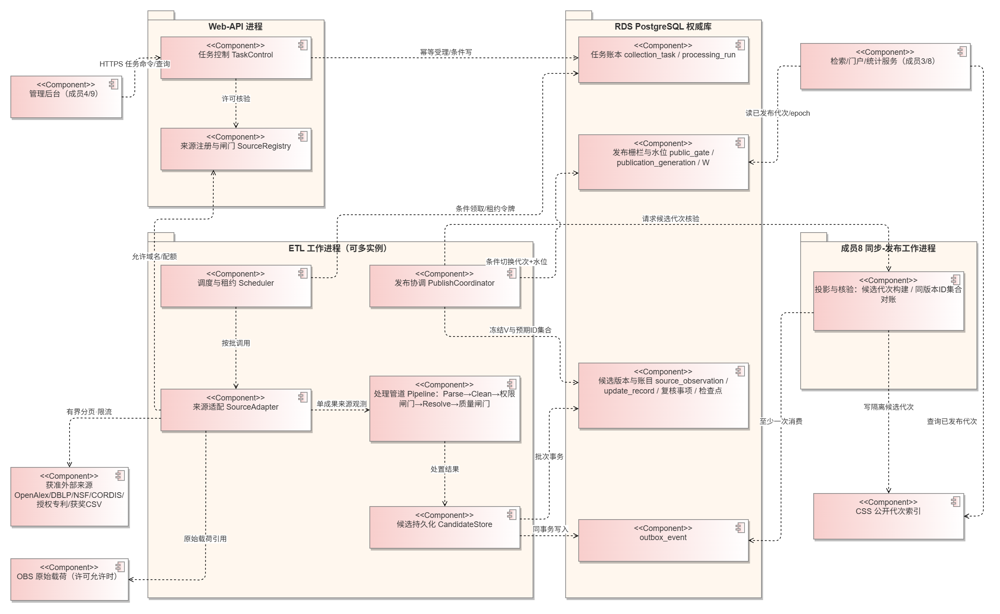
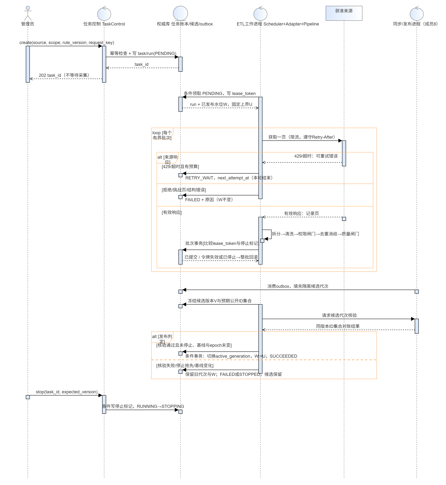

# 成员 7 架构设计供稿（方案 B，PH-7）

日期：2026-11-16。阶段：架构设计（第 9～11 周）。分支：`member-07/architecture-20261116`（从 `b@7d311e8` 创建）。汇编负责人：成员 6；复核负责人：成员 1。

## 职责

《双组并行开发与合并方案》第 5.4 节规定：成员 2、7 共同负责采集层、处理层、数据管道、异步化和增量更新架构。本目录是 B 组岗位供稿，用来替换成员 6 汇编稿 [02-system-architecture.md](../../member-06/architecture-20261118/02-system-architecture.md) 中的 PH-7 占位。A 组对应内容见成员 2 的分支 `member-02/architecture-20261105`。

## 文件

| 文件 | 内容 | 对应课程评审点 |
| --- | --- | --- |
| [01-data-pipeline-architecture-b.md](01-data-pipeline-architecture-b.md) | 构件划分与依赖规则、采集层、处理层、数据管道与一致性边界、部署映射、容量与观测、相邻岗位接口 | 逻辑架构分层与依赖；与需求分析一致 |
| [02-async-task-and-incremental.md](02-async-task-and-incremental.md) | 任务状态与租约、增量窗口与双进度、停止/重试/发布竞争、10 个故障注入场景 | 异步化、增量更新、可验证性 |
| [03-ab-comparison-and-adr-inputs.md](03-ab-comparison-and-adr-inputs.md) | A/B 共同点与差异、3 条 ADR 依据、同口径比较方法 | 方案比较；ADR 依据 |
| [diagrams/codearts/](diagrams/codearts/README.md) | **CodeArts 原生绘制**的 M7-ARCH-01 组件图和 M7-ARCH-02 顺序图（PNG/SVG）及导出登记 | 架构图 |

## 图

## 与成员 6、成员 8 稿的衔接

| 已有约束 | 本稿落实 |
| --- | --- |
| 成员 6：ETL 是独立后台数据通路，经受控发布接口交给存储和投影 | ETL 进程不写 CSS；发布只走 `public_gate` 的条件事务 |
| 成员 6：处理检查点不能证明已发布 | 候选检查点和来源成功水位 W 分开保存，W 只随发布前进 |
| 成员 6 ADR-02 / 成员 8 ADR-M8-002：outbox 作为至少一次投影通道 | 批次事务同事务写 outbox；outbox 只用来填充隔离候选代次，不能代替集合核验 |
| 成员 8 ADR-M8-003：公开栅栏 epoch | 撤回和许可收缩在同一事务里递增 epoch；发布事务要比较 epoch |
| 成员 8 数据字典 | 沿用 `collection_task`、`processing_run`、`source_observation`、`update_record`、`outbox_event`、`publication_generation`、`public_gate`；`collection_task.state_code` 的映射见 02 §1 |

## 完成边界

- 已完成：三篇 B 组架构正文；两张 CodeArts 原生图，已导出并归档。
- 没有做：核心代码、数据库迁移、运行或压测数据。表名沿用成员 8 的候选，不冻结公共契约。按根目录 `AGENT.md`，本阶段只做文档，不新建核心代码 AI 日志。
- 待人工：本人理解审阅；成员 8 衔接复核（尤其是候选代次构建回报和 `state_code` 映射）；成员 6 接入汇编稿替换 PH-7；成员 1/6 决定三条 ADR 依据是否采纳。

## AI 使用说明

本目录的文字起草、CodeArts 平台绘图操作（经本人授权、由本人登录）都由 AI 助手 Claude 辅助完成。内容依据仓库里已有的 SPEC、分析稿以及成员 2/6/8 的供稿，提交前需要本人审阅并对内容负责。这些不属于核心代码，所以不写进 `docs/ai/` 使用日志。
