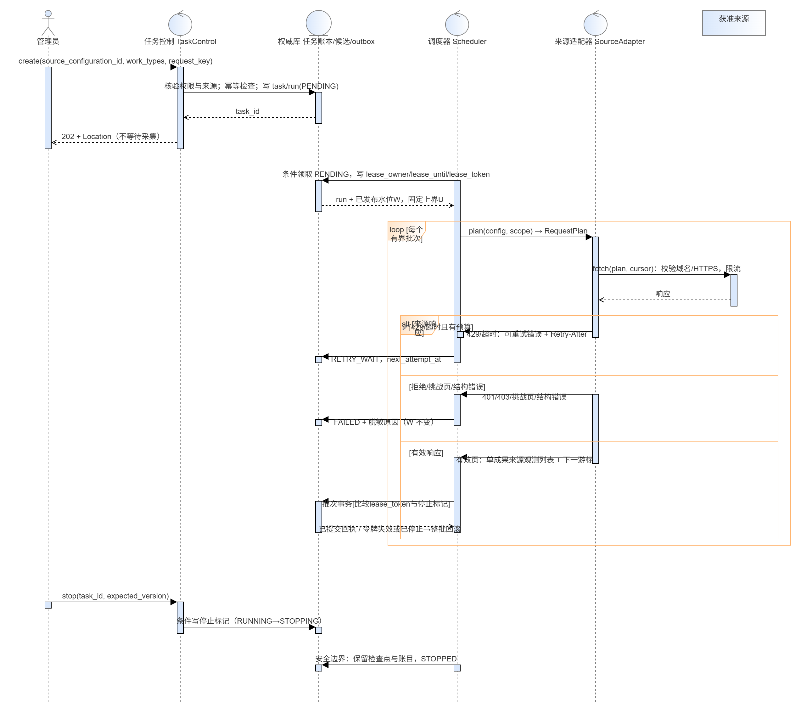

# 数据源适配与采集调度构件设计 · 方案 B

成员 7 · 第 10～12 周 · 2026-11-17 · 版本 0.1 · 状态：B 组岗位供稿，待成员 8 汇编、成员 3 复核。

对应《双组并行开发与合并方案》§5.5 中成员 2、7 的任务：数据源适配、爬虫调度、清洗、消歧、增量更新和数据质量设计。本篇覆盖前两项（适配器和调度），承接 [PR #14 的架构稿](../architecture/01-data-pipeline-architecture-b.md)和 [SPEC-M7-INGEST](../requirements/specs/SPEC-M7-INGEST.md)。清洗、消歧、增量与质量见 [02](02-processing-and-publication-b.md)，验收与汇编交接见 [03](03-validation-and-handoff-b.md)。

构件边界、表名和状态沿用成员 8 的[数据库候选](../../member-08/component-design/data/01-database-design.md)和 [OpenAPI 候选](../../member-08/component-design/api/01-api-design.md)。本篇不新增公共实体、字段或错误码；需要变更的地方列在 03 §4。

图 M7-COMP-01 为 CodeArts 原生绘制的顺序图（[SVG](diagrams/codearts/M7-COMP-01-codearts.svg)，[导出登记](diagrams/codearts/README.md)）。1–4 为同步受理，API 立即返回；5–6 为条件领取；loop 内 alt 的三个分支对应可重试、不可重试和有效响应；15–16 为批次事务；17–19 为停止。

## 1 构件清单

| 构件 | 持有的状态 | 对外契约 | 不做的事 |
| --- | --- | --- | --- |
| SourceRegistry 来源注册表 | 来源配置版本、允许域名、五类许可、配额、凭据引用 | `resolve(source_configuration_id) → SourceConfig`；`check(operation, scope) → 许可结论` | 不保存凭据明文；不接受任意 URL |
| SourceAdapter 来源适配器 | 请求计划、游标、文件校验值 | `plan(config, scope) → RequestPlan`；`fetch(plan, cursor) → Page` | 不写权威库；不做清洗 |
| Scheduler 调度器 | 任务账本行、租约、执行代次令牌、退避时间 | `claim() → Lease`；`renew(lease)`；`release(lease, outcome)` | 不理解来源响应内容 |
| BatchRunner 批次执行器 | 当前批次、检查点 | `run(lease, plan)`：循环取页 → 交管道 → 交 CandidateStore | 不绕过令牌校验提交 |
| TaskControl 任务控制 | 幂等记录、命令记录 | HTTP 命令入口，对应成员 8 的 5 个操作 | 不做外部 I/O |

## 2 来源适配

### 2.1 适配器能力声明

每个适配器启动时返回一份能力声明，调度器据此选增量模式，不按来源名写分支。

| 能力 | 取值 | 用途 |
| --- | --- | --- |
| `incremental` | `updated_time` / `cursor_only` / `file_version` / `none` | 决定增量输入怎么选（见 02 §3） |
| `page_limit` | 整数 | 单页上限 |
| `rate_policy` | 最小请求间隔、并发上限、窗口建议 | 调度器限流 |
| `retention` | 允许保存的字段集合 | 决定能写进 OBS 和权威库的内容 |
| `terminal_signal` | `last_page` / `snapshot_end` / `range_covered` | 判断"采完了" |

### 2.2 四类来源的适配路径

下表只写**已在调研里核实过**的能力，其余标"待核实"，不写进能力声明。依据是[数据源与合规分析](../research/需求调研-数据源与合规分析（成员2-成员7修订版）.md) §4。

| 成果 | 接入路径 | 增量能力 | 分页/终止 | 限流与合规 | 待核实 |
| --- | --- | --- | --- | --- | --- |
| 论文 | OpenAlex API；DBLP 月度持久化快照 | OpenAlex：`updated_time` 过滤待核实；DBLP：`file_version` | OpenAlex：`per_page` 最大 100，`cursor` 分页，普通分页最多 10,000 条；DBLP 快照：流式解析，记录 XML 与 DTD 的 URL、日期、哈希 | OpenAlex 每秒 100 请求硬限制，免费额度有日限；DBLP 连续请求间隔至少 1–2 秒，429 遵守 Retry-After | OpenAlex 增量过滤字段的实际可用性；API key 的申请和保管 |
| 专利 | 官方批量产品或已授权 API | 待核实 | 待核实 | 接入前必须取得授权；EPO OPS 免费额度每周 4 GB，自动任务建议在 GMT 19:00–07:00 或周末；USPTO 检索界面不是批量工具 | 具体选哪一路；授权是否取得 |
| 项目 | NSF 年度 JSON 或 Award API；CORDIS 官方开放数据包 | NSF：`file_version`；CORDIS：`file_version`，DET API 增量需注册 key | 文件按解析后的逻辑记录切分 | NSF 年度下载页核验时无可用导出，回退顺序为 年度 JSON → Award API → 搜索结果导出 | NSF API 的分页和限流；CORDIS 摘要权限 |
| 获奖 | 科技部授奖页面的事实字段，经人工核验后导入 CSV | `file_version` | CSV 固定编码和表头，按逻辑记录切分 | 半自动解析必须经人工批准后才能发布；人物介绍、照片等另行判断 | 无 |

没有取得授权或没有核实过的接入路径，设计中只保留适配器插槽，不写成"已支持"。NSFC 在取得书面授权前只允许少量人工核验，不做自动化；CNIPA 遇到登录、验证码或反自动化措施立即停止。

### 2.3 请求计划与响应校验

1. **请求计划**：任务创建时固定来源配置版本、规范化范围、规则版本、许可快照和运行上限，生成 `RequestPlan` 并随 `processing_run` 保存。同一任务重试沿用同一计划。
2. **取页**：有序页使用稳定排序键；有效游标写入当前批的检查点；冻结文件先校验哈希再流式读取；CSV 固定编码、表头和必填字段。
3. **响应校验**（顺序固定）：最终 URL 仍在允许域名且为 HTTPS → 状态码 → 内容类型与编码 → 字节上限 → 根结构 → 必需字段。HTTP 200 但无业务字段的挑战页按契约错误处理，不算成功，也不算空结果。证书校验失败即停止任务，不关闭 TLS 验证。
4. **终止判定**：以来源声明的末页、可信快照结束或计划范围已覆盖为准。空结果必须先通过响应契约校验。重复游标、结构变化、页上限提前耗尽、文件校验失败，都登记为失败或不完整。
5. **User-Agent**：按来源要求写项目名和版本；联系方式待团队统一确认，确定前不虚构邮箱。

### 2.4 许可检查的位置

| 检查点 | 检查什么 | 失败后果 |
| --- | --- | --- |
| 创建任务 | 来源启用、范围获准、`collect` 许可 | 拒绝创建，返回 403 或 409 |
| 每批请求前 | 许可快照仍有效 | 任务进入 FAILED，原因"许可失效" |
| 保存前 | 逐字段 `store` 许可 | 无存储依据的字段不进内部记录，只留摘要 |
| 发布前 | `display`、`export` 许可 | 不合格的字段不进公开候选 |

获取、存储、展示、导出四类许可分别判断，记录层获准不等于字段层获准。

## 3 调度与限流

### 3.1 任务领取

1. TaskControl 收到 create 命令：从服务端会话取得操作者，核验管理资格和来源权限；按 `(account_id, operation_code, request_key)` 查 `idempotency_record`，同键同参数返回原任务，同键不同参数返回 409；新任务与首个 `processing_run` 同事务写入，状态 PENDING，返回 202。
2. 同范围互斥：每个 `(source_code, scope_hash)` 同时至多一个非终态任务，用部分唯一索引保证（候选写法；建表归成员 8）。`sample` 模式使用独立范围，不推进线上水位。
3. Scheduler 轮询：以条件更新领取 PENDING 或到期的 RETRY_WAIT（PostgreSQL 候选写法为 `FOR UPDATE SKIP LOCKED`），写入 `lease_owner`、`lease_until` 和新的执行代次令牌。
4. 续约与回收：执行中定期续约；租约过期后其他进程可重新领取并生成新令牌；旧进程之后的所有写入都比较令牌，不匹配即拒绝。

### 3.2 限流

| 层级 | 规则 | 说明 |
| --- | --- | --- |
| 来源级 | 同一来源同一时刻默认一个执行者 | 扩容 ETL 进程不提高对单一来源的速率 |
| 请求级 | 按适配器 `rate_policy` 设最小间隔 | DBLP 连续请求至少间隔 1–2 秒 |
| 限额级 | 按实际响应字节和调用额度累计 | EPO 3.5 GB 告警、4 GB 硬停；OpenAlex 日额度用尽时进入 RETRY_WAIT 到次日 |
| 冷却级 | 收到 429 后更新来源级冷却时间 | 其他任务也要等，避免换个任务立即再打 |

### 3.3 重试与停止

沿用 SPEC-M7-INGEST §4，列出实现上的判定表：

| 事件 | 判定 | 去向 |
| --- | --- | --- |
| 429 | 优先解析 `Retry-After`（秒或 HTTP 日期） | RETRY_WAIT，`next_attempt_at` 不早于该时点 |
| 超时、临时网络错误、可重试 5xx | 无合法 Retry-After 时指数退避（候选 1/2/4/8 秒加抖动），最多 4 次自动重试 | RETRY_WAIT，第 5 次失败转 FAILED |
| 401、403、明确 412、验证码、许可拒绝、结构错误 | 不可自动重试 | FAILED，记录脱敏原因 |
| RETRY_WAIT 收到 stop | 直接 | STOPPED |
| RUNNING 收到 stop | 条件写停止标记 | STOPPING → 当前批次在安全边界提交或回滚 → STOPPED |
| 已 SUCCEEDED 后收到 stop | 返回既有成功 | 终态不变 |
| FAILED 后管理员 retry | 条件修复且权限有效 | 新增 `processing_run`，attempt + 1，回 PENDING |
| STOPPED 后重跑 | 不原地恢复 | 新建任务，引用 `previous_task_id` |

退避参数、最大次数、等待上限都是**候选配置**，不写成已批准值；具体取值由 1/6、5/10 在部署时确定，且不得比来源更严格的限制更松。

### 3.4 与成员 8 接口的对应

| 成员 8 的操作 | 本构件的承接 | 本篇的说明 |
| --- | --- | --- |
| `POST /admin/collection-tasks` | TaskControl.create | 202 只表示受理；只接收已审批的 `source_configuration_id` |
| `GET /admin/collection-tasks/{task_id}` | TaskControl.get | `state` 取值见 §3.5；`processed_count` 不等于公开成果数 |
| `POST …/stop-requests` | TaskControl.stop | 返回 command_id；`expected_version` 不匹配返回 409 |
| `POST …/retry-requests` | TaskControl.retry | 只对 FAILED 有效；STOPPED 返回 409 并提示"新建任务" |
| `GET /admin/task-commands/{command_id}` | TaskControl.getCommand | `command_state` 与任务 `state` 分开 |

### 3.5 状态到 `state_code` 的映射

成员 8 的 `collection_task.state_code` 标注"映射待数据岗批准"。B 组提议如下，供成员 8 汇编：

| B 组状态 | 说明 | 是否对外展示 |
| --- | --- | --- |
| PENDING | 已受理待领取 | 是 |
| RUNNING | 执行中；阶段另用 `stage` 字段 | 是 |
| RETRY_WAIT | 等待下次尝试 | 是 |
| STOPPING | 安全停止中 | 是否单列待 1/6 确认，建议展示为"停止中" |
| STOPPED | 终态 | 是 |
| FAILED | 需人工处理 | 是 |
| SUCCEEDED | 已发布 | 是 |

A 组的 QUEUED、PARTIAL_SUCCESS、可恢复的 STOPPED 与上表不同，两组差异保留，不强行统一。`stage` 取值 FETCH、PROCESS、SAVE、AWAIT_PUBLISH，只在 RUNNING 内有意义。

## 4 批次事务与回执

采用两层幂等键：

| 键 | 作用 | 范围 |
| --- | --- | --- |
| `task_id + batch_index + source_version` | 追踪同一任务内的重试和阶段计数 | 任务内 |
| `source_id + source_version + batch_hash` | 识别增量来源批次的重放 | 跨任务 |

一个批次在权威库中一次事务提交，**条件**为：`processing_run` 的执行代次令牌仍有效、停止标记未设置、批次键未被其他尝试提交。提交内容：

1. 来源观测（`source_observation`）与处置记录；
2. 更新记录（`update_record`）；
3. 复核事项；
4. 候选版本中的规范内容版本与来源到成果的映射；
5. 批次账目：`read = valid + quarantine + filtered`；`valid = new + updated + unchanged + duplicate`；
6. 候选检查点；
7. outbox 待办（目的地为候选投影）。

条件不满足（旧执行者、已停止、批次已提交）时整批回滚并返回原因，不做部分写入。提交结果未知（如网络中断）时，用批次键查回执：已提交则复用原回执，未提交则重做。原始载荷先写 OBS 再引用；事务回滚后，同内容哈希的重放复用，没有引用的载荷按保留策略清理。

**检查点规则**：检查点只能跨过连续且已有持久处置的输入。批级读取失败、未知缺页或提交失败时保留此前位置。隔离记录是有处置的结果，可以越过。
