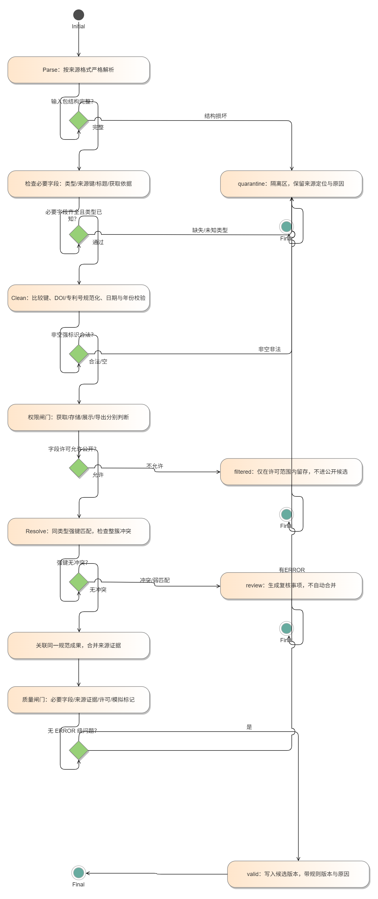

# 清洗消歧、增量更新与数据质量构件设计 · 方案 B

成员 7 · 第 10～12 周 · 2026-11-17 · 版本 0.1 · 状态：B 组岗位供稿。对应 [SPEC-M7-CLEAN](../requirements/specs/SPEC-M7-CLEAN.md)、[SPEC-M7-RESOLVE](../requirements/specs/SPEC-M7-RESOLVE.md)、SPEC-M7-INGEST §5–§6，承接 [01 来源与调度](01-source-and-scheduling-b.md)和 [PR #14 架构稿](../architecture/01-data-pipeline-architecture-b.md)。

处理层是进程内过滤器链：`Parse → Clean → 权限闸门 → Resolve → 质量闸门`。过滤器无共享可变状态，同一输入和规则版本得到同一输出，便于用固定夹具做单元测试。本篇描述每个过滤器的输入输出、判定顺序和失败去向，不写具体实现代码。



图 M7-COMP-02 为 CodeArts 原生绘制的活动图（[SVG](diagrams/codearts/M7-COMP-02-codearts.svg)，[导出登记](diagrams/codearts/README.md)），表示单条观测经过 Parse、必要字段、Clean、权限闸门、Resolve、质量闸门后落到 `valid` / `quarantine` / `filtered` / `review` 四种处置之一。菱形上方的文字是判定问题，出边标签是分支条件。

## 1 过滤器的统一契约

| 项 | 内容 |
| --- | --- |
| 输入 | 一条 `SourceObservation`：来源命名空间、来源键、原值引用、获取时间、许可快照、模拟标记 |
| 输出 | 一条 `Disposition`：`valid` / `quarantine` / `filtered` / `review`，加上原因代码、字段级证据、规则版本 |
| 约束 | 不访问网络；不直接写库；不静默丢弃；`valid` 只表示候选处理通过，不等于已公开 |
| 追溯 | 每个输出带 `rule_version`，原值只在许可允许的范围内保留 |

四种处置的去向：

| 处置 | 含义 | 去向 | 是否计入候选版本 |
| --- | --- | --- | --- |
| `valid` | 通过全部检查 | 进入候选版本 | 是 |
| `quarantine` | 非法强标识、空标题、未知类型等硬错误 | 隔离区，保留来源定位和原因 | 否 |
| `filtered` | 许可不允许公开或展示 | 仅在许可范围内留存，不进公开候选 | 否 |
| `review` | 强键冲突、传递簇矛盾、弱匹配 | 复核事项，不自动合并 | 否，直到人工结论 |

## 2 清洗（Clean）

### 2.1 判定顺序

| 步骤 | 检查 | 失败去向 |
| --- | --- | --- |
| 1 | 输入包结构：编码、CSV 列数、JSON/XML 格式；XML 禁用外部实体和网络 DTD | 整包错误：停止该包，保留已处理计数和原因，不逐字修乱码 |
| 2 | 必要字段：类型、来源键、标题、获取时间/依据 | `quarantine` |
| 3 | 文本比较键：Unicode NFKC、去首尾空白、连续空白折成一个、拉丁字符 casefold；显示值只规范空白 | — |
| 4 | 强标识规范化（DOI、专利号） | 非空但非法：`quarantine`，**不**置 null 后继续匹配 |
| 5 | 日期、年份、引用数校验 | 非法值：该字段记问题，记录是否整体隔离按字段重要性定 |
| 6 | 领域与机构映射 | 未映射：保留原标签并记 unknown |

### 2.2 字段规则一览

| 字段 | 规则 | 边界 |
| --- | --- | --- |
| 标题 | 比较键与显示值分开；繁简、拼音、译名不自动视为等价；不删除标点后强行合并 | 空或纯空白：隔离 |
| DOI | 去 `doi:`、`https://doi.org/`、`http://doi.org/`、`dx.doi.org` 前缀（大小写不敏感），解码百分号并转小写；须匹配 `10.<4–9 位数字>/<非空后缀>`，无空白、查询串、片段；尾部标点保留 | 格式合法不代表已注册；真实解析另验 |
| 专利公开号 | 保留局别、数字和 kind code，空白可删、字母大写；申请号另存 | A1、B1 不同文献阶段不自动合并；是否按专利族归并属待决业务规则 |
| 年份 | 1000–9999；布尔值不当整数；null 表示未知 | 0 和无法解释的字符串非法；不用当前年补齐 |
| 日期 | 按来源声明的格式严格解析，校验闰年和月日；保留 year/month/day 精度 | 项目起始晚于结束：隔离；未来起始日期可以是计划项目，不因此判错 |
| 引用数 | 非负整数或 null | 缺失不补 0；布尔值、负数非法；保留来源和观察时间 |
| 缺失语义 | null＝未知；`[]`＝确认无关联；0＝确认数量为零 | 来源未给作者/机构列表时用未知标志，不伪造空关联 |
| 领域 | 保留来源体系、代码和版本，按已批准映射表映射公共领域 | 未知进 unknown 并记原因；record type 不属于学科领域 |
| 金额 | 保留币种和原精度 | 不跨币种相加 |
| 摘要 | 许可单独判断 | 无依据不公开；不由 AI 补写科研事实 |

## 3 权限闸门

获取、存储、展示、导出四类许可对每个字段分别判断。

| 情形 | 处理 |
| --- | --- |
| 无合法存储依据 | 载荷不继续保存，只留许可范围内的字段与摘要 |
| 许可待审、受限或禁止展示 | 不进入公开候选；在允许的范围内非公开留存 |
| 来源不得再分发原包（如 EPO OPS） | 原包不进入 A/B 共享基准，使用获准输入或模拟夹具 |
| 模拟数据 | 保留模拟标记，不得在清洗时丢失，统计分列 |

闸门输出 `filtered` 或放行；放行的字段才进入 Resolve。

## 4 去重与消歧（Resolve）

### 4.1 成果去重

同类型内按强键判定，**不同类型永不自动合并**：

| 类型 | 自动匹配强键 | 不自动合并 |
| --- | --- | --- |
| paper | 相同规范化 DOI；或同来源相同 Work ID / DBLP key | DOI 不同或标题/类型严重冲突；仅同标题 |
| patent | 局别 + 公开号 + kind code | 同申请号但不同公开阶段；同专利族 |
| project | 同资助方/来源命名空间 + 项目号 | CORDIS/NSF/NSFC 恰好数字相同 |
| award | 公告体系 + 年度 + 奖项类别 + 项目编号 | 同名项目跨年度获奖；不同奖项类别 |

决策流程：

```
强键命中 ──┬─ 无冲突 ────────────→ 关联同一规范成果，合并来源证据
           └─ 强标识互斥 / 类型冲突 / 标题核心冲突 → review（不覆盖）
无强键 ────→ 以规范化标题 + 年份 + 至少一位明确关联作者 + venue 形成阻塞组
              → 只生成复核提议，不自动合并
```

**传递冲突**：不使用无约束并查集。A–B 共享一个 ID、B–C 共享另一个 ID 时，先检查整个候选簇内同一强标识命名空间是否有多个互斥值；有矛盾则整个受影响簇进入 `review`，不把 C 静默吸入 A。

重跑同来源键且载荷相同为 `unchanged`；同来源键载荷变化为 `update` 候选，不新建重复成果。

### 4.2 字段选择与稳定 ID

- 相同规范值合并来源证据；非空值与未知值并存时选有依据的非空值；同字段不同非空值保留候选及各自时间，不按"文件最后一行"覆盖。
- 来源优先级必须版本化并经评审，**不授予任何来源全字段最高权威**。
- 引用数保留来源与观察时点，不相加、不跨来源取最大；公开选择某一来源作显示源时，其他来源缺失不覆盖它。
- 新成果 ID 由持久化 ID 注册映射分配，不从行号生成；重跑和输入顺序变化不换 ID。合并保留存续 ID 和旧 ID 重定向；拆分由管理员确认并分配新映射，旧记录和审核证据保留，查询/门户/统计重建相应版本。

### 4.3 作者消歧

| 证据 | 作用 |
| --- | --- |
| 经校验的 ORCID（先查格式和校验位）、同来源作者 ID、已批准的跨源映射 | 强证据，可自动关联（需无互斥身份 ID 和明显上下文冲突） |
| 同名、同机构、共同作者、研究领域、年份 | 只作辅助，**不单独赋予同一身份** |
| ORCID 不同 | 不自动合并 |
| 同名无强证据 | 保持多个学者 ID，并向成员 8 提供可公开的机构/领域区分线索 |

一位作者可有多个机构和多个时期的机构变化；不能因机构变化拆成新人，也不能因机构相同合并同名人。低置信度关联进入人工复核；未确认关系**不用于门户归属或合作网络边**；消歧不触发门户认领通过、账号绑定或写权限。管理员记录选择、证据、日期和规则版本。

### 4.4 机构归一化

- 可信 ROR 或同来源机构 ID 精确匹配优先；没有标识时只用已批准、带版本的别名表。
- 仅去空白或大小写可生成比较键，不据名称相近自动跨机构合并。
- 大学、学院、附属医院及历史更名分别处理；父子关系不替代身份相等。
- 未匹配机构保留来源名称及未解析状态，不凭常识猜所属学校。

### 4.5 复核事项

`ReviewCase` 承接非法值、强键冲突、传递簇矛盾、弱匹配、人工值冲突。字段：证据引用、问题类别、候选值、结论或待定、操作人、日期、规则版本。复核期间：相关候选不进公开版本；字段继续使用上次已批准值。

## 5 质量闸门

质量闸门是进入候选版本前的最后一道检查，也是发布前核验的输入之一。

| 检查 | 严重度 | 结果 |
| --- | --- | --- |
| 必要字段缺失 | ERROR | 阻断，`quarantine` |
| 来源证据缺失或许可不全 | ERROR | 阻断，`filtered` |
| 类型未知 | ERROR | 阻断，`quarantine` |
| 高严重度冲突未处理 | ERROR | 阻断受影响内容 |
| 完整率、分布异常、疑似重复 | WARNING | 进入批次报告，不阻断 |
| 统计用计数 | INFO | 供统计和对账使用 |

### 5.1 批次账目与计数

每个输入行只属于一个处置类别：

```
read_rows  = valid_rows + quarantine_rows + filtered_rows
valid_rows = new_rows + updated_rows + unchanged_rows + duplicate_rows
```

两个等式按**来源行**分类，不等于成果总数。`new_rows` 可能多个来源指向同一新成果，所以发布版本的 `canonical_count` 另按唯一成果 ID 核对。来源总量未知时进度显示已处理数量和"总量未知"，不编造百分比。重复输入、失败、停止和隔离不膨胀规模计数。真实/模拟、四类成果和许可状态分别报告。

### 5.2 质量指标

| 指标 | 定义 | 说明 |
| --- | --- | --- |
| 隔离占比 | `quarantine_rows / read_rows` | 分母为 0 时报"不适用" |
| 必填字段完整率 | 按发布版本、按类型分别统计 | 只用于发现问题，不设未经批准的阈值 |
| 去重 Precision / Recall / F1 | 以候选记录对为单位：`P = TP/(TP+FP)`，`R = TP/(TP+FN)`，`F1 = 2PR/(P+R)` | 需要独立人工标注，样本含正负例；零分母报"不适用"，不填 100% |
| 作者消歧 P/R/F1 | 以作者提及到学者实体映射为单位 | 样本含同名、跨机构、缺标识 |
| 公开字段泄漏次数 | 未允许字段进入公开层的次数 | 必须为 0 |
| 复核队列 | 大小和最老年龄 | 用于运维观测 |

早期调研提出的"200 条/对、F1 ≥ 0.95"等阈值是**待议目标**，没有独立标签集之前不宣称已达标。

## 6 增量更新

沿用 PR #14 的双进度设计：候选检查点（恢复用）和来源成功水位 W（只随发布前进）。

### 6.1 选择输入

| 能力 | 输入范围 | 备注 |
| --- | --- | --- |
| `updated_time` | `(W − 重叠窗口, U]`，按 `(更新时间, 稳定来源键)` 排序续读 | 重叠窗口按来源配置，待评审，不臆造天数 |
| `cursor_only` | 游标只作候选检查点 | 游标失效：从最后可验证 manifest 恢复，必要时转受控全量 |
| `file_version` | 比较获准的新旧完整文件 | 属于受控快照差分，不称为精确增量 |
| `none` | 受控全量比较 | 同上 |

读取前固定本轮上界 U（时间、游标快照或文件版本）并写入候选 manifest。

### 6.2 变化分类

| 情形 | 分类 | 处理 |
| --- | --- | --- |
| 新键 | `new` | 经完整过滤器链 |
| 同键同哈希 | `unchanged` | 只计数 |
| 同键新哈希 | `update` | 经完整过滤器链；与人工值冲突时并存两份证据，继续用上次批准值 |
| 来源明确撤回，或同范围完整快照差分成立 | `withdraw` | 同事务递增公开栅栏 epoch（见架构稿 §5）；再判断该成果是否还有其他有效来源依据 |
| 单页缺失、网络失败、导出不完整 | 不是撤回证据 | 保留旧观测 |

哈希依据获准的规范化内容计算，不含请求时间和日志 ID。同来源键同版本出现不同哈希：转来源冲突，保留旧观测。无法可靠排序的多版更新交治理。

### 6.3 更新记录

`update_record` 记录成果前后版本、来源观测、规则版本、变更时点。同一变化重放不重复累计（以来源键 + 版本 + 哈希判重）。更新报告分别列出新增、修改、撤回、未变化、冲突和失败，并关联任务、来源版本、检查点和发布水位。

## 7 发布准备（数据侧）

数据侧负责到"冻结候选版本"为止，之后的索引构建和对账由成员 8 的同步/发布进程完成（接口语义见 PR #14 的架构稿 §5 和 §8）。

| 步骤 | 数据侧输出 |
| --- | --- |
| 批次提交 | 候选内容、账目、检查点、outbox 事件（同一事务） |
| 冻结候选版本 | 候选版本标识 V、预期公开成果 ID 集合、本轮上界 U、规则与许可策略版本 |
| 请求核验 | 把 V 交给成员 8 的进程，等待同版本 ID 集合对账结果 |
| 条件发布 | 条件事务：当前发布代次仍是本轮基线、任务代次有效、无停止标记、`public_gate.epoch` 未变 → 切换发布代次、推进 W、任务 SUCCEEDED |
| 任一条件失败 | 保持旧代次与 W，候选保留供重试或重建 |

候选基于旧基线、而新版本已先发布时，在新基线上重建候选并重新核验，不允许后完成的旧候选覆盖先发布的更新。
