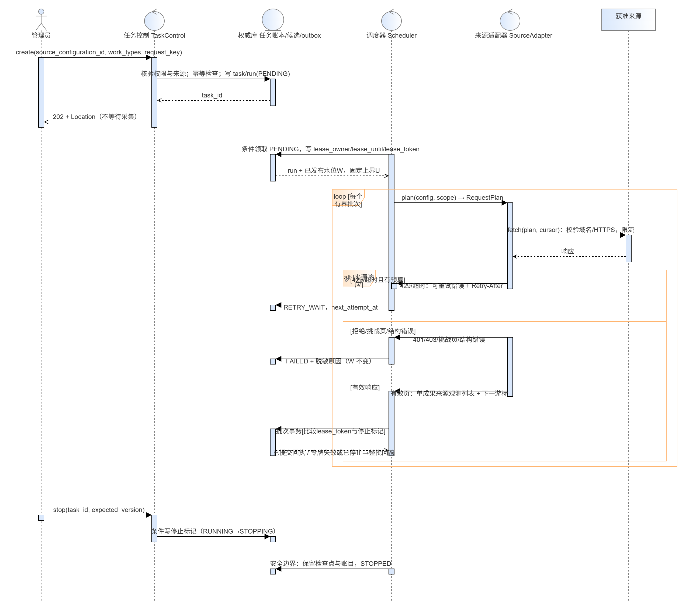
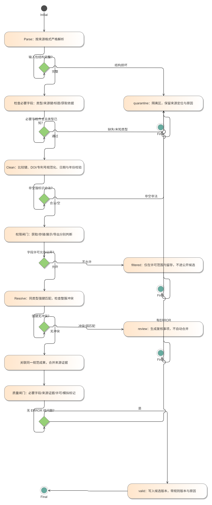

# 成员 7 构件设计供稿（方案 B）

日期：2026-11-17。阶段：构件设计（第 10～12 周）。分支：`member-07/component-design-20261117`（从 `b@16149d5` 创建）。汇编负责人：成员 8；复核负责人：成员 3。

## 职责

《双组并行开发与合并方案》§5.5：成员 2、7 共同编写数据源适配、爬虫调度、清洗、消歧、增量更新和数据质量设计。本目录是 B 组岗位供稿，承接 [PR #14 架构稿](../architecture/README.md)，沿用成员 8 的[数据库候选](../../member-08/component-design/data/01-database-design.md)和 [OpenAPI 候选](../../member-08/component-design/api/01-api-design.md)。A 组对应稿见成员 2 的 `member-02/component-design-20261116`（PR #15）。

## 文件

| 文件 | 内容 | 对应 SPEC |
| --- | --- | --- |
| [01-source-and-scheduling-b.md](01-source-and-scheduling-b.md) | 构件清单、适配器能力声明、四类来源接入路径、响应校验、许可检查点、任务领取与限流、重试与停止判定表、与成员 8 接口的对应、`state_code` 映射、批次事务与回执 | SPEC-M7-INGEST |
| [02-processing-and-publication-b.md](02-processing-and-publication-b.md) | 过滤器统一契约、清洗字段规则、权限闸门、去重与消歧、机构归一化、质量闸门与计数口径、增量分类、发布准备 | SPEC-M7-CLEAN、RESOLVE、INGEST §5–6 |
| [03-validation-and-handoff-b.md](03-validation-and-handoff-b.md) | 17 个验收场景、可复算算例、容量与恢复试验计划、公共契约待确认事项、汇编接点 | AC07-01～24 |
| [diagrams/codearts/](diagrams/codearts/README.md) | CodeArts 原生绘制的两张图及导出登记 | — |

## 图

## 与已有材料的关系

| 已有材料 | 本稿的对应 |
| --- | --- |
| PR #14：双进度（候选检查点 / 来源成功水位）、租约令牌、候选版本优先发布 | 01 §3、§4 和 02 §6、§7 把它们落成判定表和账目等式 |
| 成员 8 数据字典：`collection_task.state_code` 标注"映射待数据岗批准" | 01 §3.5 给出七个状态 + `stage` 的提议 |
| 成员 8 OpenAPI：STOP/RETRY 是意图，B 组新任务规则"由成员 7 确认" | 01 §3.3–§3.4：STOPPED 为终态，retry 对 STOPPED 返回 409 并提示新建任务 |
| 成员 6 门禁 G5、G6 | 03 §1 的 B-C05、B-C06、B-C14、B-C15 |
| A 组成员 2 构件设计 | 差异保留在架构稿 03；本稿不改写 A 组语义 |

## 完成边界

- 已完成：三篇构件设计正文、两张 CodeArts 图、Word 合并稿。
- 没有做：核心代码、数据库迁移、接口实现、运行测试。技术栈尚未确定（根目录 `AGENTS.md`），所以本稿不写具体框架、版本、命令。所有验收场景都是设计目标，没有执行。
- 待人工：本人理解审阅；成员 8 汇编与衔接复核（见 03 §4 的 C-1～C-5）；成员 1/6 决定 C-2、C-6～C-8。

## AI 使用说明

本目录的文字起草和 CodeArts 平台绘图操作由 AI 助手 Claude 辅助完成（本人授权、本人登录），内容依据仓库已有的 SPEC、调研、分析稿和成员 2/6/8 的供稿。提交前需要本人审阅并对内容负责。按根目录 `AGENT.md`，这些不属于核心代码，不写进 `docs/ai/` 使用日志。
