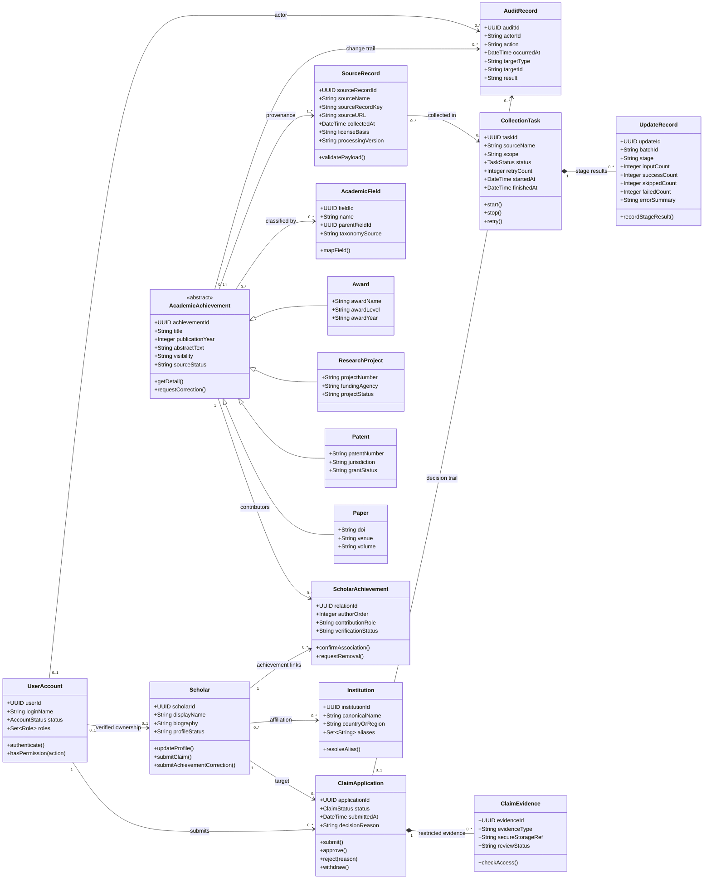

# 学术成果分享平台核心业务类图与说明

- 阶段：第 7–8 周需求分析
- 版本：0.1（需求分析候选稿，待成员 1/6 审核）
- 贡献：成员 10（方案 B；负责与 SRS 一致性检查、支撑材料和汇报材料）
- 依据：课程实践任务书“需求分析”章节、统一需求调研报告、统一需求边界 R01–R15。
- 说明：本模型是**分析层业务模型**，不等同于数据库表设计或最终 API 契约。属性和操作为业务语义候选，需经小组评审后冻结。

## 1. 建模范围与原则

系统一期围绕四类学术成果的发现、学者门户认领、成果维护、公开数据采集治理与统计分析展开。核心对象包括学者、学术成果及其类型、机构、领域、账号、认领申请、采集任务和更新记录。

1. **身份与成果分离**：`Scholar` 表示科研人员，`UserAccount` 表示登录账号；二者通过认领通过后的关系建立授权，不能因姓名匹配就自动授予维护权。
2. **原始来源与规范成果分离**：`SourceRecord` 保存来源侧记录及追溯信息，`AcademicAchievement` 表示平台规范化后的成果。多条来源记录可以映射到同一规范成果。
3. **成果与学者采用多对多关系**：一项成果可有多位作者，一位学者可关联多项成果；关系上保留作者角色、顺序及归属确认状态。
4. **成果类型显式建模**：论文、专利、科研项目、获奖共享公共属性，同时保留类型特有字段。实现时可采用继承或类型字段加扩展信息；本图表达业务语义，不预设数据库实现。
5. **敏感证明与公开数据分离**：认领申请可关联受控证据引用，证明内容不能作为公开门户字段或进入公开检索索引。
6. **操作可追溯**：采集、清洗、去重、更新和人工修正均应关联任务、批次、来源或变更记录。

## 2. 核心业务类图

## 3. 类与职责说明

| 类/概念 | 职责与关键约束 | 对应需求 |
|---|---|---|
| `UserAccount` | 登录状态、角色、服务端权限校验；前端隐藏按钮不能代替后端鉴权 | R01 |
| `Scholar` | 学者基础资料与门户状态；姓名不作为唯一标识 | R06–R09 |
| `Institution` | 机构规范名称和别名归一化；同名机构需稳定标识 | R03、R06、R10 |
| `AcademicField` | 领域分类及父子层级；保留分类来源和映射依据 | R06、R10 |
| `AcademicAchievement` | 四类成果共享字段、公开状态和规范 ID | R02、R05–R06 |
| `Paper/Patent/ResearchProject/Award` | 类型特有信息；不把四类成果压成含义不清的自由文本 | R02、R05 |
| `ScholarAchievement` | 表达多作者、作者顺序和归属确认；移除关联不删除公共成果本体 | R07、R09 |
| `SourceRecord` | 记录来源键、链接、许可依据、采集时间、处理版本；支持来源追溯 | R02–R04、R14 |
| `ClaimApplication` | 申请状态、审核结论和理由；通过时才建立账号—学者授权 | R08 |
| `ClaimEvidence` | 受控保存证明引用与审核状态；不进入公开索引 | R08、R14 |
| `CollectionTask` | 创建、运行、停止、失败、重试及状态查询 | R04、R11 |
| `UpdateRecord` | 记录采集、清洗、入库、索引等阶段计数和错误 | R03–R04、R11 |
| `AuditRecord` | 记录审核、权限和关键数据变更的操作者、时间、对象与结果 | R08–R09、R14 |

## 4. 关系与生命周期约束

- **成果与来源**：规范成果可能由多个来源记录支持；去重合并应保留来源记录和合并依据，不应删除原始来源证据。
- **学者与成果**：通过关联类 `ScholarAchievement` 维护。删除某位学者的关联不意味着删除其他作者仍在使用的成果。
- **认领与授权**：`ClaimApplication` 的通过、授权建立和审计写入应作为一致的业务操作处理；若保存失败，不得出现“申请已通过但没有权限”。
- **采集任务与更新记录**：一次任务包含多个处理阶段记录。HTTP 200 但内容类型、响应结构或业务字段不正确，仍应记录为失败。
- **分类与统计**：成果可关联多个领域。统计结果必须声明快照、时间范围、去重口径及多标签计数规则。
- **未知与零值**：缺失、未知和真实数值 0 分开表示，不将缺失资料推断为“没有成果”。

## 5. 待小组确认项

1. 账号与学者门户的关系是否允许一个账号管理多个学者档案，或多个账号共同管理一个档案。
2. 成果分类采用单主领域还是多领域标签；统计时是否允许跨标签重复计数。
3. `AcademicAchievement` 的类型扩展采用继承还是单表类型字段。
4. 认领证据允许的种类、保存期限、申诉与争议处理规则。
5. 来源记录与规范成果之间的基数，以及合并/拆分操作的审核权限。

以上为分析模型候选项。冻结前由成员 1、6 审核公共业务边界，成员 3、8 校验业务语义，成员 2、7 校验数据来源与处理链路。
