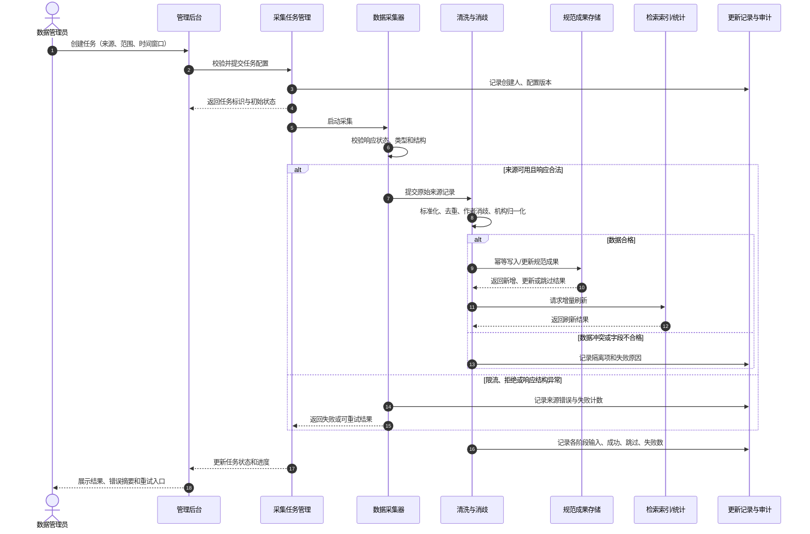
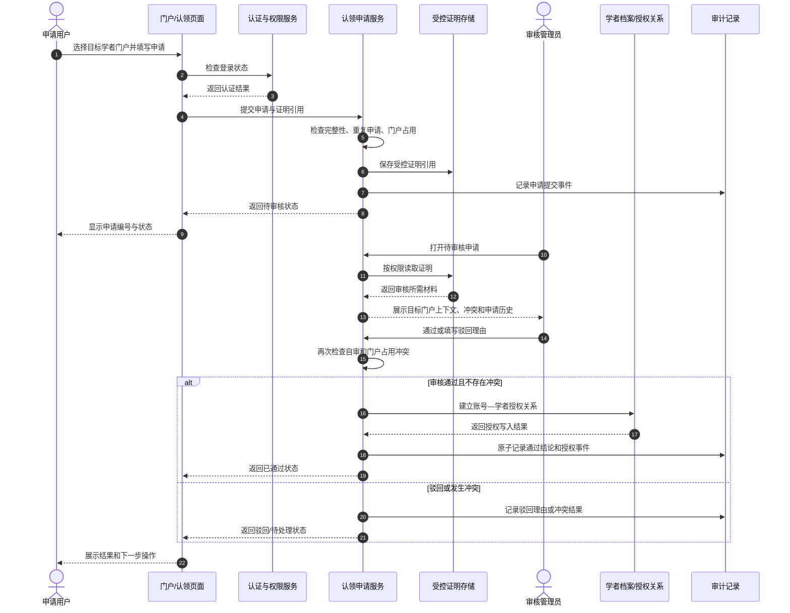
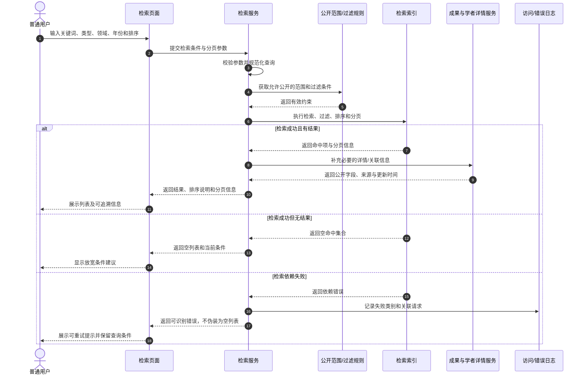

# 关键用例交互模型（时序图）

- 阶段：第 7–8 周需求分析
- 贡献：成员 10（方案 B 支撑材料）
- 状态：需求分析候选稿；不冻结具体技术栈、数据库或 API 路径。
- 依据：课程任务书要求的数据采集入库、门户认领审核、检索请求处理三条时序图；统一需求 R01–R14。

## 1. 数据采集、清洗与入库

**分析约束**

- 创建任务时冻结来源、范围和配置版本，方便复现。
- 重试必须幂等；重复执行不能重复增加同一规范成果的计数。
- `401/403`、验证码或明确拒绝不得通过绕过限制继续采集；`429` 应按来源策略退避。
- 数据库写入成功但索引刷新失败时，保留待同步状态并支持重试，不能把整条链路误报为完全成功。
- 各阶段分别计数，避免仅以“请求成功”推断“数据已入库且可检索”。

## 2. 门户认领与审核

**分析约束**

- 姓名匹配仅用于定位候选门户，不是认领通过的充分条件。
- 审核者不得审核自己的申请；审核结论必须有理由或可追溯依据。
- 申请通过与授权建立必须保持一致。若授权写入失败，不得显示为已通过。
- 证明材料仅对获授权的审核人员可见，不进入公开页面、普通日志或检索索引。
- 驳回后可按规则重新提交新申请，历史申请保留。

## 3. 检索请求处理

**分析约束**

- 空结果与依赖不可用是不同业务结果，不能混为一谈。
- 排序字段、筛选条件、页码和每页条数应被校验；排序口径应能向用户解释。
- 只返回允许公开的字段，认领证明、审核备注、凭证和内部审计内容不得出现在结果中。
- 同名学者需要展示机构、领域或代表成果等上下文，不自动合并身份。
- 详情服务或索引暂时不可用时，返回明确错误或降级状态，不拼造虚假数据。

## 4. 模型与需求追踪

| 交互模型 | 相关需求 | 关键验收观察 |
|---|---|---|
| 数据采集入库 | R02、R03、R04、R05、R11、R14 | 同一批次能追溯来源、阶段计数、失败原因；重复重试不产生重复规范成果 |
| 门户认领审核 | R01、R07、R08、R09、R14 | 未登录不能提交；待审核不授予权限；自审被阻止；通过与授权一致；证明不公开 |
| 检索请求处理 | R01、R05、R06、R07、R10、R14 | 支持过滤分页排序；区分空结果和依赖失败；仅公开合法字段 |

## 5. 待评审事项

- 是否需要把“检索学者”和“检索成果”拆成两个独立时序图。
- 采集链路中的“待审核数据”是否由平台统一业务规则控制，还是特定来源适配器处理。
- 统计服务是检索请求的同步调用，还是独立的分析请求；本模型只表达业务边界。
- 认领申请的正式状态值域、超时处理、申诉与撤回规则需由成员 1、6 确认。
