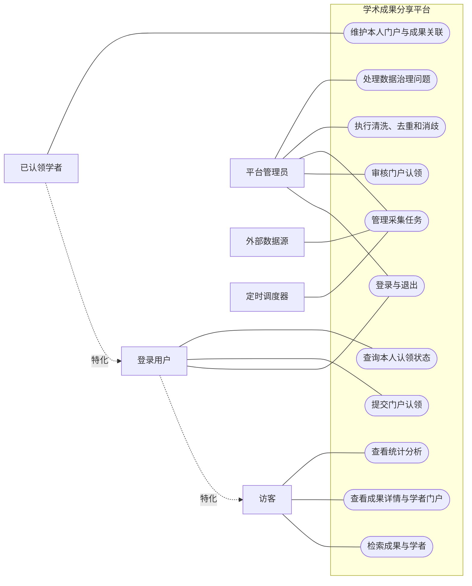
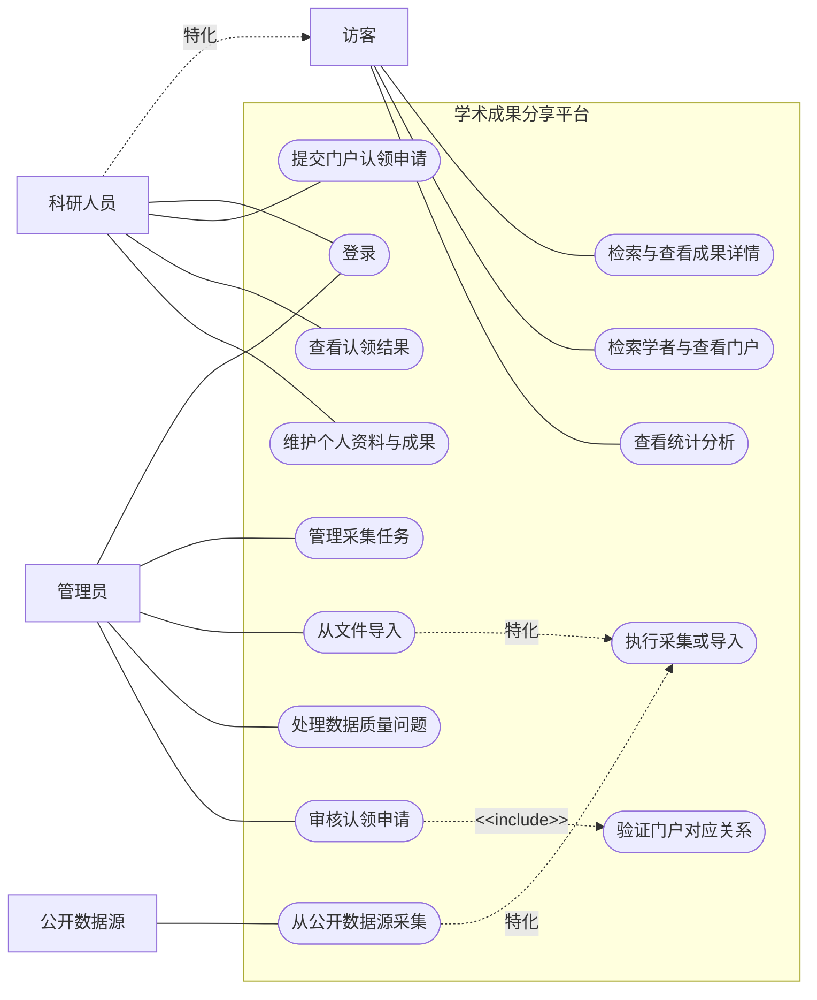

# 成员1、6系统用例图参考

本目录依据远程 `a` 分支成员1的需求建模贡献和远程 `b` 分支成员6的用例模型整理。课程任务书要求绘制一张系统用例图，成员1、6共同负责；下面两份是两人的候选画法，供对照和复画，不是两张需要分别提交的正式图。

同步日期：2026-10-12。已获取全部远程分支；`main` 已执行快进拉取且无需更新（`30f7d08`）；读取 `origin/a`（`03cfa3f`）、`origin/b`（`90181c7`）中的最新候选材料。其他成员新上传材料没有在本次自动合入main。

下面的Mermaid图是便于阅读的关系预览：矩形角色在正式UML中请改用人形或参与者符号，带“特化”的虚线在正式UML中请改为实线加空心三角。准确的UML符号以PlantUML源稿及导出的图片为准。

| 参考稿 | 可视化 | PlantUML源稿 | 主要特点 |
| --- | --- | --- | --- |
| 成员1（方案A） | [PNG图片](member-01-use-case-reference.png)、[SVG矢量图](member-01-use-case-reference.svg) | [member-01-use-case-reference.puml](member-01-use-case-reference.puml) | 区分访客、登录用户、已认领学者；细分数据治理；以登录/授权作为前置条件 |
| 成员6（方案B） | [PNG图片](member-06-use-case-reference.png)、[SVG矢量图](member-06-use-case-reference.svg) | [member-06-use-case-reference.puml](member-06-use-case-reference.puml) | 区分成果检索与学者门户；分开公开源采集和文件导入；审核包含门户对应关系验证 |

PNG和SVG由随附的 `render-reference.py` 读取源稿参与者、用例和关系后绘制，已检查中文标签及箭头。它们是复画参考图，不是CodeArts平台导出文件。成员1稿将原先的有向关联统一显示为无箭头实线，便于区分关联、泛化和包含；用例与参与者清单保持原候选语义。源稿中较长的业务注释集中在下文，未全部塞进图片。

## 成员1参考图

## 成员6参考图

## 照着复画

1. 先画一个大矩形作为系统边界，标注“学术成果分享平台”。参与者放在边界外，用例椭圆放在边界内。
2. 按课程硬性要求确保图中至少能找到六类目标：数据采集管理、门户认领、认领审核、检索查看、统计分析、成果管理。两份候选稿对这些目标做了不同程度的拆分。
3. 角色到用例画实线关联；参与者泛化画实线加空心三角，三角指向更一般的参与者；`<<include>>`画虚线箭头，从主用例指向必需包含的用例。
4. 不要把系统内部步骤误画成参与者。例如清洗、去重通常是系统处理能力，不应画成一个“清洗服务”外部人形参与者。
5. 将图中每个用例名称与SRS需求编号逐项对应。完成后由成员1、6共同确认统一角色名称、系统边界和用例粒度，再在CodeArts Modeling中建立正式模型并导出图。

## 用例内容如何解释

| 功能区域 | 画图时表达的用户目标 | 说明中应补充的规则 |
| --- | --- | --- |
| 公开查询 | 找成果、找学者、查看详情和门户、查看统计 | 检索包含关键词、筛选、排序和分页；空结果与服务故障分开；统计注明口径和更新时间 |
| 账号使用 | 登录（成员1还包含退出） | 受保护操作需有效会话与服务端授权；登录不会自动赋予门户维护权 |
| 门户认领 | 提交申请、查看状态或结果 | 待审阶段只有申请记录；验证材料、重复申请和门户占用规则需共同确认 |
| 认领审核 | 管理员作出通过或驳回决定 | 不得自审；通过状态、维护授权和审计保持一致；驳回应说明理由 |
| 成果维护 | 修改本人资料、补录成果或纠正本人关联 | 前置为已通过认领和有效授权；个人展示关系与共享成果本体分开，不能随意删除他人成果 |
| 数据任务 | 配置、启动、查看、停止、重试采集任务 | 查看和停止不代表再次执行采集；公开源采集与文件导入是候选获取方式 |
| 数据治理 | 清洗、去重、消歧、处理错误和冲突 | 成员1将批次处理单列为用例，成员6主要作为内部步骤；低置信度和冲突需复核，来源和规则可追溯 |

用例图描述“谁能通过系统实现什么目标”，不表达先后执行顺序。提交申请、验证、审核、通过/驳回的顺序交给成员3、8的活动图；待执行、运行中、失败等生命周期交给成员2、7的状态图。

## 展示时可以这样说明

成员1：“我的参考稿从权限边界出发。访客使用公开查询功能，登录用户可以提交认领及查询结果，已认领学者在获得授权后才能维护本人门户。管理员管理采集和数据治理，并审核认领。角色泛化表示继承公开能力，不表示角色转换流程。”

成员6：“我的参考稿细化了数据获取和审核。公开源采集与文件导入是执行采集或导入的两种专门方式，公开数据源只关联实际采集。认领审核包含门户对应关系验证。正式模型将与成员1统一角色和用例粒度，再与活动图、状态图及SRS逐项核对。”

## 复画后自查

- 所有参与者都在平台边界外，所有平台用例都在边界内。
- 泛化的空心三角方向正确；`<<include>>` 从审核指向验证。
- 两份方案均能对应课程要求的六类用例，维护权的前置条件明确。
- 图中没有把通过、驳回画成角色，也没有把数据库或Elasticsearch画成业务参与者。
- 每个用例都有SRS需求对应，尚未确认的角色、调度边界及数据方式仍标为候选。
- 两人最终共同确认一张正式图，并保留CodeArts源模型和导出图片。

## 两稿合并时请确认

- “科研人员”是否天然拥有“访客”全部公开浏览能力；成员1还区分了普通登录用户和已认领学者。
- “登录与退出”是独立用例，还是其他受保护用例的前置条件。不要把每个用例都机械地连到登录。
- 采集任务管理、执行采集、公开源采集、文件导入之间的用例关系。成员6用泛化表达采集方式，是否符合课堂 UML 口径需在建模工具中检查。
- 门户对应关系验证是否是每次审核都必须执行的步骤，若是，成员6稿的 `<<include>>` 才成立。
- 成员6的“维护个人资料与成果”必须写明前置条件：目标门户已认领且当前账号已获维护授权；“科研人员”参与者不表示未认领用户也有维护权限。
- 成员1将外部数据源连接到“管理采集任务”，这是粗粒度候选表达。共同定稿时建议参照成员6的拆分，将外部源关联到实际采集用例。定时调度器若属于本系统内部组件，则不能作为边界外参与者；若为外部调度系统，才保留该角色。
- 课程任务书要求的统计分析、成果管理和数据采集管理均需保留；推荐、合作网络增强、付费增值业务等未确认内容不要直接扩成一期用例。

## 来源

- 课程任务书《软件系统分析与设计》实践任务书（一），需求建模部分：系统用例图须覆盖数据采集管理、门户认领、认领审核、检索查看、统计分析、成果管理。
- 成员1候选：`origin/a` 的 `docs/contributions/member-01/requirements/04-use-cases.md` 和 `diagrams/system-use-case.puml`。
- 成员6候选：`origin/b` 的 `docs/contributions/member-06/showcase-20261014/02-use-case-model.md` 和 `models/use-cases.puml`。
- 两个参考稿的正式共同负责人是成员1、6；该图仍需人工在CodeArts Modeling中重建、复核和导出。
