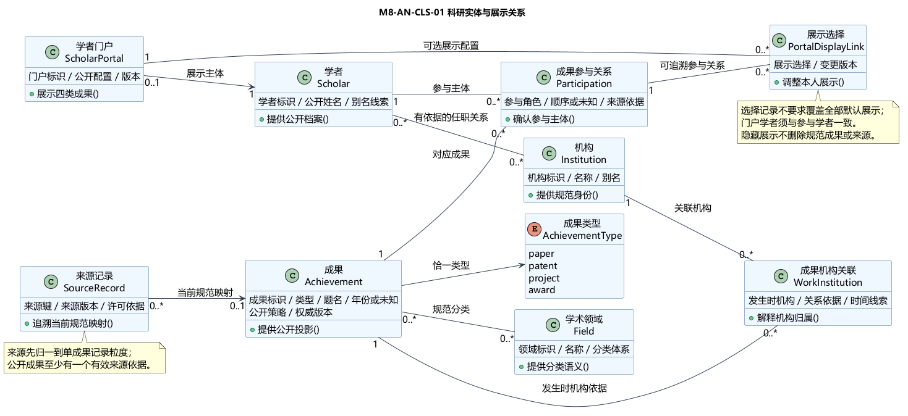
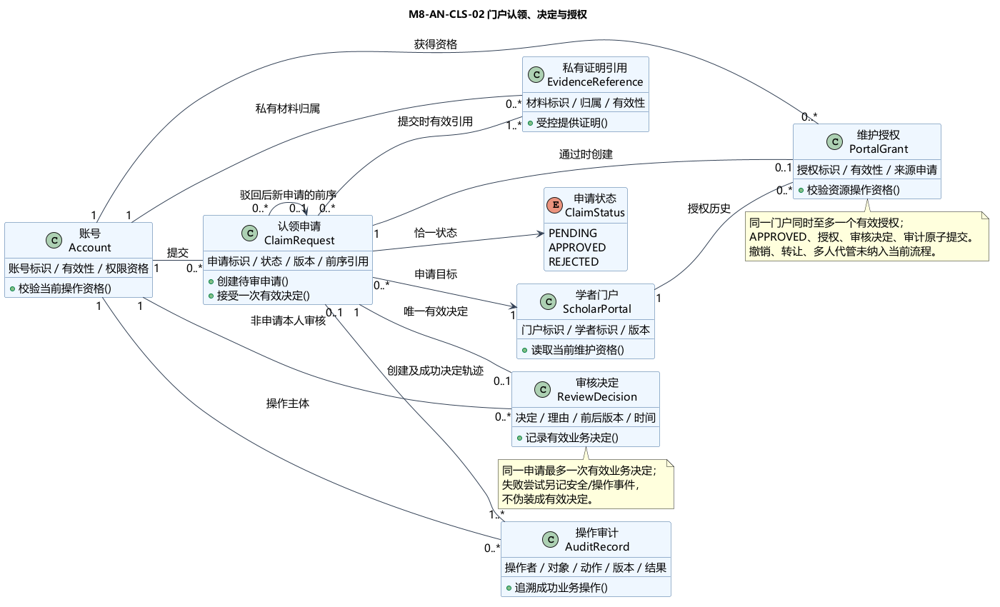
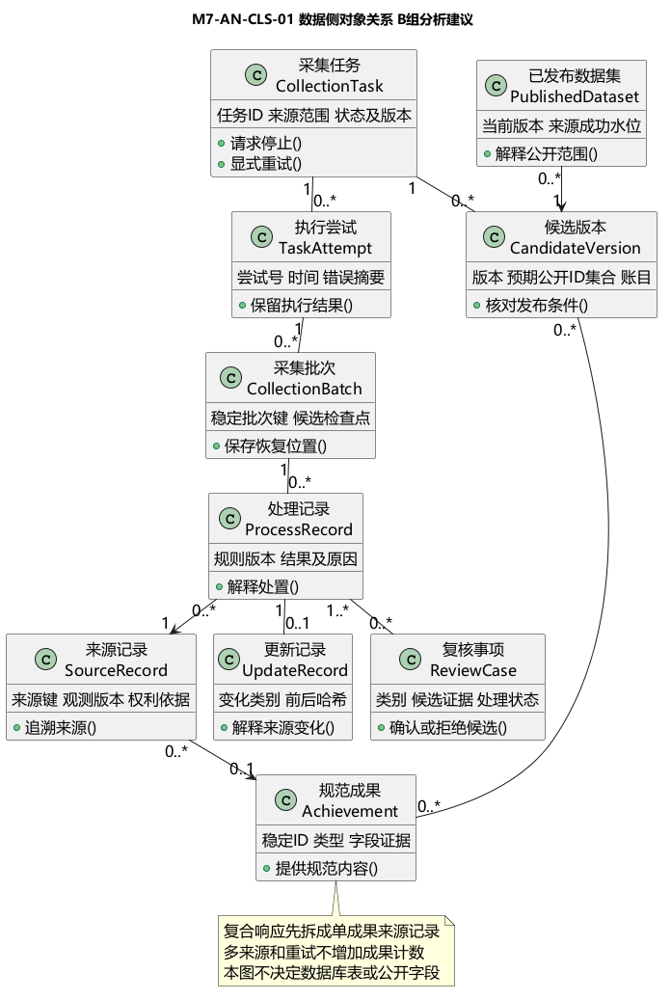

# 学术成果分享平台：系统核心业务类图与说明

版本0.1联合汇编稿；2026-10-27；阶段：第7～8周需求分析。汇编岗位成员3，复核岗位成员8；本次依用户要求接入十位成员的实际供稿，未代填任何人工审批。

复核状态：用户于2026-10-27确认统一材料复核完成，见[记录](10-review-confirmation.md)。原图和个人供稿保留历史版本，候选公共语义不因材料复核自动冻结。

## 1 分析输入与范围

本报告回答“系统有哪些业务对象、各自负责什么、哪些关系不能混同”。配套的[关键用例交互模型](02-key-use-case-interactions.md)回答对象如何协作。两份文档共同构成本阶段唯一正文，成员目录及个人Word/PDF均为来源附件。

输入为既有[统一SRS](../02-requirements/01-unified-srs.md)、成员1/6整体分析、成员2/7数据分析、成员3/8业务分析、成员4/9界面分析和成员5/10核查材料。固定分支和提交、逐文件来源见[入口](README.md)及07-source-manifest.csv。

按用户2026-10-14明确的课堂修订要求，本次分析采用**不少于1,000,000条去重、规范化、可公开检索成果**的目标。历史SRS及部分来源仍写10,000条，保留为历史输入，不作为本次最终规模口径。此处说明用户已给出的目标，不宣称已完成真实导入，不用规模修订自动冻结其他公共语义；历史文档更新见[差异表](06-review-and-conflicts.md)。

一期包括论文、专利、科研项目、获奖、学者门户、认领与维护、数据治理、检索和基础统计。支付、转让、撤回/申诉等未获确认的扩展不由汇编自动加入。

## 2 业务职责与术语映射

| 正文概念 | A组局部名称 | B组局部名称 | 共同职责及边界 |
| --- | --- | --- | --- |
| 登录账号 | Account | Account / UserAccount | 会话主体和操作资格；不等于学者 |
| 学者 | Scholar | Scholar | 规范科研实体，姓名不作唯一键 |
| 规范成果 | Work | Achievement / AcademicAchievement | 持久化规范身份，四类成果按类型表达 |
| 成果参与关系 | Authorship | Participation / ScholarAchievement | 参与人、角色、顺序和证据；四类成果不统称论文作者 |
| 机构 / 领域 | Organization / Field | Institution / Field / AcademicField | 规范标识与分类线索，保留未知和来源 |
| 学者门户 | ScholarPortal | Portal / ScholarPortal | 公开展示入口，与规范实体及维护权限分离 |
| 认领申请 | ClaimRequest | ClaimRequest / ClaimApplication | 本人提出维护资格请求，提交不授权 |
| 有效审核决定 | ReviewRecord | ReviewDecision | 一申请最多一次有效终态决定，尝试和失败另记 |
| 门户维护授权 | PortalGrant | PortalGrant / Grant | 对特定门户的有效维护资格，不转移知识产权 |
| 来源记录 | SourceRecord | SourceRecord | 来源键、许可、版本和事实证据，不是成果计数单位 |
| 任务 / 批次 | CollectionTask / ProcessingBatch | CollectionTask / CollectionBatch | 协调有界处理与恢复；任务、尝试和成果身份不同 |
| 处理、更新与治理 | GovernanceIssue / UpdateRecord | ProcessRecord / UpdateRecord / ReviewCase | 解释变化、冲突与人工处理，不静默覆盖人工修正 |

这张表是分析职责映射，不把英文类名转换为已批准API、数据库列或统一枚举。成员10的继承结构是类型差异表达候选，不能据此认定四类成果必须采用继承落库。

## 3 整体结构

整体连接采用[成员1的13类整体模型](../../contributions/member-01/analysis/02-overall-class-model.md)作为导航，结合[成员6整体结构](../../contributions/member-06/analysis/02-overall-class-structure.md)补足证明、审核与控制职责。

整体关系分为三部分：账号通过申请及审核取得门户维护权；学者通过参与关系关联成果，成果关联机构、领域和来源；采集任务通过批次产生可追溯处理结果，冲突转治理。门户对成果的展示选择不拥有共享成果，不画成删除门户即级联删除成果。

成员1图上的门户历史授权0..*与成员6图上的当前有效授权0..1表达不同时间范围，两者可以同时成立。审核记录0..*也不能解释为一申请可多次成功改判。具体细化见下列局部图。

## 4 科研实体类图与说明

正文图AN-CLS-01使用成员8已提交的仓库原图，A组对应图保留在附录索引，不重绘或覆盖。

[原图源](../../contributions/member-08/analysis/diagrams/core-domain.puml)；[A组对照图](../../contributions/member-03/analysis/diagrams/core-domain.svg)。

| 关系 | 分析表达 | 约束与原因 |
| --- | --- | --- |
| 学者—参与关系—成果 | 每个参与关系连接各一个学者和成果，两端均允许多条关联 | 顺序、角色和证据放在关系上；未知参与者保留来源，不编造规范学者 |
| 成果—来源记录 | 单成果粒度来源记录当前映射0或1项规范成果，成果可有多个来源 | 未映射或隔离来源不公开；复合响应先拆分为单成果观测，历史映射保留版本 |
| 成果—机构 / 领域 | 多对多或有证据的关联对象 | 不用学者当前任职倒推历史成果单位；多机构合计可能超过全局成果数 |
| 学者—门户 | 当前提案是一门户一学者，学者可暂没有门户 | 是否全量即时生成及更多门户策略仍待1/6共同确认 |
| 门户—展示选择 | 仅控制本人展示，关联到同一学者的参与关系 | 同门户同参与关系同时至多一个有效选择；隐藏不删除公共成果或真实合作关系 |

公开成果必须至少具有一项有效来源依据。处理中的规范候选与已发布公开成果不能混称；“类图允许来源为0”不构成公开放行依据。

## 5 门户认领、决定与授权类图

[原图源](../../contributions/member-08/analysis/diagrams/claim-domain.puml)；[A组对照图](../../contributions/member-03/analysis/diagrams/claim-domain.svg)。

1. Account验证登录与职责；ClaimRequest记录目标、申请人、版本及受限材料引用。
2. ReviewDecision记录有效决定，AuditRecord记录成功操作或失败尝试。失败尝试不是第二个有效决定。
3. 通过时申请终态、决定、门户授权、幂等结果和必要审计共同成功或共同失败；实现机制留给设计阶段。
4. 同门户同时最多一个有效维护授权；历史多条授权不表示允许并行冒领。管理员审核必须回避本人。
5. 当前3/8供稿共同采用待审、通过、驳回三态候选。驳回后补充材料新建申请并保留旧终态；不因成员10图存在withdraw()而自动开放撤回。
6. 证明材料只向本人及职责内审核者开放；公开页面、索引和日志正文不包含证明内容。

## 6 数据对象与发布边界

数据侧由[成员2对象分析](../../contributions/member-02/analysis/01-data-processing-class-model.md)和[成员7对象分析](../../contributions/member-07/analysis/01-data-object-model.md)共同支撑。

TaskAttempt、批次、ProcessRecord、UpdateRecord分别描述执行尝试、处理单元、处置事实及来源变化，不与成果身份混用。候选检查点用于恢复，来源成功水位表示已确认的公开更新进度；不能把批次已提交直接当作全版本发布成功。

候选版本和已发布数据集表达“已保存”和“可公开查询”的区别，不意味着已经选择数据库、分片、队列、outbox或跨存储事务。A/B任务状态和恢复方式有实际差异，按配套交互文档分别说明，不能直接相互替换状态值。

## 7 跨图不变量与规模走查

| 编号 | 必须保留的分析约束 | 走查方式 |
| --- | --- | --- |
| AN-I01 | 账号、学者、门户、申请和授权分离 | 申请创建后仍不能维护门户 |
| AN-I02 | 禁止自审，唯一有效授权，决定与授权审计一致 | 同门户两个通过请求最多一个成功，失败无半授权 |
| AN-I03 | 来源和规范成果分离，同名不自动合并 | 同成果两个来源只计一条，同名不同人保持不同规范ID |
| AN-I04 | 展示选择不等于成果所有权 | 隐藏本人展示不删除其他作者的成果或合作依据 |
| AN-I05 | 批次重试不重复计数，人工值冲突可追溯 | 中断恢复后复算成果集合和批次处置账目 |
| AN-I06 | 当前权威公开策略优先于旧索引、缓存和旧快照 | 撤下后结果、total及统计全集均不得继续包含受限内容 |
| AN-I07 | 同一响应和规模对账采用可核验版本 | 比较数据库与索引的公开成果ID集合，不能只比总数 |
| AN-I08 | 真实与模拟、四类成果、未知值分别披露 | 关系边、历史来源、隔离记录不混入百万成果数 |

合成走查例：5条来源中两条为同一论文，另有专利、项目各一条，最后一条获奖来源未获许可。若其余检查通过，应公开3项规范成果而非5项；论文关联3名参与者仍只计1项。相同批次再次处理不增加规范成果。数据库和索引即使都为3条，也需确认3个标识完全一致。此例解释规则，不是实际规模或性能证据。

## 8 模型使用与后续确认

正文只选择一套图作讲解主线，A/B原图、成员10独立候选及局部编号完整保留在来源目录和08-model-catalog.csv。选作讲解不表示某组实现已胜出，也不改变原作者。

公共状态、字段、材料标准、阈值和物理设计仍须成员1/6及相关岗位共同评审。具体冲突和已收件状态以[06](06-review-and-conflicts.md)为准；原供稿中的“未收到”“没有SRS”等文字属于其编写时快照，不能替代本次收件表。
