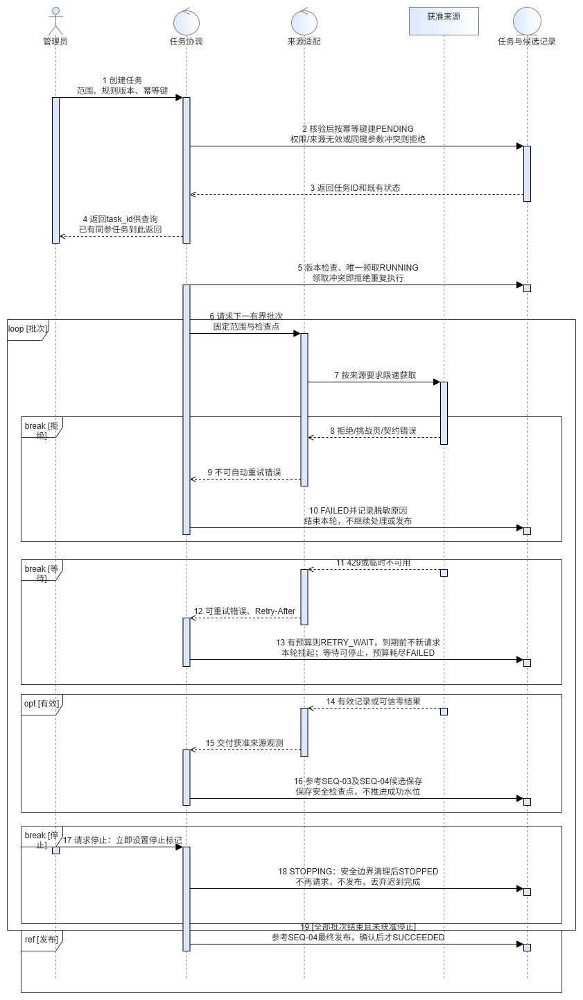
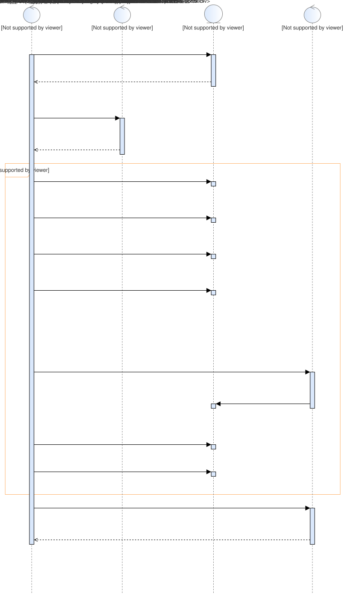
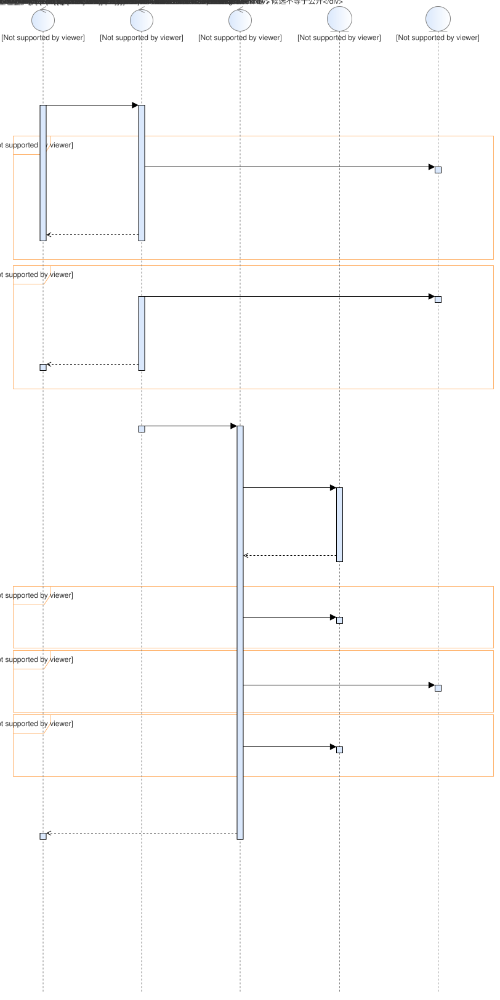
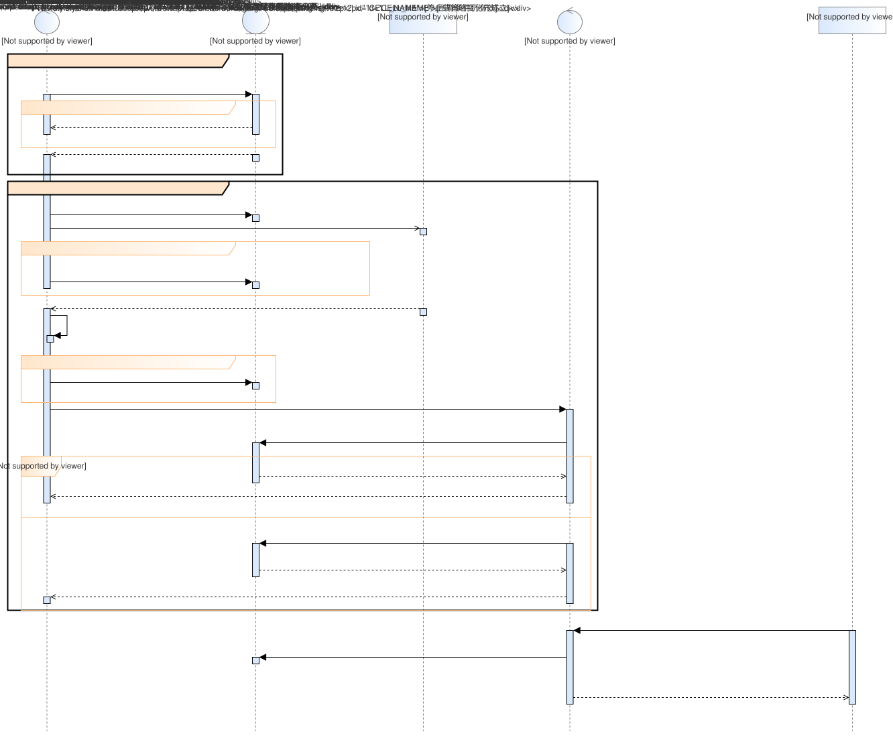
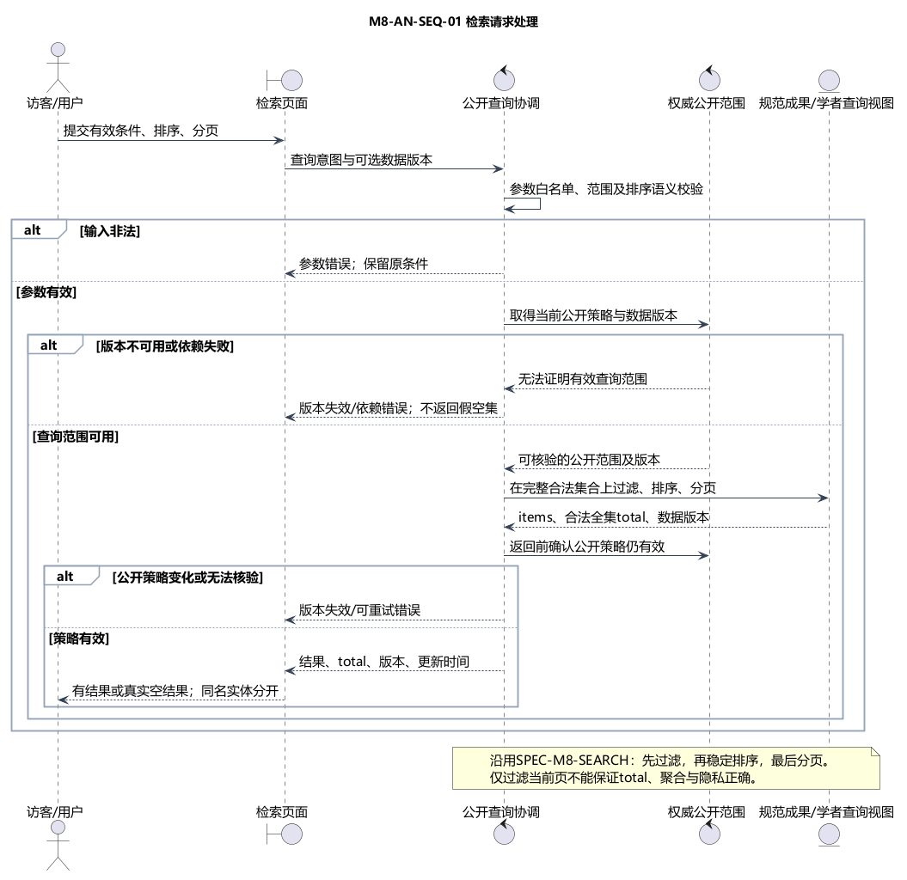
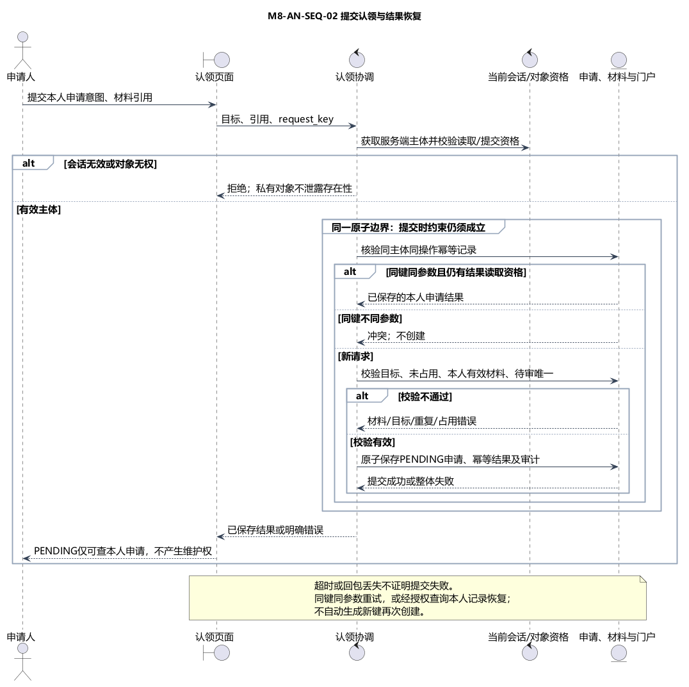
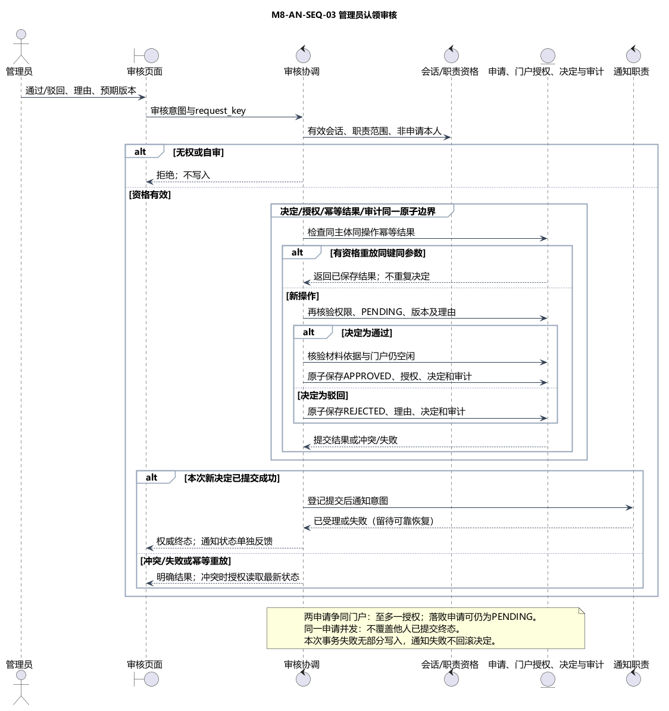
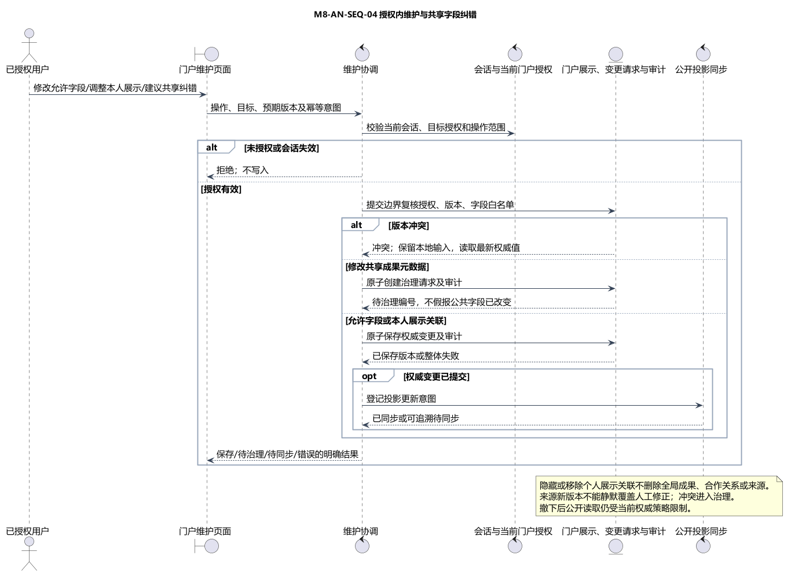
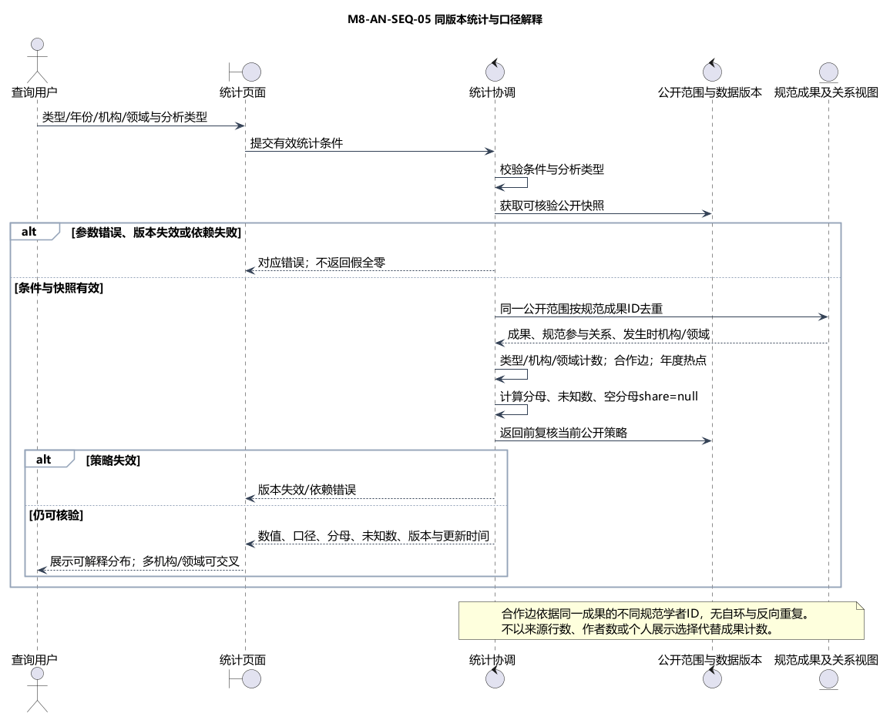

# 学术成果分享平台：关键用例交互模型

版本0.1联合汇编稿，2026-10-27。配合[核心业务类模型](01-core-business-class-model.md)阅读。本报告汇编数据接入、检索、门户认领及维护统计交互，保留A/B方法差异，不冻结技术选型和公共接口。

## 1 分析方法与图表选择

每条交互检查前置条件、输入、正常协作、异常/并发分支及后置条件。页面图描述用户看到什么，服务图描述业务怎样协作，任务状态图描述允许的状态迁移，三者分别保留。

数据主线采用成员7四张已归档平台导出图；A组成员2的四图作为同章节对照。业务主线采用成员8原图，成员3对应图及成员10简化候选保留为支撑。文件仍在作者目录，本文只引用，不改写或重绘原图。图号AN-*仅为汇编定位号，不覆盖原M2/M7/M3/M8编号。

## 2 数据采集、更新、清洗与入库

### 2.1 采集任务执行与安全停止（AN-SEQ-D01）

前提：有资格管理员或获批调度入口触发，来源范围及许可有效。输入包括来源、固定范围、配置与规则版本。

主流程：验证配置并建立任务，记录执行尝试，按来源读取有界输入，核对响应状态、类型和结构，保留批次与处理证据，再将记录交给后续处理。HTTP成功但内容异常仍失败；限流按来源规则退避，不绕过验证码或明确拒绝。

停止请求只在安全边界生效：当前批次提交或回滚后保存恢复依据。不得中断到半写入状态后宣称停止成功。

[A组平台图](../../contributions/member-02/analysis/diagrams/collection-task-sequence.png)；[B组参考图源](../../contributions/member-07/analysis/diagrams/collection-task-sequence.puml)。

### 2.2 增量更新与更新记录（AN-SEQ-D02）

输入采用上次成功水位及固定来源版本，比较来源键、原值哈希和已有映射，区分新增、改变、撤回、未变化及冲突。来源更新与人工维护值冲突时保留证据并转复核，不按来源顺序覆盖。

批次检查点用于恢复处理；发布水位必须在完整候选版本通过核验并发布后推进。撤下内容立即受当前权威公开策略约束，不能等待下一轮索引刷新继续暴露。

[A组平台图](../../contributions/member-02/analysis/diagrams/incremental-update-sequence.png)；[B组参考图源](../../contributions/member-07/analysis/diagrams/incremental-update-sequence.puml)。

### 2.3 清洗、去重与消歧（AN-SEQ-D03）

来源记录先按类型拆分和校验，保留许可允许的原值与规则版本，再规范化强标识、题名、日期、参与者和机构等。强标识冲突、低置信关联和未知字段保留可追溯处置，不凭姓名授予身份或门户权力。

B组采用保守隔离和人工复核路径。A组候选评分、阈值及非法强键处置与B组不完全相同；这些差异列入06，不把某个分支实现假设直接设为公共清洗规则。

[A组平台图](../../contributions/member-02/analysis/diagrams/cleaning-sequence.png)；[B组参考图源](../../contributions/member-07/analysis/diagrams/cleaning-sequence.puml)。

### 2.4 候选入库与确认发布（AN-SEQ-D04）

先幂等保存候选规范内容和处置账目，再准备公开投影，比较同版本数据库与索引的公开成果标识集合；满足版本、许可、范围及账目核对后确认发布。真实、模拟及四类成果分列，百万级门槛仅统计合格公开规范成果。

索引失败保留已成功的数据及待同步事实，不向用户报告全链路完成；恢复只补偿需要的环节。图中的跨存储共同发布表达业务一致性要求，不证明数据库与搜索引擎有跨系统原子事务；具体机制待架构阶段设计。

[A组平台图](../../contributions/member-02/analysis/diagrams/persistence-sequence.png)；[B组参考图源](../../contributions/member-07/analysis/diagrams/publication-sequence.puml)。图4保持原样，其片段条件与排版的待复核事项及工程定位限制见[导出登记](../../contributions/member-07/analysis/diagrams/codearts/README.md)。

### 2.5 两组任务恢复语义对照

| 议题 | A组成员2 | B组成员7 | 汇编处理 |
| --- | --- | --- | --- |
| 停止后再运行 | 沿既有STOPPED恢复路径及检查点 | STOPPED重跑创建新任务并引用旧任务 | 保留两套局部语义，尚不能直接交换状态值 |
| FAILED重试 | 参考原任务模型，需人工处理并按其规则重发 | 同任务增加attempt并显式重试 | task、attempt与业务结果分开，等待共同状态映射 |
| 恢复与发布进度 | 批次检查点、同步补偿 | 候选检查点与发布成功水位明确分离 | 共同要求已提交边界和不重复计数 |
| 索引同步机制 | 候选中涉及可靠外发/补偿思路 | 候选版本、同版本集合核对及确认发布 | 均未因汇编被选为已实现架构 |

## 3 检索请求处理（AN-SEQ-B01）

输入：关键词、类型、年份、机构、领域、排序、分页及可选数据版本。公开访客可读允许公开的数据。

正常协作：校验条件及版本，确定完整合法候选集合，按明确规则排序并使用稳定次级键，再分页并返回同口径总数和版本。姓名相同的学者以不同规范标识呈现，来源与更新时间可追溯。

异常：非法参数定位错误；快照不能复现则提示版本失效；依赖失败不返回伪造空结果。受限内容必须从完整合法集合及total、统计分母中排除，不能仅过滤当前页而沿用旧总数。当前公开策略优先于旧索引或缓存。

[A组对应图](../../contributions/member-03/analysis/diagrams/search-sequence.svg)；[成员8说明](../../contributions/member-08/analysis/02-business-interactions.md)。排序权重、分页字段和具体机器错误码仍为设计候选。

## 4 认领申请与本人查询（AN-SEQ-B02）

前提：用户有效登录、目标可申请、证明引用归本人且可用。服务端取得申请主体，校验目标、材料、重复待审与占用；同主体同操作同键同参数重放返回原结果，同键不同参数产生冲突。

创建结果只是待审申请和本人查询资格，不产生门户维护权。他人申请及受限证明不得通过修改ID读取。客户端请求超时不代表创建失败，应使用相同幂等语义或有权查询恢复确定结果。

[A组对应图](../../contributions/member-03/analysis/diagrams/claim-submit-sequence.svg)。

## 5 管理员审核（AN-SEQ-B03）

审核者必须具备职责且不是申请人。读取证据后作有理由决定，在最终提交边界复检待审状态、预期版本与门户占用，再原子保存有效决定、终态、通过授权、幂等结果与必要审计。

两个请求争用同门户最多一个成功。失败方不得覆盖成功结果、伪造另一申请的驳回或回滚他人事务。持久化失败无半授权；通知失败单独补偿，申请查询反映已保存决定。通过和驳回是单个申请终态，补充后另建申请，未默认开放撤回、申诉、转让。

[A组对应图](../../contributions/member-03/analysis/diagrams/claim-review-sequence.svg)。

## 6 授权维护与公共纠错（AN-SEQ-B04）

当前账号对目标门户有有效授权，才可修改允许的个人字段。成果补录、公共元数据纠错与个人隐藏展示分别处理；公共字段冲突转治理，不直接删除共享成果或他人关联。

写入前检查最新授权、白名单及版本，记录前后变化。保存成功但公开投影未同步时明确反馈待同步，不能假装已经发布；权限失效后不得用旧页面缓存继续写入。

## 7 同版本统计（AN-SEQ-B05）

在同一公开版本、时间范围和过滤条件下按规范成果ID去重。多来源、参与者和重复处理不增加成果数；未知分类、真实与模拟、跨机构及多领域计数说明单独披露。专家关系只根据经确认的共同成果关系产生，不将同名学者误当同一人，也不因个人隐藏展示改写规范合作证据。

## 8 界面与服务的衔接

[统一界面分析](05-ui-interaction-analysis.md)接入成员4与9材料。页面负责输入、临时状态、旧响应保护及恢复入口；服务端负责会话、对象权限、版本、幂等和业务决定。客户端加载、上传中、超时都不能改写申请终态。

新增查询淘汰旧请求的迟到响应；筛选变化重置页码；无结果与失败有不同文案。写请求超时显示“结果待确认”，查询权威状态后再决定重试，不能仅根据10秒本地计时宣布失败或会话过期。

## 9 交互模型走查

| 场景 | 预期观察 | 来源覆盖 |
| --- | --- | --- |
| 重复采集同一批次 | 不新增同一规范成果，处置与版本仍可追踪 | 成员2/7四条时序 |
| 入库成功而索引失败 | 显示候选已保存/待同步或未发布，保留补偿依据 | 成员2/7入库图 |
| 合法查询无匹配与依赖故障 | 分别显示空态和失败，故障不报0项事实 | 成员3/8检索图、4/9页面分析 |
| 提交或审核超时 | 不盲目新建请求，不擅改终态，按幂等或权限查询恢复 | 成员3/8业务图、4/9反馈 |
| 并发审核同一门户 | 至多一个有效授权，失败无部分保存 | 成员3/8审核图 |
| 隐藏本人展示、来源撤下或权限改变 | 共享成果不误删，受限内容不因旧快照继续公开 | 成员3/8维护及统计图 |

这些是模型检查预期，不是执行过的业务测试。平台导出文件按各作者登记保留；原图不等于可编辑工程包，也不替代UML人工语义评审。
